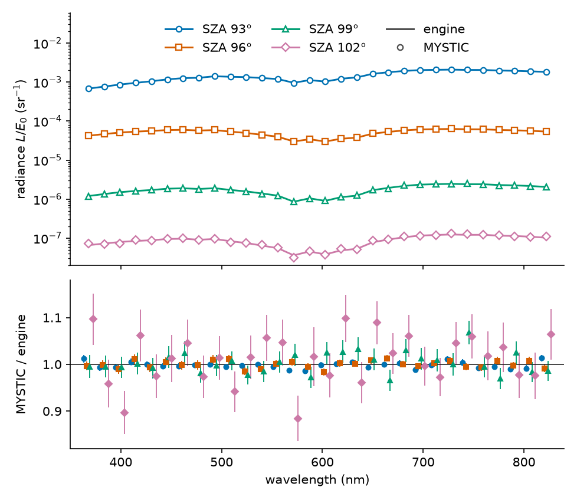

# sosfuse2

Radiance tables of the clear twilight sky for a spherical-shell atmosphere. The solver iterates successive orders of
scattering to convergence on a height and angle grid with Anderson mixing. It models polarised Rayleigh scattering, a
tropospheric aerosol layer, a stratospheric sulfate layer (enabled in the bundled v2 states), absorption by ozone, NO₂
and O₄, and a Lambertian ground. A single solve covers every solar elevation of a table, by default +6° to −18°.

The package ships a NumPy reference implementation and an optional CUDA kernel compiled at run time through CuPy and
NVRTC. It also includes numeric checks against fixed references within tolerances, and a provenance record that labels
each table written by `run_state` and `tables_from_sources` with a SHA-256 signature of its inputs and the hashes of
its producing code and data.

## Start here

For a first contribution, follow [Your first change](CONTRIBUTING.md).

1. The input is an atmosphere state from `src/sosfuse2/assets/states_v2.json` and the grid settings resolved in
   `src/sosfuse2/solve/configuration.py`.
2. `create_configured` (`src/sosfuse2/solve/build.py`) builds the solver for that state.
3. `Solver.solve` (`src/sosfuse2/solve/source_iteration.py`) iterates the source field to convergence.
4. `make_table` (`src/sosfuse2/outputs/radiance_table.py`) turns the converged field into a radiance table.
5. `python -m sosfuse2 walkthrough` runs a small offline example through steps 2–4 to show the program flow.

For production runs, `src/sosfuse2/jobs/run_storage.py` checks existing output, takes locks and writes the arrays. The
[task table](AGENTS.md) pairs each area with the test to run after editing it.



The figure compares 1.9.0 engine radiance with MYSTIC Monte Carlo radiance for the same optical input at the sunward
pixel (20.25° view elevation, 0.5° relative azimuth). Solar zenith angles (SZA) of 93°, 96°, 99°, 102° and 105°
correspond to solar elevations of −3°, −6°, −9°, −12° and −15°, and radiance is divided by solar irradiance (L/E₀) at 30
wavelengths. Over that range the mean radiance falls by a factor of about 3 × 10⁵, so each panel divides both spectra by
the engine's 30-wavelength mean and compares their shape on a linear axis. Ratios span 0.966–1.068 up to SZA 99°, where
each wavelength carries a MYSTIC standard error of at most 2.5 %. They span 0.884–1.098 at 102° and 0.956–1.100 at 105°,
where the standard errors are 4–6 % and 3–4 %. The last panel gives the inverse-variance mean ratio at each angle: 1.0085 ±
0.0088 at 102° and 1.0022 ± 0.0073 at 105°.

At 105°, MYSTIC needed 212 runs of 25 million photons at each wavelength to reach that standard error. For deeper
twilight, `docs/VALIDATION.md` turns to a direct quadrature of second-order scattering and to SASKTRAN2. The eight-state
comparison at 93° and 96° (mean ratio minus 1 of +0.10 %, root mean square 0.63 % over 96 cases) appears as Figure 3 of
`docs/VALIDATION.md`, and scripts in `docs/validation/mystic` repeat it.

## Install

The package requires Python ≥ 3.12, NumPy ≥ 2.0, Pillow, and `zstd` on `PATH` (to pack state outputs as `.tar.zst`;
without it, a state solve stops with `E_ZSTD_MISSING`). Because the solver uses `resource`, sosfuse2 runs only on Unix,
and Python 3.11 is untested. The NumPy reference uses FP32 flush-to-zero mode, which is supported on Darwin arm64, Linux
arm64, and Linux x86_64; other platforms such as macOS x86_64 stop with `E_FTZ_UNSUPPORTED`.

A C++ compiler is needed only for checks and tests, and an optional C99 compiler speeds up host column integrals. On
CUDA machines, NVRTC compiles kernels on first use; see the [kernel cache guide](docs/ENVIRONMENT.md#kernel-compilation-cache).
Apple silicon users can enable experimental [MLX transport and table queries](docs/ENVIRONMENT.md#experimental-mlx-transport-apple-silicon).

sosfuse2 is not on PyPI. Install it in a virtual environment from a checkout of the tagged commit:

```sh
pip install .                 # from a checkout of the tagged commit; or `pip install <sdist>` outside the source tree
pip install ".[test]"         # + pytest
pip install ".[gpu,test]"     # + CuPy (CUDA 12) and the NVIDIA runtime/NVRTC/cuBLAS wheels
```

## Quick start

Install the package, prepare the O₄ and density data once, and solve one reduced-resolution state on the NumPy backend.
The two preparation commands write data into the asset cache `SOSFUSE2_WORK_ROOT` (by default
`$XDG_CACHE_HOME/sosfuse2` or `~/.cache/sosfuse2`). Every solve reads this cache regardless of `--work-root`, and
generates missing density data on first use.

```sh
pip install ".[test]"
python -m sosfuse2.asset_tools.prepare_minor_absorbers --download
python -m sosfuse2 generate_density_profile
python -m sosfuse2 run_state --backend numpy
```

All arguments to `run_state` are optional. The last line is shorthand for `python -B -m sosfuse2.jobs.run_state --id
clear_34 --reduced --backend numpy --work-root ./work`: the state is `clear_34`, the work root is `./work`, and the
NumPy backend always solves the reduced grid. Adding `--threads 2` sets the size of each preparation pool whose
variable is unset or blank. Because O₄ data are neither bundled (`THIRD_PARTY.md`) nor downloaded by a solve, a missing
or stale cache stops the run with `E_O4_ASSET_MISSING` or `E_O4_ASSET_STALE`.

The output table `table.npz` and its `meta.json` land in `./work/out/clear_34/`. `meta.json` records `contract: "v5"`,
the state, backend, tolerance settings, `code_hashes` for a fixed list of production modules, solver sources, and data
assets, and a `signature` over them (`docs/PROVENANCE_V3.md`). This reduced-grid table holds one wavelength (550 nm),
solar elevations −3° and −6°, and 4 × 6 view directions; the reduced grid is a software check. The table is a NumPy
archive (*The radiance table* in `docs/MODEL.md`):

```python
import numpy as np

t = np.load('work/out/clear_34/table.npz')
radiance = t['radiance']  # W m^-2 sr^-1 nm^-1; axes: solar elevation, view elevation, relative azimuth, wavelength
print(t['solar_elevation_deg'], t['view_elevation_deg'], t['relative_azimuth_deg'], t['wavelength_nm'])
```

Full-resolution tables require CUDA and the `gpu` extra: `python -m sosfuse2 run_state --backend cupy --work-root
./work-cuda` solves `clear_34` on the full grid. It uses its own work root because the signature in the NumPy run's
`meta.json` records the backend and grid, and a different signature in the same output folder stops the run with
`E_OUTPUT_IDENTITY`. `python -B -m sosfuse2.jobs.pipeline` with `--ids` or `--plan` runs the production queue with
overlapping preparation.

`docs/ENVIRONMENT.md` describes file locations, offline use and the bundled states (*Work root, prepared data and state
files*), how `--backend auto` chooses a backend, and the settings for production queues, device memory and host limits
(*Production queues and checks*).

## Why a spherical-shell solver

At solar elevations of −6° and −9°, direct sunlight reaches the sky overhead only above the Earth's shadow, at about
35 km and 79 km above the observer, respectively. A plane-parallel atmosphere lacks this shadow, so the model uses a
spherical shell. While Monte Carlo codes handle spherical geometry, their radiances carry sampling noise. Because
sosfuse2 solves for a source field rather than sampling photons, a table of 100 × 180 directions and 45 bands has no
sampling noise and covers all solar elevations in one solve. `docs/MODEL.md` describes the physics, grids and iteration,
and `docs/PERFORMANCE.md` records where GPU time goes.

## Validation

Using the same optical input at 30 single wavelengths, we compared 1.9.0 tables of eight bundled states against MYSTIC
(libRadtran 2.0.6) at six pixels and solar zenith angles 93° and 96°. Because both codes share the input, the comparison
tests transport rather than input physics. At 93°, luminance agrees with MYSTIC within 0.8 % (−0.30 % to +0.77 %) across
all 48 state–pixel combinations, with MYSTIC 0.18 % to 0.35 % brighter in the mean up to 20.25° elevation. At 96°, the
95 % luminance-difference interval excludes 0 in 2 of 48 combinations, as expected by chance. The MYSTIC build
reproduces the 120 cells of the spherical Rayleigh benchmark of Korkin et al. (2020) to 0.27 %.

`docs/VALIDATION.md` documents the set-up, tables and 1.1.0 change sizes, sensitivity to the fixed choices under
*Limitations* below, and a qualitative check of one state's stratospheric aerosol input against measured zenith
polarisation (Ugolnikov et al. 2004). It also covers two deeper-twilight checks down to −18° solar elevation
(second-order scattering against direct quadrature, and a Rayleigh atmosphere against SASKTRAN2), along with further
MYSTIC comparisons and measured twilight brightness.

In IPRT spherical test case E1 at solar zenith angles 93° and 96°, the default quadrature of 1.2.3 misses our error
limits, which we attribute to the case's layered profile. The numeric checks in `docs/CHECKS.md` show that changes
keep tables within tolerance of fixed references across refactors and other hardware; they do not measure physical accuracy.

## Limitations

- The default density configuration (`usstd76`/`usstd76`/`usstd` for `density_profile`, `ozone_profile` and
  `rayleigh_column` in a state's `density` block, or `--density-profile`, `--ozone-profile` and `--rayleigh-column`)
  still differs from measured twilight brightness. At solar elevations −6° / −9° / −12°, model-to-measurement ratios for
  `clear_89` are 1.00 / 1.05 / 0.87 in Maryland, 1.67 / 1.45 / 1.23 at Sacramento Peak, and 0.88 / 0.75 / 0.59 at
  Paranal (`docs/VALIDATION.md`, Table 13, last column). Specify all three options when choosing a configuration: CLI
  choices merge over the state's `density` block, and a result that lacks any of the three stops with
  `E_DENSITY_PARTIAL`.
- NO₂ uses a fixed AFGL profile shape, 220 K cross sections, and a default column of 0.207 DU (`parameters.no2_du`).
  Real columns vary by location, season and time of day, and the model omits photochemistry.
- O₄ uses the square of the active air density and fixed, temperature-independent 293/287 K cross sections. The source
  data span approximately 297–654 nm (on the 360–840 nm fine spectral grid of the bundled assets, the table is zero
  above that range), and we have not tested what omitting the temperature dependence of O₄ does. O₂ A- and B-band CIA,
  monomer O₂ lines and water vapour are excluded (*Processes not modelled* in `docs/MODEL.md`).
- Rayleigh scattering follows Bodhaine et al. (1999) with vacuum wavelength conversion and the existing 450 nm air
  anchor. Phase depolarisation stays fixed at 0.03. NO₂ and O₄ contribute extinction only.
- Default states use a fixed Gaussian sulfate layer centred at 21 km with σ = 3 km and optical depths of 0.002–0.006 at
  550 nm; these background choices do not track the observed stratospheric aerosol burden.
- Tables store total radiance only: the solver tracks Rayleigh polarisation internally and treats aerosol scattering as
  depolarising, without writing Stokes parameters.
- Numeric tolerances bound differences from fixed references of the same model, while `docs/VALIDATION.md` measures how
  tables change with finer grids, more path nodes, a higher Legendre order and a tighter iteration tolerance; neither
  measures physical error.
- We have not compared the colours with measured twilight colours (Lee and Hernández-Andrés 2003; Lee 2026).
- A stored source records only the path of an optics table outside the package (`stratosphere.optics_table` or
  `troposphere_phase.optics_table`), not its content. Give a changed table a new path, or solve the source again
  (*Optics tables outside the package* in `docs/PROVENANCE_V3.md`).
- MLX is experimental; its [accuracy checks](docs/TESTED.md) compare against the NumPy reference.
- On CUDA, a warm launch that cannot use the angular direction table (for example with `SOSFUSE2_DETERMINISTIC=1`)
  contracts the coefficients directly or uses the fused kernel, and a solve that falls back to the fused kernel can take
  many times longer (*Production queues and checks* in `docs/ENVIRONMENT.md`).

## Tests and checks

For an edit, run the check for the changed area and the required offline CPU check in the
[contributor guide](CONTRIBUTING.md). For release checks, choose the tier your machine can run.

| Available inputs and hardware | Checks |
|---|---|
| CPU and the installed package | [Packaged tests and public CI](docs/CHECKS.md#1-any-machine-no-gpu-no-upstream-research-checkout-public-ci) |
| CUDA GPU and prepared O₄ data | [Reference fixtures and repeat checks](docs/CHECKS.md#2-cuda-machine-cupy-cuda-12-no-upstream-research-checkout) |
| CUDA GPU, research checkout and reference table | [Full-grid table comparison](docs/CHECKS.md#3-cuda-machine-with-the-upstream-research-checkout) |

See [environment-dependent outcomes](docs/KNOWN_FAILURES.md) for skips and host limits.

## Package layout

```
src/sosfuse2/
  foundation/     paths and work root, content identity, host limits, timers
  atmosphere/     a state and a wavelength to densities and optical coefficients
  rays/           spherical ray segments, incoming-direction quadrature, columns
  precompute/     reusable CPU arrays and their caches
  backends/       one transport evaluation: numpy_reference.py, kernel.cu, native/sh_cpu.cpp, mlx_*.py (experimental), configs/
  solve/          state settings, solver assembly, transport and source iteration
  outputs/        radiance tables, previews, packs
  jobs/           state runner, production queue, planner, cache store, walkthrough
  checks/         numeric checks (gate.py, gate_data/), diagnostics, fixtures/, testkit.py
  asset_tools/    generators of the data assets, O₄ preparation
  assets/         data (see assets/README.md)
  tests/          the packaged tests (pytest --pyargs sosfuse2)
docs/             CHANGELOG.md, MODEL.md, VALIDATION.md (+ validation/ data and figure scripts), REFERENCES.md, PERFORMANCE.md,
                  CHECKS.md, TESTED.md, KNOWN_FAILURES.md, PROVENANCE_V3.md, ARCHITECTURE.md, ENVIRONMENT.md,
                  WALKTHROUGH.md
```

`docs/ARCHITECTURE.md` documents folder roles, import direction, and cross-cutting topics.

## Related codes

libRadtran (Mayer and Kylling 2005; Emde et al. 2016) includes the MYSTIC Monte Carlo solver (Mayer 2009), which supports
a spherical 1D atmosphere (Emde and Mayer 2007) and polarisation (Emde et al. 2010). SCIATRAN (Rozanov et al. 2014)
models atmosphere and ocean radiative transfer. SASKTRAN (Bourassa et al. 2008) handles spherical geometry with a
successive-orders mode (Zawada et al. 2015), while Min and Duan (2004) and Lenoble et al. (2007) describe vector
successive-orders solvers. Eradiate (Leroy et al. 2026) is a Mitsuba 3 Monte Carlo ray tracer with plane-parallel and
spherical-shell atmospheres and polarisation. twilight (Mahdi 2026) computes deep-twilight spectral sky radiance via
backward Monte Carlo in a spherical refracting atmosphere and models human visual detection at dawn and dusk.

sosfuse2 is narrower: it handles one spherical configuration, iterates a source field rather than sampling photons, and
outputs only radiance tables. See `docs/REFERENCES.md` for full references.

## Maintenance

We publish this research code as we use it; versions 1.0.0 to 1.2.3 were released together, and versions from 1.3.0
onward individually. `docs/CHANGELOG.md` lists releases since 1.2.0, gives the old-to-new module table for upgrades from
1.3.x after 1.4.0 moved modules into layer folders, and explains how to reproduce earlier output. `docs/TESTED.md`
records where and how we verified releases.

We maintain sosfuse2 as part of ongoing research and read issues and pull requests, without a support commitment or
release schedule. Physics changes such as an added absorber alter provenance hashes, so tables from different versions
are not interchangeable.

## Licence

Code is MIT (`LICENSE`), and project-generated data are CC0 1.0 (`src/sosfuse2/assets/README.md`). Data derived from
third parties keep their original notices in `THIRD_PARTY.md`, which is also installed with the wheel. The CIE colour
tables are CIE standard data under CC BY-SA 4.0, and the bundled copies come via Mitsuba 3 and colour-science (both
BSD-3-Clause). NO₂ is distributed under CC BY 4.0 with BIRA-IASB attribution, while O₄ data are prepared locally and not
bundled. The fine solar and ozone spectra are resampled from TSIS-1 HSRS v2 (LASP) and IUP Bremen cross sections under
their publishers' citation terms, and the LOWTRAN7 validation values are a U.S. Government work. All licences appear in
the wheel's licence expression. Please cite the project (`CITATION.cff`) and the data sources in `THIRD_PARTY.md`.
