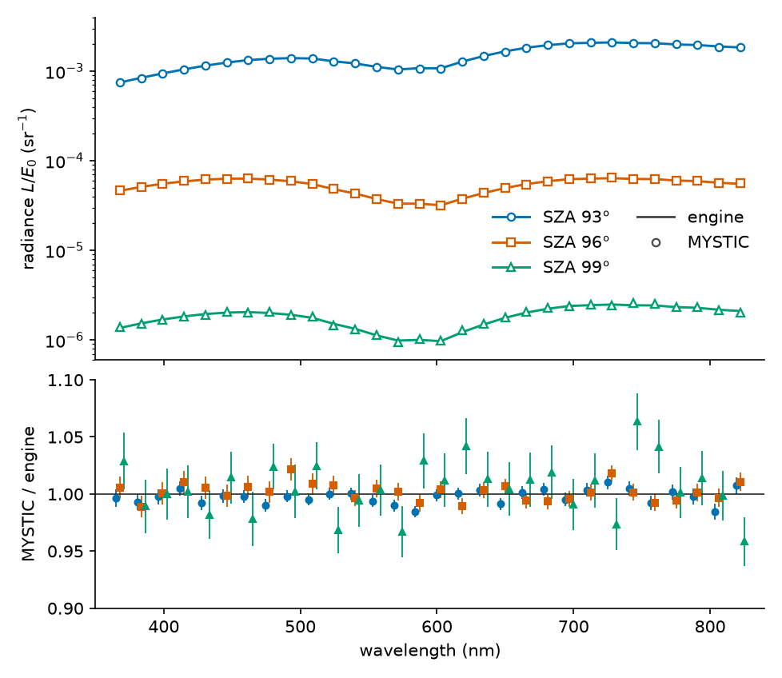

# sosfuse2

Radiance tables of the clear twilight sky for a spherical-shell atmosphere. Multiple scattering is iterated to convergence
on a height and angle grid (successive orders of scattering, accelerated with Anderson mixing), with polarised Rayleigh
scattering, a tropospheric aerosol layer, an optional stratospheric sulfate layer, ozone/NO₂/O₄ absorption and a Lambert ground.
One solve gives the sky at every solar elevation of a table, by default +6° to −18°. The package has a NumPy reference
implementation, an optional CUDA kernel (compiled at run time through CuPy/NVRTC), numeric gates with tolerances against
fixed references, and a provenance record that signs every table with the hashes of the code and data that made it.

This is research code, published in the form it is used in. Versions 1.0.0, 1.1.0 and 1.1.1 are published together;
1.1.1 is the current release. It changes documentation, comments and provenance notes only, so its tables carry new
`code_hashes` but the same numbers as 1.1.0 (checked, see *Status*). The configurations it was verified on are listed
under *Status*, and nothing beyond them is claimed.



Sky radiance on the sun side at 20° elevation for solar elevations −3°, −6° and −9°: the engine (lines) and the Monte
Carlo code MYSTIC (markers) on the same optical input, and their ratio with the MYSTIC standard error. The dip near
600 nm is the ozone Chappuis band. Details in `docs/VALIDATION.md`.

## Why

With the Sun 6° to 9° below the horizon the sky overhead is lit only through the upper atmosphere: the Earth's shadow
stands about 35 km above the observer at 6° and about 79 km at 9°. A plane-parallel atmosphere has no such shadow, so the
model is a spherical shell. Monte Carlo codes handle this geometry but their radiances carry sampling noise: the MYSTIC
runs for the comparison below, one direction at three solar elevations and 30 wavelengths, took 6.6 CPU-hours for a
standard error of 0.5–2.4 % per value. sosfuse2 solves for a source field instead of
sampling photons, so a table of 100 × 180 directions and 45 bands has no sampling noise and covers all solar elevations
at once. `docs/MODEL.md` describes the physics, the grids and the iteration.

## Validation

On the same optical input, the engine and MYSTIC (libRadtran 2.0.6) agree to within 2.2 % per wavelength at solar
zenith angles 93° and 96° (MYSTIC standard error below 1 %). At 99° the ratios spread over 0.958–1.063, consistent with
the 2.0–2.4 % MYSTIC error (largest deviation 2.7 standard errors). The colour differences are |Δu′| ≤ 0.0012 and
|Δv′| ≤ 0.00014, at most 1.7 standard errors. The MYSTIC build reproduces the
120 cells of the spherical Rayleigh benchmark of Korkin et al. (2020) to 0.27 %. The comparison covers one state, one
direction and three solar elevations, and it used a table baked with the research build, the 1.0.0 physics and the
legacy spectral inputs, not the 1.0.0 defaults. Because the input is shared, it tests the transport, not the input
physics. For 1.1.0, paired MYSTIC runs on the engine's input test the change caused by NO₂ and O₄ at 12 pixels of two
states and solar zenith angles 93°–99°: of 108 values (u′, v′ and Y), 66 reproduce MYSTIC's change to 10 % (or 1e-4),
none fails, and 42 are not resolved by the Monte Carlo noise. `docs/VALIDATION.md` gives the set-up, the tables, the
size of the 1.1.0 changes, the sensitivity to the fixed choices below, and a qualitative check of the stratospheric
aerosol input against measured zenith polarisation (Ugolnikov et al. 2004).

## Limitations

- NO₂ uses a fixed AFGL profile shape and 220 K cross sections, with a default column of 0.207 DU (`parameters.no2_du`);
  real columns vary with location, season and time of day. There is no photochemistry. In MYSTIC runs at ten twilight
  pixels, per-layer temperatures instead of 220 K (NO₂) and 233 K (ozone) changed the colour by at most 1.8e-4 in u′v′
  and Y by at most 0.04 % (95 % bounds).
- O₄ uses fixed 293/287 K cross sections over approximately 297–654 nm (on the engine's 360–840 nm grid), and the square
  of the active air density. O₂ A/B-band CIA, monomer O₂ lines and water vapour are excluded. The excluded CIA bands
  reach vertical optical depths of about 2.2e-3 (A) and 1.7e-4 (B) in the reference profile. The temperature dependence
  of O₄ is neither modelled nor tested.
- Rayleigh uses Bodhaine et al. (1999), with vacuum wavelength conversion and the existing 450 nm air anchor.
  Phase depolarization remains fixed at 0.03; a single-scattering estimate of Bodhaine's wavelength-dependent value
  (0.0305 at 360 nm to 0.0276 at 830 nm) gives at most 3.9e-5 in u′v′ and 0.083 % in Y. NO₂ and O₄ contribute
  extinction only.
- The tables hold total radiance only. Rayleigh polarisation is followed inside the solver, aerosol scattering is
  treated as depolarising, and no Stokes parameters are written.
- The numeric tolerances bound the discretisation and iteration error against fixed references of the same model. They
  are not a bound on the physical error.
- The colours have not been compared with measured twilight colours (Lee and Hernández-Andrés 2003; Lee 2026).

## Install

```sh
pip install .                 # from a checkout; or `pip install <sdist>` outside the source tree
pip install ".[test]"         # + pytest
pip install ".[gpu,test]"     # + CuPy (CUDA 12) and the NVIDIA runtime/NVRTC/cuBLAS wheels
```

Requires Python ≥ 3.12, NumPy ≥ 2.0 and Pillow, plus two executables on PATH: a C++ compiler (`g++` or `clang++`; the CPU
spherical-harmonics helper `native/sh_cpu.cpp` is built once into the work root, `E_COMPILER_MISSING` otherwise, and the
kernel syntax tests call `clang++`) and `zstd` (state outputs are packed as `.tar.zst`, `E_ZSTD_MISSING` otherwise).

Downloaded inputs, the geometry cache and the CPU helper build go to `SOSFUSE2_WORK_ROOT`, by default `$XDG_CACHE_HOME/sosfuse2`.
A solve (`run_gpu_state_v3`, `pipeline`) writes its tables, intermediate files and packs under the `--work-root` it is given
(`out/<id>`, `tmp/<id>`, `pack/`). The package directory is read-only data.

On a CUDA machine the kernels are compiled (NVRTC) on first use; `SOSFUSE2_COMPILE_CACHE=<dir>` keeps them between runs, and
`python -B -m sosfuse2.precompile --jobs 8` fills that cache before a queue starts.

## Quick start

Three commands: install, prepare the O₄ absorption data once, solve one reduced-resolution state with the NumPy backend
(about a minute on a laptop: 36 s with two threads on an Apple M4).

```sh
pip install ".[test]"
python -m sosfuse2.prepare_minor_absorbers --download
python -B -m sosfuse2.run_gpu_state_v3 --id clear_34 --reduced --backend numpy --threads 2 --work-root ./work
```

The table and its `meta.json` land under `./work/out/clear_34/`. `meta.json` carries `contract: "v4"`, the state, the
backend, the tolerance settings and `code_hashes` of the fixed list of production modules, promoted solver definitions
and data assets, plus a `signature` over them. `docs/PROVENANCE_V3.md` defines the record and how readers that also hold
older `v3` tables compare by logical key.

The O₄ step downloads the HITRAN O₂–O₂ collision-induced absorption file into the work-root environment
(`SOSFUSE2_WORK_ROOT`), verifies the source SHA and prints the generated SHA; `--cia O2-O2_2024.cia` uses a local copy
instead, and `SOSFUSE2_OFFLINE=1` refuses the download. The O₄ data are not bundled (`THIRD_PARTY.md`). A solve never
downloads them: a missing or stale cache stops with `E_O4_ASSET_MISSING` or `E_O4_ASSET_STALE`.

The state ids come from `sosfuse2/assets/states_v2.json` (the default `--states`; 64 parameter sets over `aod550`,
`angstrom`, `ssa`, `scale_height_km`, `g`, `ozone_du`, `albedo` and `stratosphere_tau550`; the solar depressions are the
runner's axis (`solar_elevation_deg` in its settings), not part of a state; `states_v1.json` holds the 40 first-generation
states). Every state in these two files marks its stratospheric layer `unsupported`, so the layer is off unless
`--stratosphere on` is given. A full-resolution table needs the CUDA backend (`--backend cupy`); the production queue that
bakes many states with overlapping preparation is `python -B -m sosfuse2.pipeline`.

### Operating notes

These matter for production queues and gates, not for the first solve.

- Absorbers: `parameters.no2_du=0` and `parameters.o4=false` disable the respective absorbers for research runs. `o4`
  must be a JSON boolean. An external air profile with O₄ enabled must declare `air_surface_number_density_m3` in its
  payload.
- Legacy tables: old tables without a physics field remain readable as legacy products. Reproduce their numbers with the
  original package revision recorded in their provenance; `spectral_mode=legacy` selects the old spectral grid, not old
  physics. Legacy, B2 and private S1 reference fixtures cannot be combined. Same-state source reuse also requires equal
  resolved `optics_state` values; omitted amounts and explicit defaults have the same signature.
- Memory (CUDA): before its first KSPLIT allocation, a state checks the minimum memory peak across its ground and source
  bundles. If it cannot fit alone, production runs use KSPLIT=0 for the entire state; memory occupied by other service
  states causes a wait instead. `SOSFUSE2_KSPLIT_FALLBACK=0` makes this an `E_KSPLIT_MEMORY` error (the default for gates
  and benchmarks); `1` permits fallback. A fallback is recorded once as `KSPLIT_FALLBACK` in the phase log and pipeline
  summary, and the table metadata records `ksplit_effective`. On a 10 GB RTX 3080 the full-resolution gate state falls
  back (minimum peak 7.06 GB against a budget of 6.74 GB).
- Logs: pipeline logs live in a separate `logs/<run>/` directory per invocation, referenced by `pipeline_summary.json`,
  so cold and warm runs retain both traces. Benchmark stage timers use `timings-<run>.json`, with the filename recorded
  in `benchmark.json`.

## Numerical tolerances

Correctness is judged by tolerances against fixed references, never by byte identity:

| gate | compares | tolerance |
|---|---|---|
| G-P | CUDA kernel vs NumPy golden (fixed applies) | rtol 1e-3 |
| G-T | anchor radiances (`gate/anchors.json`) | ratchet, recorded |
| G-A / H / PS | queue parity, history, persistent service | per case |
| repeat (`gate --stage`) | same build, cold vs warm, repeated runs | rtol 1e-5, max difference recorded |
| G-F | full-grid fixed table (needs the research checkout) | rtol 1e-3 |

Accumulation order, lane mapping and record layout may change between versions; changes are judged
against the fixed references and their tolerances. `SOSFUSE2_DETERMINISTIC=1` selects deterministic accumulation for studies that need bit-stable repeats.
The baseline log and reference manifest live in `src/sosfuse2/gate/baselines/`.

## Tests and checks

`docs/CHECKS.md` describes three tiers and exactly what runs where:

1. Any machine, no GPU (this is the public CI): `python -B -m pytest -q -p no:cacheprovider --pyargs sosfuse2` from
   the installed package. Expected: `0 failed`, 5 `xfailed`. Tests that need the research records skip unless
   `SOSFUSE2_SKY_SOS_ROOT` points at that checkout; tests that need `clang++` skip when it is absent.
   Tests use a synthetic O₄ table in an isolated temporary root and do not download HITRAN data. Original-data
   reproduction is optional (`SOSFUSE2_HITRAN_CIA`, `SOSFUSE2_BIRA_DIR`); it skips when neither is supplied.
2. CUDA machine: `python -B -m sosfuse2.gate --all --out <dir>` (G-P, G-T, G-A, H, PS) and `gate --stage --out <dir>`.
3. CUDA machine with the research checkout: `gate --gf --out <dir>`.

Five test cases fail in the research baseline the package was split from and are marked `xfail(strict=True)`; their
ids, causes and the rule for retiring them are in `docs/KNOWN_FAILURES.md`. They are not hidden: a case that starts
passing turns the run red until its entry is removed.

## Status

Verified configurations for 1.1.1 (documentation-only release; nothing else is claimed):

| platform | Python | backend | what was run |
|---|---|---|---|
| Linux x86_64, RTX 3080, CUDA 12 | 3.12 | CuPy | installed sdist: the G-F product state baked through the production queue, table bit-identical to the 1.1.0 fixed G-F table (max relative difference 0.0), same O₄ asset |
| macOS arm64 | 3.14 | NumPy | installed sdist (clean room): 524 passed, 65 skipped, 5 xfailed, 0 failed; the README quick start as written (O₄ download 3 s, reduced solve 36 s) |

Verified configurations for 1.1.0:

| platform | Python | backend | what was run |
|---|---|---|---|
| Linux x86_64, RTX 3080, CUDA 12 | 3.12 | CuPy | release tree in place (`PYTHONPATH=src`): `gate --all` and `gate --gf` pass at the 1.1.0 baselines (the full-resolution product state runs at KSPLIT 0 on this 10 GB card) |
| macOS arm64 | 3.14 | NumPy | installed package tests (clean room): 462 passed, 0 failed, 5 xfailed; in-tree E6 `--validate-mac` and the NumPy gate goldens |
| Linux x86_64, AVX-512 (GCP n2-standard-4) | 3.14 | NumPy | targeted tests only: the log-blend unit tests and the FX-N +1 ULP test, NumPy AVX-512 dispatch on and off |

Known limits: Unix only (the solver uses `resource`); the NumPy reference runs in FP32 flush-to-zero mode, available on Darwin
arm64, Linux arm64 and Linux x86_64 only (other platforms, e.g. macOS x86_64, stop with `E_FTZ_UNSUPPORTED`); Python 3.11 untested; the persistent-queue tests need
a larger `PERSISTENT_TEST_DEADLINE` than the 60 s default (their setup queue took 462 s on a 12-core Linux host; CI uses
2400 s, see `docs/CHECKS.md`); a state that selects a `usstd76` density or ozone
profile downloads the IPRT input on first use; the default states do not (`SOSFUSE2_OFFLINE=1` to refuse, see
`THIRD_PARTY.md` §9).

## Layout

```
src/sosfuse2/
  fused.py, kernel.cu, kernel_config.py   CUDA kernel, launch configuration, NumPy reference (reference.py)
  geometry*.py, ray_columns.py, ...       spherical-shell geometry, columns, caches
  stratosphere.py, tropo_*.py, mie.py     aerosol layers and Mie tables
  spectral.py, air_wavelength.py          spectra, colour weights
  pipeline*.py, run_gpu_state_v3.py       state runner, production queue, provenance (v4)
  gate.py, gate/                          numeric gates, fixtures, fixed references
  accepted/                               per-call engine loader (engine.py)
  solver_*.py                             editable solver and preview definitions
  host/, native/sh_cpu.cpp                host helpers, CPU spherical-harmonics kernel
  assets/, configs/, fixtures/            data (see assets/README.md), kernel flag sets, test records
  tests/, testing.py                      the packaged tests (pytest --pyargs sosfuse2) and their support module
docs/                                     MODEL.md, VALIDATION.md (+ validation/ data and figure script), REFERENCES.md,
                                          CHECKS.md, KNOWN_FAILURES.md, PROVENANCE_V3.md
```

The solver definitions live in editable `src/sosfuse2/solver_*.py` files. `accepted/engine.py` selects definitions and executes
them in a fresh scope for each state; it remains at that location for the engine loader. Optical coefficients are separate
from column and geometry producers so coefficient edits do not invalidate geometry caches. The production grid, spectrum,
sun geometry, deferred ground preparation and two-layer aerosol profile reach `create()` through keyword-only hooks
(`run_gpu_state_v3.create_configured`, `tropo_profile.engine_hooks`); nothing rewrites source text.

## Related codes

libRadtran (Mayer and Kylling 2005; Emde et al. 2016) includes the Monte Carlo solver MYSTIC (Mayer 2009), which has a
spherical 1D atmosphere (Emde and Mayer 2007) and polarisation (Emde et al. 2010). SCIATRAN (Rozanov et al. 2014) is a
radiative transfer package for atmosphere and ocean. SASKTRAN (Bourassa et al. 2008) is a spherical-geometry code with a
successive-orders mode (Zawada et al. 2015), and vector successive-orders solvers are described by Min and Duan (2004)
and Lenoble et al. (2007). sosfuse2 does less than these: one spherical configuration, a source field iterated in place
of photon sampling, and radiance tables as the only product. Full references are in `docs/REFERENCES.md`.

## Maintenance

The package is maintained by one person as part of ongoing research. Issues and pull requests are read, but there is no
support commitment or release schedule. Changes to the physics (for example an added absorber) change the provenance
hashes, so tables from different versions are not interchangeable.

## Licence

Code: MIT (`LICENSE`). Data generated by this project: CC0 1.0 (`src/sosfuse2/assets/README.md`). Third-party-derived
data keep their original notices (`THIRD_PARTY.md`, also installed with the wheel): the CIE colour tables are CIE standard
data (CIE publishes them under CC BY-SA 4.0; the copies here came through Mitsuba 3 and colour-science, BSD-3-Clause).
NO₂ is distributed under CC BY 4.0 with BIRA-IASB attribution; O₄ data are prepared locally and are not bundled. The
fine solar and ozone spectra are resampled from TSIS-1 HSRS v2 (LASP) and IUP Bremen cross sections under their publishers'
citation terms, and the LOWTRAN7 validation values are a U.S. Government work. The wheel's licence expression lists all of
them. Please cite the project (`CITATION.cff`) and the data sources listed in `THIRD_PARTY.md`.
