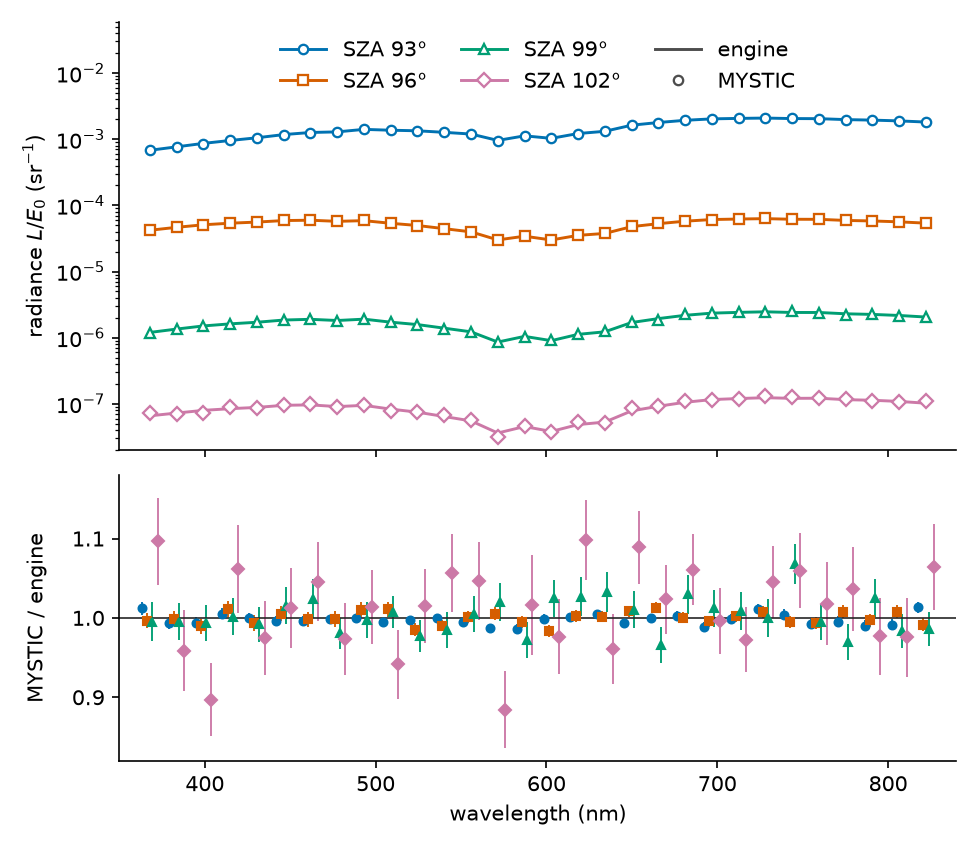
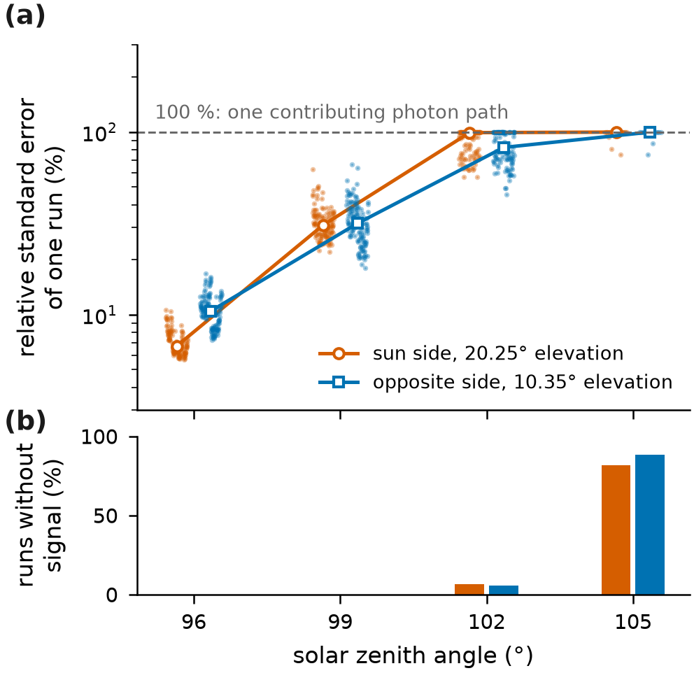
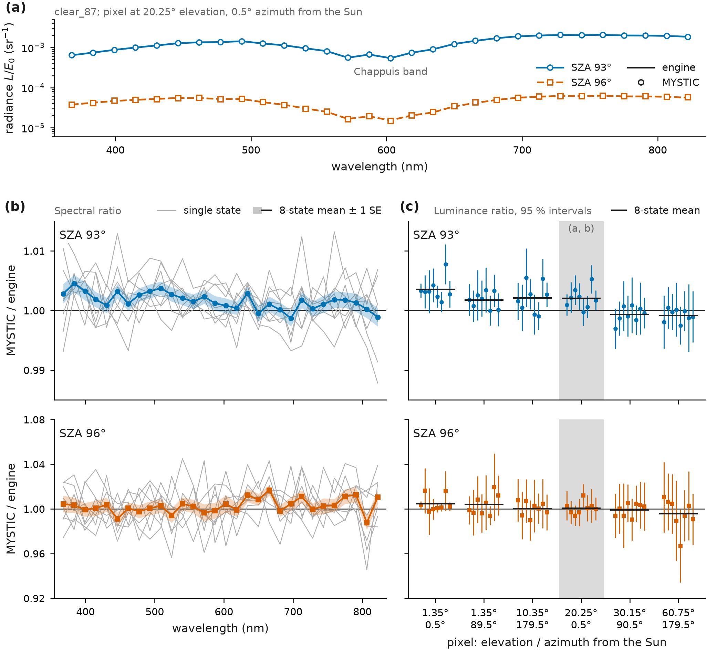
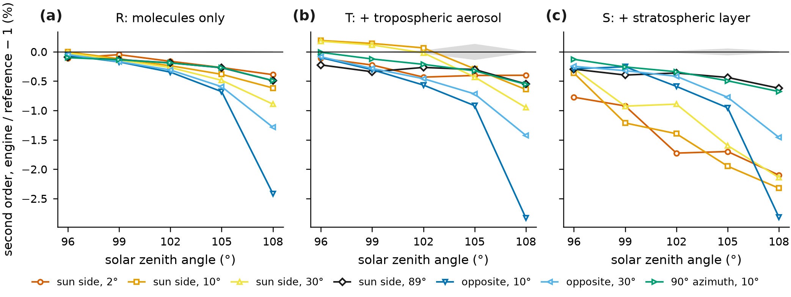
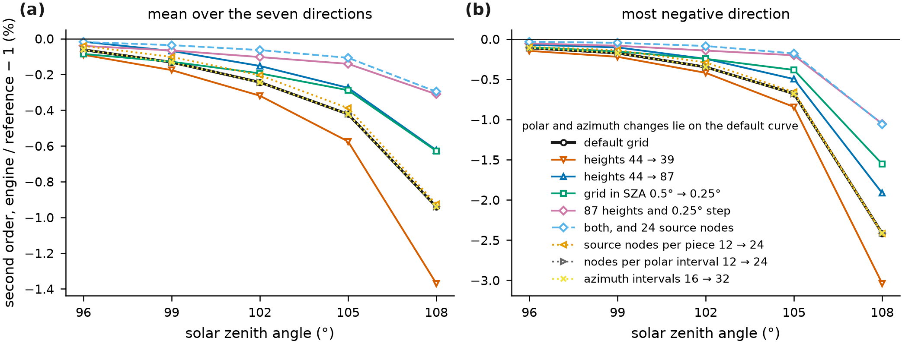
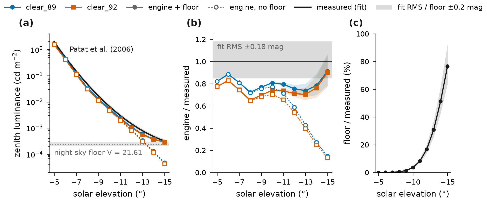
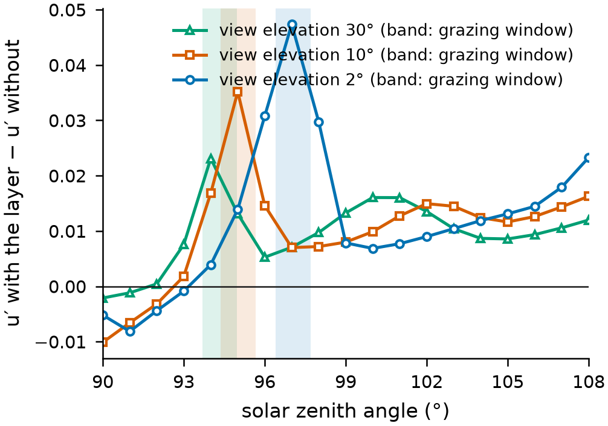

# Validation

Comparison runs come from the upstream research repository. The first radiance comparison with MYSTIC (Figure 1)—originally
run with 1.0.0 physics, repeated with 1.7.0, and solved again on the engine side with 1.9.0—uses one atmospheric state
(state A) at one sunward pixel (20.25° elevation, 0.5° relative azimuth) viewed from 0.1 km above the ground at solar
zenith angles (SZA) of 93°, 96° and 99° (solar elevations −3°, −6° and −9°), from 1.9.3 also at 102° (−12°) and from
1.10.3 at 105° (−15°), each with separate MYSTIC runs. State A combines tropospheric aerosol (aod550 0.0551, Ångström exponent 1.889, single-scattering
albedo 0.898, Henyey–Greenstein asymmetry parameter 0.683, scale height 1.0 km) with a 224.75 DU ozone column, a
Gaussian stratospheric sulfate layer (centre 19 km, σ 3 km, τ550 0.0037) and a Lambert surface of albedo 0.376.



Figure 1. State A at the sunward pixel (20.25° elevation, 0.5° relative azimuth). First five panels: radiance over solar
irradiance, L/E₀, from the engine (lines) and MYSTIC (open markers with standard-error bars) at one SZA each, both divided
by the engine's mean over the 30 wavelengths, which each panel prints. The means span a factor of about 3 × 10⁵, so the
division lets one linear axis compare spectral shape at every angle. MYSTIC relative standard errors are 0.52 % to 2.46 %
up to SZA 99°, 4.2 % to 6.2 % at SZA 102° and 3.4 % to 4.4 % at SZA 105°. Last panel: inverse-variance mean of the
MYSTIC / engine ratio over the 30 wavelengths, with its standard error. Data: `docs/validation/mystic_compare.csv` (SZA
93° to 99°), `docs/validation/mystic_compare_102.csv` and `docs/validation/mystic_compare_105.csv`. Script:
`docs/validation/plot_validation.py`.

Later sections extend beyond that pixel. *Stratospheric aerosol input and zenith polarisation (Ugolnikov et al.)* checks
the stratospheric aerosol input against measured zenith polarisation. *NO₂ and O₄ in 1.1.0: engine against MYSTIC on the
same input* compares a 1.1.0 development build against MYSTIC for two states across 12 combinations of state, direction
(sunward, zenith, antisolar) and SZA from 93° to 99°; it tests whether the engine reproduces MYSTIC's colour and
luminance changes from NO₂ and O₄ and reports the absorber-free comparison without a pass or fail threshold (neither
state belongs to the 64 bundled states in `states_v2.json`, and both place the stratospheric layer at 19 km rather than
21 km). *Bundled states against MYSTIC (1.9.0)* compares tables of eight bundled states with MYSTIC radiances at six
pixels for SZA 93° and 96°.

Two numerical sections follow, covering convergence of two settings and IPRT test case E1. We make no comparison with
MYSTIC below a solar elevation of −15°, where single MYSTIC runs carry little signal (Figure 2) and −15° alone took 6,360
runs, and instead test parts
of the deep-twilight problem down to −18° by comparing second-order scattering against direct quadrature and a Rayleigh
atmosphere against SASKTRAN2. Two further sections compare with measured twilight-sky brightness and purple-light timing.
Before the open checks, two final numerical sections examine the SZA and height grids and measure band-approximation
error against the engine's `point` tables.

Every same-input MYSTIC comparison ran at single wavelengths rather than in the default band mode. For Figure 1 and all
CUDA runs from *Bundled states against MYSTIC (1.9.0)* onwards, we ran the engine with `SOSFUSE2_DETERMINISTIC=1`, which
is off by default (except for the one repeat in that section that turns it off). In the earlier releases used here this flag fixed
only the accumulation order; from 1.9.0 it also disables the CUDA angular direction table, the tabulated first-light
ground phase and GPU arithmetic for Anderson history staged in host memory. Engine tables in Figures 1 and 3 come from
1.9.0, those in Figures 4, 5 and 7 from 1.9.2, and those in the other comparison sections from earlier releases
(*Versions behind the comparisons*). The 1.9.0 MLX section compares the 1.9.0 MLX transport with NumPy references; the MLX
transport does not read this setting.

## Same-input comparison with MYSTIC (1.9.0)

The reference is MYSTIC, the Monte Carlo solver of libRadtran 2.0.6 (Mayer 2009; Emde et al. 2016), run in a 1D
spherical-shell atmosphere with polarisation and backward tracing. Because both codes read the same optical input, any
difference comes from transport and its numerics.

With its own molecular absorption switched off, MYSTIC reads the engine's state A input with NO₂ (0.207 DU) and O₄ in
0.5 km layers up to 80 km plus the 0.1 km observer level: per-layer Rayleigh scattering and ozone, NO₂ and O₄ absorption
optical depths, both aerosol layers with their phase functions, and surface albedo. Both codes use a 6371 km Earth
radius and a 0.03 Rayleigh depolarisation factor, completely depolarise aerosol scattering (passing only the P₁₁ element
to MYSTIC), and omit refraction.

The input files match those of state A with both absorbers in *NO₂ and O₄ in 1.1.0: engine against MYSTIC on the same
input*, regenerated with 1.7.0. Because they differ from the earlier files in at most four absorption optical depths per
file (by at most 4.4e-16 relative), the input checks of that section carry over. Written from the 1.9.0 optical export,
all 126 input files are identical byte for byte.

We solved the state with the installed 1.9.0 package on a CUDA machine in `spectral_mode` `point` at the centres of 30
equal bins over 360–830 nm, fixing the ozone cross section at 233 K as in the 1.1.0 comparison and keeping the default
grid, Legendre order 16 and 80 km top. Alongside `SOSFUSE2_DETERMINISTIC=1`, we set `SOSFUSE2_BLOCK_SIZE=256`,
`SOSFUSE2_FMAD=0` and `SOSFUSE2_FASTMATH=0`. MYSTIC ran each wavelength separately with a unit solar spectrum and so
gives L/E₀ directly. We divide the engine radiance by the solar irradiance of the point set-up, and for colour we
multiply the MYSTIC spectrum by that irradiance and apply the colour weights of the point set-up to both codes. This
comparison tests neither the default band mode nor the temperature-dependent ozone cross section (*Error of the band
approximation*).

Up to 1.6.1, this section compared a 1.0.0-physics research build (legacy spectral inputs, a λ⁻⁴ Rayleigh law, no NO₂ or
O₄) against MYSTIC on that input with the same photon counts and seeds. Its MYSTIC / engine ratios spanned 0.984–1.010,
0.989–1.022 and 0.958–1.063 at SZA 93°, 96° and 99° (`docs/validation/mystic_compare.csv` of release 1.6.1). Releases
1.7.0 to 1.9.0 published the 1.7.0 engine column. The 1.9.0 column differs from it by at most 5.6e-7 relative, and the
MYSTIC runs are the same, so Tables 1 and 2 are unchanged.

Each of the 90 cells (3 solar zenith angles × 30 wavelengths) combines two or four differently seeded MYSTIC runs, totalling 260 runs and
2,074,640,958 photons. Photon counts and seeds come from the 1.0.0 comparison, which added runs where its first pass was
too noisy at SZA 99° and in 10 of 30 cells at SZA 96°. A cell value is the photon-weighted mean of its runs, with standard
error (SE) from the photon-weighted combination of MYSTIC's `mc_std`, targeting a relative SE of 1 % at SZA 93° and 96°
and 2.5 % at SZA 99°.

For 1.9.3 we added SZA 102° (solar elevation −12°). Its MYSTIC input files were written in the same way from the same
state, and the engine value is the −12° row of the same 1.9.0 table. Each of its 30 cells combines 46 differently seeded
runs of 5,000,000 photons (1,380 runs, 6.9 × 10⁹ photons, 19.3 CPU-hours of `uvspec` time). Because a single run at
this solar elevation often collects only a few photon paths (Figure 2), each cell's SE is the larger of the combined
`mc_std` and the scatter across its 46 runs. We set no SE target for it.

For 1.10.3 we added SZA 105° (solar elevation −15°) in the same way, with the engine value from the −15° row of the same
table. Each of its 30 cells combines 212 differently seeded runs of 25,000,000 photons (6,360 runs, 1.59 × 10¹¹ photons,
808 CPU-hours of `uvspec` time), with SE defined as at SZA 102° and no SE target. Nineteen runs found no contributing
photon path and count as zero in the mean of their cell. Small samples gave low means, because they had not yet caught
the rare large contributions: the inverse-variance mean ratio was 0.9253 ± 0.0259 after 13 runs per wavelength and
0.9641 ± 0.0195 after 26, and stayed within 0.7 SE of 1 from 53 runs on, while the per-cell SE fell as one over the
square root of the number of runs.

Table 1 lists the MYSTIC / engine ratios, with blue and red denoting mean ratios below 450 nm and above 600 nm. The
final column counts cells meeting the SE target, measuring MYSTIC precision rather than code agreement.

| SZA | ratio min / median / max | blue / red mean ratio | MYSTIC relative SE | cells within target |
|---:|---|---|---|---|
| 93° | 0.9866 / 0.9979 / 1.0131 | 1.0002 / 0.9991 | 0.52–0.79 % | 30 of 30 (1 %) |
| 96° | 0.9836 / 0.9998 / 1.0126 | 0.9992 / 1.0005 | 0.68–0.99 % | 30 of 30 (1 %) |
| 99° | 0.9657 / 1.0009 / 1.0678 | 0.9990 / 1.0091 | 2.02–2.46 % | 30 of 30 (2.5 %) |
| 102° | 0.8843 / 1.0155 / 1.0979 | 1.0003 / 1.0235 | 4.16–6.17 % | no target |
| 105° | 0.9556 / 1.0061 / 1.0999 | 0.9904 / 1.0049 | 3.37–4.42 % | no target |

Table 1. Radiance ratio MYSTIC / engine at the five solar zenith angles.

For colour, we compute CIE 1976 u′ and v′ from the 30-wavelength spectrum using the point set-up's colour weights, which
combine solar irradiance with CIE 1931 colour-matching functions over each bin. Defining Δ as MYSTIC minus engine, we
estimate its SE from 200 random draws of the MYSTIC spectrum within its per-wavelength SE with the engine fixed,
treating wavelengths as independent because each cell uses its own seeds.

| SZA | engine u′, v′ | MYSTIC u′, v′ | Δu′ ± SE | Δv′ ± SE |
|---:|---|---|---|---|
| 93° | 0.198197, 0.472516 | 0.198224, 0.472311 | +0.000027 ± 0.000180 | −0.000205 ± 0.000243 |
| 96° | 0.184588, 0.442920 | 0.184600, 0.442590 | +0.000013 ± 0.000313 | −0.000331 ± 0.000485 |
| 99° | 0.184929, 0.442375 | 0.186189, 0.441450 | +0.001261 ± 0.000742 | −0.000925 ± 0.001195 |
| 102° | 0.180683, 0.431971 | 0.181640, 0.431693 | +0.000957 ± 0.001436 | −0.000278 ± 0.002758 |
| 105° | 0.178416, 0.429220 | 0.177982, 0.430276 | −0.000433 ± 0.001181 | +0.001056 ± 0.002308 |

Table 2. Chromaticity of the sunward pixel in both codes.

Every ratio at SZA 93° and 96° lies within 1.7 % of 1 with per-cell SE below 1 %, and SZA 99° ratios span 0.966–1.068 with
2.0–2.5 % SE. The largest colour difference is Δu′ = +0.0013 ± 0.0007 (1.7 SE) at SZA 99°, while the other five Δu′ and
Δv′ values lie within 1 SE, so we detect no systematic difference at this precision. The largest cell deviation,
|ratio − 1| / ratio_se in the data file, is 2.66 at 743.83 nm and SZA 99°, and SZA 93° peaks at 2.61 at 587.17 nm, the
same cell as in the 1.0.0 comparison. Across all 90 cells, four exceed 2 and none exceeds 3, against 4.1 and 0.24
expected for independent normal deviates.

At SZA 102° the ratios span 0.884–1.098 with 4.2–6.2 % SE, and their inverse-variance mean is 1.0085 ± 0.0088. Two of
the 30 cells exceed 2 SE (largest 2.37 at 571.50 nm) and none exceeds 3, and both colour differences lie within 1 SE.
At SZA 105° the ratios span 0.956–1.100 with 3.4–4.4 % SE, and their inverse-variance mean is 1.0022 ± 0.0073. One cell
exceeds 2 SE (2.42 at 743.83 nm), none exceeds 3, and both colour differences lie within 1 SE. Over all 150 cells, seven
exceed 2 and none exceeds 3, against 6.8 and 0.41 expected.

The 2.5 % target at SZA 99° comes from the 1.0.0 comparison, where reaching 2 % was estimated at 6.05 extra CPU-hours
against 3.64 for 2.5 %. With those photon counts, no SZA 99° cell meets 2 % and all 30 meet 2.5 %.

These SEs reflect only MYSTIC Monte Carlo noise and exclude engine, layering and input uncertainty. Any error in shared
inputs, such as the ozone cross section, Mie table, solar spectrum, colour-matching functions or Rayleigh optical-depth
law, cancels in the ratio and goes undetected. This comparison covers one state and one pixel at five solar zenith angles, down to a
solar elevation of −15°.

Below −15° we use other references, because the signal of a single MYSTIC run fades and SZA 105° already took 6,360
runs. We ran two bundled states
(`clear_43`, `clear_80`) at two pixels with 250,000 photons per run and the set-up of *Bundled states against MYSTIC
(1.9.0)*. The median relative SE of one run grows from 6.7 % in the sunward direction and 10.5 % in the antisolar direction at SZA 96°
to 31–32 % at SZA 99° and 82–99 % at SZA 102°. At SZA 105°, 82 % of the runs in the sunward direction and 88 % in the antisolar direction return no radiance (Figure 2). For
solar elevations from −6° to −18° we therefore compare the second-order term against a direct quadrature and a molecular
atmosphere against SASKTRAN2.



Figure 2. Monte Carlo noise of single MYSTIC runs (250,000 photons, two seeds at each of 30 wavelengths) for `clear_43`
and `clear_80`. (a) Relative standard error that MYSTIC reports for each run with a signal (dots) and the medians (lines)
at the sunward pixel (20.25° / 0.5°) and the antisolar pixel (10.35° / 179.5°); 100 % means one contributing photon
path. (b) Share of runs that returned no radiance. Data: `docs/validation/mystic_noise.csv`. Script:
`docs/validation/plot_deep_twilight.py`.

## MYSTIC build check

Because the comparison depends on the MYSTIC build and its spherical 1D set-up, we ran the same libRadtran build on the
Rayleigh benchmark of Korkin et al. (2020): a conservative Rayleigh spherical shell over a black surface with tabulated
MYSTIC top-of-atmosphere radiances. We reproduced 120 cells covering optical depths 0.25 and 1, SZA 0°, 70.47° and
84.26°, relative azimuths 0° and 180°, and single-scattering and total radiance (30 cells per optical depth and mode),
using 1,690,000 photons and one seed per cell. The `uvspec` binary has sha256
`d0c5ff763780e13455a95f4eaaa7c5ea936d9f1cbdf1d3eeb4c2a9439b42abb8`, matching the binary from the tree that ran the state A
comparison.

Absolute deviations from the tabulated MYSTIC values peak at 0.2728 % with a mean of 0.0643 %, and no cell exceeds 3
standard errors (0 of 120). Because the authors report Monte Carlo accuracies per group of cells rather than per cell,
each standard error combines our run error with the stated group accuracy. The benchmark values themselves are not
included in this repository.

Three limits apply. Because the benchmark's vertical structure was unavailable as a table, we tested two candidates on
three cells: a uniform 0 to 100 km shell and an exponential profile with an 8 km scale height. Only the uniform shell
matched the table, whereas the exponential profile was 4.2 % and 5.7 % off at two cells and 99.99 % low at the third, so
we chose the vertical structure by matching the table. The benchmark has no polarisation, aerosol, absorption or surface
reflection, so this check tests neither MYSTIC's polarised mode nor any optical input from the state A comparison.
Finally, it uses top-of-atmosphere viewing geometry rather than a ground-based sky view.

## Stratospheric aerosol input and zenith polarisation (Ugolnikov et al.)

We ran this calculation in MYSTIC rather than the engine, passing MYSTIC the 1.0.0 state A optical input (the Figure 1
input up to 1.6.1, including its stratospheric sulfate layer) and reading the returned Stokes vector. Because the engine
stores a single radiance per direction and wavelength with no Stokes output, this serves as a qualitative check of the
stratospheric sulfate input and does not test engine transport.

Viewing the zenith at SZA 90°–99° and 30 wavelengths, we compute the degree of linear polarisation, DoLP = √(Q² + U²)/I.
Additional runs at SZA 93°–96° and 5 wavelengths reduced the standard error where the twilight features appear. The DoLP
standard errors are 0.001–0.006 at SZA 91°–94°, 0.006–0.011 at SZA 95° and 0.011–0.022 at SZA 96°.

We compare against published zenith twilight polarisation measurements in V (550 nm) and R (700 nm) bands (Ugolnikov et
al. 2004). Measured V-band polarisation stays nearly constant down to about −5° solar elevation before decreasing. In
the R band, day-to-day differences appear in bright twilight down to about −3° and then nearly vanish, followed by a
multiple-scattering fall after −5°. Later studies link twilight-sky signals to stratospheric aerosol: a scattering
effect growing with wavelength up to 35 km (Ugolnikov and Maslov 2018a) and depolarisation near 20 km (Ugolnikov and
Maslov 2018b).

The calculation shows two features, the second only under its aerosol assumption. First, polarisation drops after
SZA 95°: at 555.8 nm, DoLP stays at 0.71–0.73 from SZA 90° to 95° and falls to 0.66 ± 0.01 at SZA 96°, while values from
SZA 97° onwards are too noisy to read (0.60 ± 0.06 at SZA 97°). Second, with aerosol scattering treated as unpolarised,
the stratospheric layer lowers R-band polarisation near the solar elevations where measurements show day-to-day
differences, and the curve dips and recovers. At 696.8 nm, DoLP is 0.776 at SZA 91°, 0.725 at SZA 93°, 0.712 ± 0.003 at
SZA 94°, 0.755 ± 0.007 at SZA 95° and 0.695 at SZA 96°. At 743.8 nm the dip is deeper, with 0.782 at SZA 91°,
0.700 ± 0.003 at SZA 94° and 0.769 ± 0.007 at SZA 95°. The measurements describe a day-dependent reduction rather than a
dip.

To isolate the cause, we set the stratospheric aerosol column to zero while keeping everything else fixed and repeated
the calculation for SZA 91°–96° at 555.8, 696.8 and 743.8 nm. Without the layer, the dip and recovery vanish: at 743.8 nm,
DoLP is 0.840, 0.861, 0.859, 0.849, 0.820 and 0.774 for SZA 91°–96°, peaking near SZA 92°–93° before steadily decreasing.
Layer depolarisation (DoLP with the layer minus without it) is −0.058, −0.086, −0.132, −0.149 and −0.051 at 743.8 nm for
SZA 91°–95°, and at most −0.073 at 555.8 nm (SZA 93°), about half the 743.8 nm peak. These depths, the recovery at SZA 95°
and the ratio between the two wavelengths all rest on the unpolarised-aerosol assumption (next paragraph).

We made no quantitative comparison of absolute polarisation or dip depth because the published values appear only as
figures and the observing sites, dates and aerosol loads differ from state A. As in the engine, aerosol scattering uses
only P₁₁ and depolarises completely, so light scattered by the layer reaches the observer unpolarised. Mie theory for
the layer's particles gives a single-scattering degree of polarisation −P₁₂/P₁₁ of 0.53 at 555.8 nm, 0.68 at 696.8 nm
and 0.72 at 743.8 nm at a scattering angle of 93°, with the same sign as for Rayleigh scattering. For this particle size
the depths above are therefore, to first order, upper limits in magnitude, and the recovery at SZA 95° and the ratio
between wavelengths may not survive a calculation with the full phase matrix, which we did not run. We have not
inverted the stratospheric optical depth from measured polarisation with the relation of Ugolnikov and Maslov (2019) or
compared it with the 0.0037 input.

## Input physics added in 1.1.0

Up to 1.0.0, the engine omitted NO₂ and O₄ absorption and scaled Rayleigh optical depth as a pure wavelength power law.
These are choices of input physics rather than solver errors, and the same-input comparison cannot detect them because
both codes read the same input. Instead, we ran MYSTIC in pairs with and without each item on otherwise identical input
using libRadtran's own molecular cross sections and profiles, where the run without the item represents the 1.0.0
engine. The results led to the three 1.1.0 changes: NO₂ and O₄ absorption and the Bodhaine et al. (1999) Rayleigh cross
section (`docs/MODEL.md`, *Constituents*). All numbers in this section compare such MYSTIC pairs rather than MYSTIC
against the engine. For scale, solver changes are checked against a tolerance of Δu′v′ 2.9e-4 at the 95th percentile and
0.122 % in luminance RMS. We measured all three effects for one state—O₄ and Rayleigh at SZA 96°, and NO₂ at SZA 93°–99° in
the directions given in each subsection—and did not measure band-mean spectra, other states or other directions with
libRadtran's own input.

### NO₂

libRadtran's `afglus` profile holds a 5.57e15 cm⁻² (0.207 DU) NO₂ column, giving a vertical optical depth of about 3e-3
between 370 and 430 nm. To keep photon paths nearly identical for a precise ratio, we ran paired MYSTIC simulations
differing only in NO₂ with the same random seeds: 8 seeds of 500,000 photons per wavelength across 30 wavelengths for
each pixel in Table 3. Ratios are with-NO₂ divided by without-NO₂, Δ is with minus without, and ΔY is the relative
change in luminance Y using the point set-up's colour weights.

| view | SZA | blue mean ratio | ΔY | Δu′ | Δv′ |
|---|---:|---:|---|---|---|
| sunward 20° | 93° | 0.927 | −1.40 ± 0.01 % | +0.00117 ± 0.00001 | +0.00351 ± 0.00002 |
| sunward 20° | 96° | 0.924 | −1.83 ± 0.03 % | +0.00107 ± 0.00003 | +0.00480 ± 0.00006 |
| sunward 20° | 99° | 0.900 | −2.07 ± 0.12 % | +0.00133 ± 0.00012 | +0.00624 ± 0.00042 |
| zenith | 93° | 0.926 | −1.59 ± 0.01 % | +0.00094 ± 0.00001 | +0.00469 ± 0.00003 |
| zenith | 96° | 0.917 | −2.15 ± 0.04 % | +0.00086 ± 0.00006 | +0.00600 ± 0.00014 |
| zenith | 99° | 0.914 | −1.2 ± 1.4 % | +0.0005 ± 0.0018 | +0.0092 ± 0.0013 |
| antisolar 10° | 93° | 0.920 | −1.67 ± 0.02 % | +0.00133 ± 0.00002 | +0.00454 ± 0.00005 |
| antisolar 10° | 96° | 0.919 | −2.11 ± 0.02 % | +0.00107 ± 0.00003 | +0.00550 ± 0.00018 |

Table 3. Effect of the `afglus` NO₂ column in paired MYSTIC runs.

Across all eight pixels, NO₂ lowers blue radiance and raises v′, so the 1.0.0 engine without NO₂ produced a bluer sky
than the same sky with this NO₂ column (lower v′ by 0.0035 to 0.0092, or 12 to 32 times the solver colour tolerance).
The shift grows with SZA and varies by about ±25 % with direction at fixed SZA. At the zenith at SZA 99°, blue radiance
is so low that rare high-order scattering paths dominate and decorrelate the two runs, enlarging the errors, yet Δv′
remains 7 times its standard error. Two independently seeded runs at the sunward pixel at SZA 96° give Δv′ = +0.0049 ±
0.0006, consistent with the paired +0.00480 ± 0.00006.

Because these runs use one profile's column while stratospheric NO₂ varies by a factor of several with season, latitude
and twilight chemistry, they do not determine the effect for any particular sky. We expect rough scaling with column but
did not measure it. 1.1.0 exposes the column as state parameter `parameters.no2_du` with default 0.207 DU.

### O₄

libRadtran computes O₄ absorption from the O₂ profile, reaching a peak vertical optical depth of 8.3e-3 at 477.5 nm and
7.4e-3 at 571.5 and 634.2 nm. At the sunward pixel at SZA 96°, adding O₄ to MYSTIC (two independent runs with two seeds
of 9 million photons per wavelength) scales radiance by 0.966, 0.939, 0.964 and 0.913 at 477.5, 571.5, 587.2 and
634.2 nm, and by about 1 elsewhere, shifting colour by Δu′ = −0.0013 ± 0.0004 and Δv′ = −0.0007 ± 0.0006. Because the 30
point wavelengths hit narrow O₄ band centres, we expect a smaller effect on band-mean spectra. We did not measure that
effect in MYSTIC, and report the engine's band-grid shift in *Size of the 1.1.0 changes on the production grid*.

### Rayleigh optical-depth law

The 1.0.0 engine derived its 550 nm Rayleigh optical depth from the IPRT 450 nm US Standard Atmosphere table times
(450/550)⁴ and scaled it as (550/λ)⁴. By contrast, the Bodhaine et al. (1999) Rayleigh optical depth used in libRadtran
(`crs_model rayleigh Bodhaine`) departs from exact λ⁻⁴ scaling. In a DISORT direct-beam calculation for libRadtran's
`afglus` atmosphere, the vertical optical depth ratio (Bodhaine / 1.0.0) is 1.031 at 368 nm, 1.000 at 446 nm and 0.957
at 822 nm.

Scaling only the engine's Rayleigh optical depth per wavelength to Bodhaine while keeping the 0.03 depolarisation factor
shifts MYSTIC radiance at the sunward pixel at SZA 96° by an inverse-variance weighted mean ratio of 0.9892 ± 0.0020
(5.4 standard errors from 1): 0.9825 ± 0.0033 below 420 nm and above 700 nm, and 0.9917 ± 0.0030 between 450 and
650 nm. Colour stays within its standard error, with Δu′ = +0.0001 ± 0.0004 and Δv′ = +0.0001 ± 0.0006.

1.1.0 evaluates the Bodhaine cross section at vacuum wavelength, keeps the 1.0.0 coefficient at 450 nm and retains the
0.03 phase-function depolarisation factor (`src/sosfuse2/atmosphere/rayleigh.py`). Its ratio to the 1.0.0 coefficient is
1.032 at 368 nm, 1 at 450 nm and 0.958 at 822 nm, close to the libRadtran ratios.

## NO₂ and O₄ in 1.1.0: engine against MYSTIC on the same input

We test whether the new absorbers shift colour and luminance by the same amount in the engine and MYSTIC when both read
the same per-layer optical input and absorption optical depths. The comparison therefore covers how absorption travels
through the spherical shell, slant paths, the Earth's shadow and multiple scattering, without testing the cross sections
or profiles themselves. When `SOSFUSE2_BIRA_DIR` or `SOSFUSE2_HITRAN_CIA` supplies the original data files, the package
tests compare the corresponding cross-section assets with them (`docs/CHECKS.md`).

Using the 1.1.0 development build with the new physics, we generated CUDA tables for two states with `spectral_mode`
`point` at 30 wavelengths (367.8–822.2 nm) and a fixed 233 K ozone cross section. We did not use the default band mode
because single-wavelength MYSTIC runs cannot reproduce band means, and both codes shared the solar irradiance and colour
weights of this point set-up. We ran the engine on the production interpolation grid before the 1.1.0 change to the
transport interpolation rule (`docs/MODEL.md`, *Multiple scattering*) and did not re-solve the two states for 1.1.0. On
that grid, the rule change moves the full-grid reference state's radiance by at most 3.7e-6 relative (*Size of the 1.1.0
changes on the production grid*), far below our 1e-4 tolerance. At the sunward pixel at SZA 93°, 96° and 99°, the 1.9.0
solution of state A with both absorbers (Figure 1) differs from the development build by at most 5.6e-7 relative.

The two states are state A, described at the top of this document, and state B, both using the `usstd76` density and
ozone profiles. State B has aod550 0.168, Ångström exponent 1.62, single-scattering albedo 0.954, asymmetry parameter
0.753, a 2.53 km scale height, an ozone column of 307.4 DU, surface albedo 0.559, and a stratospheric sulfate layer with
τ550 0.0022 (centre 19 km, σ 3 km). We sampled 12 pixels: in state A, the sunward pixel (20.25°, 0.5°) and zenith at SZA 93°,
96° and 99° plus the antisolar direction (10°, 180°) at SZA 93° and 96°, and in state B, the sunward and antisolar
directions at SZA 94° and 96°.

We ran four variants per state: 00 with neither absorber (Bodhaine Rayleigh law only), 10 with NO₂ (0.207 DU), 01 with
O₄, and 11 with both. A variant's change Δ is its value minus that of 00 for u′ and v′, and Y_variant/Y_00 − 1 for
luminance Y.

As in the first comparison, we wrote the engine's per-layer optical input for MYSTIC. Across 960 layer entries,
molecular optical depths agree with the engine's to 1.8e-15 relative, and a DISORT direct-beam run on the generated
files reproduces total vertical optical depth to 3.9e-7. All four variants share every input file except molecular
absorption. Each variant run in MYSTIC paired its random seed with a 00 run, using 500,000 photons per seed and
wavelength, so paired runs follow nearly identical photon paths and yield a far more precise difference than independent
runs. We started each comparison with 8 seeds, doubled unresolved ones to 16 seeds, and raised the zenith pixel at SZA
96° to 32, totalling 23,040 runs and 35.2 CPU-hours of `uvspec` time.

We compare D = Δ_engine − Δ_MYSTIC against a tolerance of max(0.1 |Δ_MYSTIC|, 1e-4), requiring the engine to match the
change within 10 % of its size or within 1e-4 in u′, v′ or Y_rel when small. The 95 % Student t interval of D from the
per-seed paired changes reflects only MYSTIC's sampling error. A value passes if the interval lies inside ±tolerance,
fails if it lies wholly outside, and is unresolved otherwise.

| variant | MYSTIC Δu′ | MYSTIC Δv′ | MYSTIC ΔY | pass | fail | unresolved |
|---|---|---|---|---:|---:|---:|
| NO₂ (10) | +0.0003 to +0.0014 | +0.0037 to +0.0077 | −1.4 to −2.6 % | 30 | 0 | 6 |
| O₄ (01) | −0.0007 to −0.0022 | −0.0005 to −0.0015 | −1.0 to −2.8 % | 13 | 0 | 23 |
| both (11) | −0.0010 to +0.0002 | +0.0033 to +0.0065 | −3.0 to −4.9 % | 23 | 0 | 13 |

Table 4. Outcome of the paired comparison over the 12 pixels.

Of the 108 values (12 pixels × 3 variants × 3 quantities), 66 pass, none fails and 42 are unresolved. By quantity, Y
passes in 30 of 36 cases, u′ in 19 and v′ in 17. Unresolved values occur where the MYSTIC interval stayed wider than the
tolerance after seed top-ups and give no evidence of a difference. Most are O₄ colour changes small enough to hit the
1e-4 tolerance floor. Across the 41 of 108 values whose MYSTIC relative standard error is 2 % or less, the ratio of the
engine's change to MYSTIC's lies between 0.971 and 1.048. All values appear in `docs/validation/b2_tier1_effects.csv`.

At 16 seeds, the zenith pixel at SZA 96° produced one failure, with the engine's O₄ change in v′ equal to 0.72 times
MYSTIC's. With 32 seeds, MYSTIC gives Δv′ = −0.00100 [−0.00121, −0.00080] against −0.00094 in the engine, leaving v′
unresolved while Y passes. The 16-seed interval had been too narrow. In deep twilight a t interval from 16 paired seeds
can understate the scatter, and 16-seed values there should be read with that caveat.

Outside the paired criterion, the 00 runs also provide an absolute same-input comparison of the 1.1.0 engine without NO₂
and O₄ across the two states and 12 pixels (Table 5). We read the engine at the nearest table pixel. Its sunward pixel
matches the MYSTIC direction. The zenith pixel lies at 89.55° view elevation, and the antisolar pixel lies at 10.35°
view elevation and 179.5° relative azimuth. Standard errors in Table 5 come from seed scatter.

| state | view | SZA | seeds | MYSTIC/engine per wavelength, min / median / max | Y MYSTIC/engine | Δu′ (MYSTIC − engine) | Δv′ |
|---|---|---:|---:|---|---|---|---|
| A | sunward | 93° | 16 | 0.993 / 0.999 / 1.004 | 0.9988 ± 0.0004 | −0.00001 ± 0.00005 | +0.00015 ± 0.00009 |
| A | sunward | 96° | 16 | 0.970 / 0.999 / 1.022 | 0.9987 ± 0.0031 | +0.00000 ± 0.00035 | +0.00094 ± 0.00065 |
| A | sunward | 99° | 16 | 0.939 / 1.019 / 1.079 | 1.0049 ± 0.0196 | +0.00002 ± 0.00130 | −0.00096 ± 0.00350 |
| A | zenith | 93° | 16 | 0.987 / 0.999 / 1.006 | 0.9973 ± 0.0012 | +0.00017 ± 0.00019 | −0.00038 ± 0.00026 |
| A | zenith | 96° | 32 | 0.961 / 0.996 / 1.031 | 0.9916 ± 0.0056 | +0.00065 ± 0.00044 | −0.00086 ± 0.00104 |
| A | zenith | 99° | 16 | 0.684 / 0.971 / 1.203 | 0.9546 ± 0.0220 | −0.00178 ± 0.00274 | +0.00047 ± 0.00609 |
| A | antisolar | 93° | 16 | 0.967 / 0.976 / 0.995 | 0.9771 ± 0.0010 | −0.00049 ± 0.00009 | −0.00108 ± 0.00017 |
| A | antisolar | 96° | 16 | 0.980 / 1.004 / 1.038 | 1.0138 ± 0.0052 | −0.00020 ± 0.00048 | +0.00224 ± 0.00089 |
| B | sunward | 94° | 16 | 0.990 / 1.000 / 1.008 | 1.0021 ± 0.0017 | −0.00024 ± 0.00015 | +0.00047 ± 0.00021 |
| B | sunward | 96° | 16 | 0.966 / 0.999 / 1.023 | 1.0018 ± 0.0046 | −0.00118 ± 0.00051 | +0.00051 ± 0.00083 |
| B | antisolar | 94° | 16 | 0.970 / 0.991 / 1.004 | 0.9945 ± 0.0016 | −0.00014 ± 0.00020 | −0.00022 ± 0.00025 |
| B | antisolar | 96° | 16 | 0.964 / 1.007 / 1.057 | 0.9955 ± 0.0040 | +0.00094 ± 0.00046 | −0.00187 ± 0.00087 |

Table 5. Absolute same-input comparison of the 1.1.0 engine without NO₂ and O₄ (variant 00).

For the sunward pixel, where directions coincide, luminance ratios lie between 0.9987 and 1.0049. At state A's antisolar
pixel at SZA 93°, the ratio is 0.977 ± 0.001, 24 standard errors from 1. Four further MYSTIC seeds at the engine's pixel
direction gave 0.995 ± 0.002 against 0.980 ± 0.001 with the same four seeds at the original direction, so the 0.35°
elevation offset accounts for most of that difference. At the engine's direction, Δu′ = +0.0001 ± 0.0002 and Δv′ =
−0.0002 ± 0.0003. We did not rerun the other zenith and antisolar pixels at the engine's direction.

## Size of the 1.1.0 changes on the production grid

We solved the full-grid reference state on the production grid in default band mode for each combination of the new
absorbers and compared the result with its 1.0.0 table (Table 6). This state uses the `usstd76` density and ozone
profiles, aod550 0.4, Ångström exponent 1.0, single-scattering albedo 0.92, asymmetry parameter 0.65, a 1.2 km scale
height, 300 DU of ozone, a black surface and a stratospheric sulfate layer with τ550 0.01 at 19 km. Across all
solar-elevation rows, Y RMS is the root-mean-square relative luminance change, weighted by the cosine of view elevation,
over pixels whose Y is at least 1 % of their row mean. The worst row is the largest RMS of a single solar elevation, and
Δu′v′ is the per-pixel chromaticity change.

| change against 1.0.0 | Y RMS | worst row | Δu′v′ 95th percentile | Δu′v′ maximum |
|---|---:|---|---:|---:|
| Bodhaine Rayleigh only | 0.45 % | 0.85 % (−4°) | 7.0e-4 | 1.55e-3 |
| and NO₂ (0.207 DU) | 2.40 % | 3.97 % (−18°) | 1.25e-2 | 1.35e-2 |
| and O₄ | 1.67 % | 2.07 % (−12°) | 2.75e-3 | 3.05e-3 |
| and both (the 1.1.0 default) | 4.04 % | 6.18 % (−18°) | 1.08e-2 | 1.17e-2 |

Table 6. Change of the full-grid reference state against its 1.0.0 table.

NO₂ dominates the colour shift while O₄ offsets part of it. These shifts reflect two models of one state rather than
errors, and 1.0.0 and 1.1.0 tables are not interchangeable.

We computed Table 6 before changing the 1.1.0 transport interpolation rule. Re-solving the 1.1.0 default (both
absorbers) under the old and new rules moved radiance by at most 3.7e-6 relative across every solar-elevation row from
+6° to −18° (for elements at least 1e-3 of each row's maximum), leaving Δu′v′ against 1.0.0 at 1.08e-2 (95th percentile)
and 1.17e-2 (maximum). We did not re-solve the other three rows of Table 6.

## Sensitivity to fixed choices in 1.1.0

We tested two fixed 1.1.0 model choices at the paired absorber comparison pixels (Table 4) against the same tolerance of
Δu′v′ 2.9e-4 and 0.122 % in Y.

**Temperature of the cross sections.** The engine uses 220 K NO₂ cross sections at all heights and, in the point set-up,
233 K ozone cross sections. We did not test the default band mode, which averages ozone cross sections over the US
Standard Atmosphere temperature profile (`docs/MODEL.md`, *Ozone*). Using 16 paired seeds at the 10 paired-comparison
pixels excluding SZA 99°, we compared fixed temperatures in MYSTIC against per-layer cross sections evaluated at the US
Standard Atmosphere temperature at each layer's midpoint, keeping O₄ at its fixed temperatures in both runs. We
interpolated NO₂ between the 220 K and 294 K data of Vandaele et al. (1998) and ozone between the Serdyuchenko columns,
holding temperatures outside each table at its endpoint. Per-layer temperatures shift u′ by −2.3e-5 to −4.8e-5, v′ by
−5.1e-5 to −8.0e-5 and Y by −0.004 % to −0.026 %. Their 95 % upper bounds are 1.8e-4 for |Δu′v′| (0.61 of the tolerance)
and 0.040 % for |ΔY| (0.33 of the tolerance), keeping fixed temperatures within tolerance at these pixels. Because the
294 K data used in this run end at 666.6 nm, NO₂ remained at 220 K above it; the bundled NO₂ asset holds only the 220 K cross
sections. An estimate of that omitted part, which is not a
bound, gives at most 0.028 % in Y.

**Rayleigh depolarisation.** The phase function uses a constant depolarisation factor of 0.03, whereas Bodhaine et al.'s
King factor F(λ) corresponds to ρ = 6(F − 1)/(7F + 3), ranging from 0.0305 at 360 nm to 0.0276 at 830 nm. Paired MYSTIC
runs could not resolve this effect because altering the phase function changes photon paths and decorrelates pairs.
Noise dominated a two-pixel pilot, and extrapolating it gives about 25,000 seeds for a result. Instead, for the 12
paired-comparison pixels, we scaled each engine spectrum by the ratio of the Rayleigh phase function at ρ(λ) to that at
0.03 for single-scattering angles of 0°, 60°, 90°, 120° and 180°. The largest shifts are 3.9e-5 in colour (0.14 of the
tolerance) and 0.083 % in Y (0.68 of the tolerance). Because this scaling treats all radiance as Rayleigh single
scattering at one angle, it estimates the size of the effect but does not bound it under multiple scattering, which we
did not measure.

## Bundled states against MYSTIC (1.9.0)

We compared the installed 1.9.0 package against MYSTIC on eight of the 64 bundled states in `states_v2.json`
(`clear_37`, `clear_43`, `clear_62`, `clear_66`, `clear_68`, `clear_80`, `clear_86` and `clear_87`), keeping their 21 km
stratospheric layer, NO₂ and O₄. The bundled states carry no `density` block, and we added one with
`density_profile: usstd76`, `ozone_profile: usstd76` and `rayleigh_column: usstd`. As in the 1.1.0 comparison, both
codes read the same optical input, with the engine in `point` mode at 30 wavelengths and a 233 K ozone cross section. We
enabled two non-default switches for the engine tables, `SOSFUSE2_GROUND_SH_L=24` and `SOSFUSE2_DETERMINISTIC=1`, so
these tables differ from an unmodified default run. We sampled six table pixels (elevation and relative azimuth in Table
7) at SZA 93° and 96°, giving 96 state–pixel–SZA cases.

MYSTIC (libRadtran 2.0.6) received optical inputs in 0.1 km layers from the ground to 3 km and 0.5 km layers above; in an
earlier two-state run, refining layers below 3 km from 0.5 km to 0.1 km raised MYSTIC luminance at 1.35° elevation by
0.11 % to 0.88 % at SZA 93°. We expanded the tropospheric Henyey–Greenstein phase function to 256 Legendre terms and
supplied the stratospheric phase function via the engine sulfate table's 33 Legendre moments. Each case has 16 seeds of
250,000 photons at each of the 30 wavelengths, and all 46,080 runs finished.

These MYSTIC runs date from the 1.2.3 comparison: the 1,976 input files written from the 1.9.0 export are identical,
and over the 96 cases the 1.9.0 engine radiance matches 1.2.3 within 2.0e-6 relative. Against the 1.2.3 record, four
values in Table 7 and the 96-case mean below shift by one unit in the last printed digit. For each case we computed the
relative luminance difference Y_MYSTIC / Y_engine − 1 and its 95 % Student t interval over the 16 seeds, reflecting
MYSTIC's sampling error alone. Table 7 summarises the eight states.

| pixel (elevation / azimuth) | SZA 93°: mean [min, max] (%) | intervals excluding 0 | median SE (%) | SZA 96°: mean [min, max] (%) | intervals excluding 0 | median SE (%) |
|---|---|---:|---:|---|---:|---:|
| 1.35° / 0.5° | +0.352 [+0.144, +0.775] | 6 of 8 | 0.12 | +0.464 [−0.229, +1.624] | 0 of 8 | 0.30 |
| 1.35° / 89.5° | +0.175 [−0.001, +0.344] | 1 of 8 | 0.13 | +0.391 [−0.600, +1.949] | 0 of 8 | 0.90 |
| 10.35° / 179.5° | +0.209 [−0.093, +0.551] | 4 of 8 | 0.15 | +0.045 [−1.027, +0.777] | 0 of 8 | 0.90 |
| 20.25° / 0.5° | +0.203 [−0.029, +0.527] | 4 of 8 | 0.11 | +0.075 [−0.604, +1.196] | 1 of 8 | 0.52 |
| 30.15° / 90.5° | −0.066 [−0.305, +0.091] | 0 of 8 | 0.16 | −0.073 [−0.946, +0.518] | 0 of 8 | 0.95 |
| 60.75° / 179.5° | −0.081 [−0.251, +0.046] | 0 of 8 | 0.18 | −0.439 [−3.318, +1.047] | 1 of 8 | 1.35 |

Table 7. Y_MYSTIC / Y_engine − 1 in per cent over the eight states: mean, minimum, maximum, states with 95 % intervals
excluding 0, and median standard error.

Across all 96 cases, Y_MYSTIC / Y_engine − 1 has a mean of +0.105 %, a root mean square of 0.629 % and a largest
absolute value of 3.318 % (`clear_68` at 60.75° / 179.5°, SZA 96°, standard error 1.53 %). At SZA 93°, all 48 cases lie
between −0.30 % and +0.77 %. Chromaticity differences (MYSTIC minus engine) span −0.00060 to +0.00028 in u′ and −0.00070
to +0.00045 in v′ at SZA 93° (median standard errors 0.00015 and 0.00025), and −0.0024 to +0.0024 in u′ and −0.0054 to
+0.0026 in v′ at SZA 96° (median standard errors 0.00086 and 0.0014).



Figure 3. Engine 1.9.0 (12 source nodes per path segment, Legendre order 16, `SOSFUSE2_GROUND_SH_L=24`) and MYSTIC
(libRadtran 2.0.6) at 30 wavelengths from 368 to 822 nm for eight of 64 bundled states at SZA 93° and 96° (solar
elevations −3° and −6°), with 16 seeds of 250,000 photons. (a) L/E₀ of `clear_87` (418 DU, largest ozone column) at
sunward pixel 20.25° / 0.5°, with engine lines and MYSTIC markers (standard errors at most 0.47 % at 93° and 2.8 % at
96°). The dip near 600 nm is the ozone Chappuis band. (b) MYSTIC / engine ratio at that pixel for the eight states
(grey) and their mean ±1 standard error (per-state seed scatter combined in quadrature and divided by 8). (c) Luminance
ratio at six pixels for `clear_37`, `clear_43`, `clear_62`, `clear_66`, `clear_68`, `clear_80`, `clear_86` and
`clear_87` (left to right) with 95 % Student t intervals over 16 seeds, black mean bars and a grey band marking the
pixel of (a) and (b). Over the 96 cases, ratio minus 1 has mean +0.10 % and root mean square 0.63 %. At SZA 93°, all 48
cases lie between −0.30 % and +0.77 %, 15 of 48 intervals exclude 1 and the 1.35° / 0.5° mean is +0.35 %; at SZA 96°,
the largest difference is −3.32 % (`clear_68`, 60.75° / 179.5°, standard error 1.53 %) and 2 of 48 intervals exclude 1,
against 2.4 expected by chance. At 93° the mean is +0.13 % and the root mean square 0.26 %; at 96° the root mean square of 0.85 % is comparable to the
Monte Carlo error.

At SZA 93°, mean MYSTIC luminance exceeds the engine's by 0.18 % to 0.35 % at the four pixels up to 20.25° elevation,
and the interval excludes 0 in six of eight states at 1.35° / 0.5°. Averaged over the 48 SZA 93° cases, the
per-wavelength difference is +0.06 % to +0.20 % from 368 to 415 nm, +0.17 % to +0.36 % from 431 to 540 nm and −0.11 % to
+0.13 % above 556 nm (standard error about 0.07 % per wavelength). The solar zenith angle grid explains part of this
offset: refining it from 0.5° to 0.25° cuts the 1.35° / 0.5° mean from +0.352 % to +0.195 %, leaving +0.13 % to +0.20 %
at the two sunward pixels (*Grids in solar zenith angle and in height*). At SZA 96°, Monte Carlo noise exceeds most
differences, with intervals excluding 0 in 2 of 48 cases against 2.4 expected by chance. With a median case standard
error of 0.89 % at 96°, that count cannot resolve a difference of the size found at 93°. The eight-state mean at 1.35° /
0.5° is +0.46 % ± 0.21 %, matching the sign at 93°, which is not significant across six pixels.

We solved two additional engine tables per state, raising either path-segment source nodes from 12 to 24 or
multiple-scattering phase-function Legendre order from 16 to 24. Against the same MYSTIC runs over all 96 cases, the
mean, root mean square and largest absolute difference are +0.080 %, 0.622 % and 3.334 % with 24 source nodes and
+0.089 %, 0.633 % and 3.310 % with order 24, compared with +0.105 %, 0.629 % and 3.318 % at 12 nodes and order 16. At
SZA 93°, either change cuts any pixel's mean difference by at most 0.04 percentage points, a small fraction of the 0.18 %
to 0.35 % offset.

Without `SOSFUSE2_DETERMINISTIC=1`, 1.9.0 gave the same eight tables at 12 nodes and order 16, element for element. On
the 10 GB GPU we used, both runs took the KSPLIT transport (factor 3). We did not solve the states without KSPLIT or
test the paths that the switch turns off one at a time.

This comparison spans eight states, six pixels and two solar zenith angles in `point` mode with the three US Standard Atmosphere
options. As in earlier comparisons, errors in the common input cancel in the ratio.

## Convergence of the path quadrature and of the Legendre order

The engine integrates the source along each path piece with 12 nodes and expands multiple-scattering phase functions to
Legendre order 16 (`docs/MODEL.md`). Using the two switches from the previous section for all tables in this section, we
raised one setting at a time and compared the full tables against that default.

In default band mode with the exp8 configuration (`exp8`/`triangle`/`keep`, the default through 1.4.0), we solved four
bundled states: `clear_34`, `clear_37`, `clear_43` and `clear_80`. For these node tests, Y RMS is the root-mean-square
relative luminance change weighted by the cosine of view elevation over table pixels reaching 1e-3 of their
solar-elevation row maximum, and the Δu′v′ percentile is unweighted. Raising source nodes from 12 to 24 gives a Y RMS of
0.007 % to 0.048 %, a largest single-pixel Y change of 0.212 % and a 95th percentile of Δu′v′ of at most 1.2e-4. Raising
them from 12 to 48 gives nearly the same shift against 12 nodes, with Y RMS at most 0.050 % and largest change 0.216 %.
In `clear_43`, the state with the largest change, moving from 24 to 48 nodes shifts no pixel by more than 0.009 % at
solar elevations −3°, −6° and −12°.

Table 8 lists the changes from raising each setting across the eight states of the previous section, from the 1.2.3
engine tables made for the earlier record of that comparison, in its `point` set-up with the three US Standard
Atmosphere options. Each metric uses the unweighted mean over 30 wavelengths of the
relative radiance change at every pixel with positive radiance. Each entry is the maximum over the eight states, and
different states supply different entries.

| solar elevation | 24 against 12 source nodes: net mean / 95th percentile of \|change\| / largest \|change\| | order 24 against 16: net mean / 95th percentile of \|change\| / largest \|change\| |
|---:|---|---|
| 0° | 0.016 / 0.028 / 0.042 % | 0.012 / 0.632 / 1.215 % |
| −3° | 0.018 / 0.028 / 0.034 % | 0.011 / 0.320 / 0.481 % |
| −6° | 0.042 / 0.062 / 0.086 % | 0.015 / 0.480 / 0.676 % |
| −9° | 0.074 / 0.121 / 0.207 % | 0.026 / 0.869 / 1.271 % |
| −12° | 0.128 / 0.155 / 0.235 % | 0.024 / 0.877 / 1.206 % |

Table 8. Table radiance change when one setting is raised. The net mean is the magnitude of the signed pixel mean.

At 12 nodes the source quadrature is converged to about 0.2 % per pixel. Raising the Legendre order shifts single pixels
by up to 1.3 % in states with aerosol asymmetry parameter 0.78 to 0.80. Because signed changes cancel across the sky,
the net mean stays within 0.03 % while the mean absolute change is 0.08 % to 0.25 %: higher order redistributes radiance
between directions. At the six MYSTIC comparison pixels, order 24 differs from order 16 in luminance by −0.35 % to
+0.29 %, below the MYSTIC standard error in 93 of 96 cases.

For the four band-mode states, we also compared order 32 against 16 under the definitions of
*Size of the 1.1.0 changes on the production grid*, which select pixels with Y at least 1 % of their row mean and
cosine-weight the Δu′v′ percentile. Y RMS is 0.160 % in `clear_37` and 0.158 % in `clear_43`, above the 0.122 %
tolerance in *Input physics added in 1.1.0*, and 0.024 % in `clear_80` and 0.022 % in `clear_34`. The 95th percentile of
Δu′v′ stays within 2.9e-4 in all four. The default order stays 16. In band-mode runs of these four states, order 24 took
2.1 times as long as order 16.

Under the same definitions, we compared order 24 against 16 for the eight states of
*Bundled states against MYSTIC (1.9.0)* using its `point` set-up at 30 wavelengths in package 1.2.3. Y RMS and the 95th
percentile of Δu′v′ (with aerosol asymmetry parameter g) are 0.163 % and 3.2e-4 in `clear_37` (g 0.797), 0.130 % and
2.7e-4 in `clear_87` (g 0.792), 0.127 % and 1.7e-4 in `clear_43` (g 0.780), 0.088 % and 1.5e-4 in `clear_62` (g 0.759),
0.076 % and 1.1e-4 in `clear_86` (g 0.749), 0.049 % and 9.4e-5 in `clear_66` (g 0.738), 0.027 % and 6.2e-5 in `clear_80`
(g 0.755), and 0.004 % and 1.0e-5 in `clear_68` (g 0.653). The three states with the largest g, 0.780 to 0.797, exceed
the 0.122 % Y RMS tolerance, and `clear_37` also exceeds 2.9e-4. The other five stay within both. In every state, Y RMS
peaks at the −11° solar-elevation row. These figures compare two orders of the same engine and do not measure error
against a reference.

## IPRT spherical test case E1

Case E1 of the IPRT spherical intercomparison of polarised radiative transfer models is a non-absorbing, aerosol-free
Rayleigh atmosphere over a black surface at 450 nm. We compared ground-level total radiance at SZA 93° and 96° in 324
directions with viewing zenith angles up to 89° against two references: SMART-G results stored for the case by its
authors (Ramon et al. 2019) and our vector MYSTIC runs with 56 seeds. Before running the engine, we fixed limits on
r = engine / reference − 1 at each SZA: 0.20 % for the magnitude of the mean of r, 0.50 % for the 95th percentile of
|r|, 1.00 % for the largest |r|, and 0.50 % for the mean absolute r near the antisolar horizon.

The case specifies homogeneous atmospheric layers up to 120 km: 1 km thick below 25 km, 2.5 km thick from 25 to 50 km
and 5 km thick above that. Because the engine linearly interpolates a profile table and has no homogeneous-layer input,
we entered the layers at 0.125 km spacing, smoothing every layer boundary. We ran engine 1.2.3 with NO₂ and O₄ switched
off, an 80 km top that cuts an optical depth of 2.35e-6, and 12 source nodes and 24 output nodes per line-of-sight
piece.

| engine setting | SZA 93°: mean of r / 95th percentile of \|r\| / largest \|r\| (%) | SZA 96°: mean of r / 95th percentile of \|r\| / largest \|r\| (%) |
|---|---|---|
| 12 source nodes, 24 output nodes (default) | +0.114 / 2.655 / 3.193 | −1.630 / 4.119 / 4.953 |
| 24 source nodes, 24 output nodes | −1.419 / 1.757 / 1.899 | −2.306 / 4.610 / 5.554 |
| 48 source nodes, 24 output nodes | −0.937 / 1.437 / 1.587 | −1.755 / 4.111 / 5.059 |
| 96 source nodes, 24 output nodes | −1.008 / 1.475 / 1.615 | −2.241 / 4.559 / 5.498 |
| 48 source nodes, 96 output nodes | −0.142 / 0.363 / 0.501 | −1.415 / 3.141 / 4.133 |

Table 9. Engine against SMART-G in case E1 with the layered profile.

With default settings the engine misses the limits. Only the mean at SZA 93° passes, through cancellation between −0.5 %
to −0.7 % towards the zenith and +1.5 % to +2.4 % towards the horizon. Near the antisolar horizon, mean absolute r is
2.30 % at SZA 93° and 0.53 % at SZA 96°. Against MYSTIC, the defaults give +0.119 / 2.623 / 3.147 % at SZA 93° and
−1.695 / 4.152 / 6.693 % at SZA 96°. Tightening iteration tolerance from 1e-3 to 2e-4 changes directions by at most
0.010 %, refining the solar zenith angle grid from 0.5° to 0.25° by at most 0.23 %, and doubling the angular quadrature
by at most 0.015 %. Each of the first two doublings of source nodes moves the mean by 0.5 % to 1.5 %, and doubling from
48 to 96 nodes moves it by 0.07 % at SZA 93° and 0.49 % at SZA 96°.

Repeating these refinements on a continuous US Standard Atmosphere profile yields a largest change across both solar zenith angles of
0.043 % from 12 to 24 source nodes and 0.005 % from 24 to 48, and at 12 source nodes 0.013 % from 24 to 48 output nodes
and 0.006 % from 48 to 96. The path quadrature therefore converges on a smooth profile, matching the full-table
convergence tests, and we attribute its sensitivity in E1 to the entered table's layer boundaries. On the layered
profile, 48 source nodes and 96 output nodes give −0.142 / 0.363 / 0.501 % at SZA 93°, inside the first three limits
with the fourth unevaluated. Because we chose this setting after seeing the results, it does not pass the pre-specified
test. At SZA 96°, doubling output nodes from 48 to 96 at 12 source nodes (not listed in Table 9) still moves the mean of
r by 1.1 percentage points, and the two references differ by 2.0 % at the 95th percentile of their relative difference,
leaving that angle undecided.

The continuous profile differs from SMART-G by −0.72 / 1.03 / 1.26 % at SZA 93° and −2.75 / 4.50 / 5.26 % at SZA 96° in
the order of Table 9. Because this difference includes the atmospheric change from layered to continuous, it does not
measure the engine. Case E1 therefore neither confirms the engine to our limits nor shows an error on the continuous
profiles it is built for. The engine aligns its quadrature with few of the case's layer boundaries, and we expect a
layered case to need more. Engine 1.3.0 matched 1.2.3 at all 342 grid directions of both solar zenith angles, both at default settings
and with 24 source nodes, the 0.25° solar zenith angle grid and doubled angular quadrature. The 324 directions compared
earlier count the zenith once.

## Second-order scattering against a direct quadrature (solar elevation −6° to −18°)

MYSTIC's Monte Carlo error grows quickly as solar elevation decreases. For deeper twilight we compared the engine's
second-order scattering term against an independent vector calculation that integrates directly over both scattering
points using the same Rayleigh depolarisation factor of 0.03. The two calculations share only the optical input: we
exported each constituent profile from the engine at 0.005 km spacing, and their column optical depths agree to a
relative 2.1e-6. They share no source grid, spherical-harmonic expansion, interpolation or path quadrature, and the
reference evaluates the Henyey–Greenstein function in closed form where the engine expands it.

We ran the installed 1.9.2 package, whose engine is unchanged in 1.9.3, on the default grid in default band mode at
553.875 nm for three states derived from `clear_33` with a black surface and `usstd76`/`usstd76`/`usstd`. State R removes aerosol and
the stratospheric layer, leaving molecular scattering and gas absorption. State T keeps tropospheric aerosol (aod550
0.045, asymmetry parameter 0.738, single-scattering albedo 0.978) without the stratospheric layer. State S keeps both,
with a stratospheric τ550 of 0.0052. We evaluated seven directions: 2°, 10°, 30° and 89° elevation in the sunward
direction, 10° and 30° elevation in the antisolar direction, and 10° elevation at 90° relative azimuth. We refined the reference in
levels: in Table 10, "reference step" is the largest relative change between its last two levels, and the last column
is the largest first-order difference among directions reached by the direct beam.

| state | solar elevation | engine / reference − 1 (%) | reference step (%) | first order, largest (%) |
|---|---:|---|---:|---:|
| R | −6° | −0.109 to −0.003 | 0.002 | 0.014 |
| R | −9° | −0.173 to −0.050 | 0.003 | 0.020 |
| R | −12° | −0.347 to −0.162 | 0.007 | 0.022 |
| R | −15° | −0.679 to −0.269 | 0.020 | 0.016 |
| R | −18° | −2.415 to −0.390 | 0.011 | no direction in the direct beam |
| T | −6° | −0.224 to +0.192 | 0.007 | 0.014 |
| T | −9° | −0.340 to +0.142 | 0.005 | 0.022 |
| T | −12° | −0.567 to +0.066 | 0.026 | 0.021 |
| T | −15° | −0.918 to −0.291 | 0.136 | 0.017 |
| T | −18° | −2.830 to −0.401 | 0.010 | no direction in the direct beam |
| S | −6° | −0.774 to −0.129 | 0.007 | 0.015 |
| S | −9° | −1.213 to −0.255 | 0.002 | 0.022 |
| S | −12° | −1.725 to −0.340 | 0.020 | 0.023 |
| S | −15° | −1.948 to −0.438 | 0.058 | 0.017 |
| S | −18° | −2.814 to −0.621 | 0.013 | no direction in the direct beam |

Table 10. Engine second-order radiance at 553.875 nm against direct quadrature, as ranges over the seven directions.



Figure 4. Engine second-order radiance against the direct quadrature, engine / reference − 1, for the seven directions
in states R, T and S
(553.875 nm, default grid). Grey band: largest last refinement step of the reference at each SZA. Data:
`docs/validation/second_order_direct.csv` (grid `default`). Script: `docs/validation/plot_deep_twilight.py`.

Down to −12°, second-order radiance agrees to 0.35 % for molecules alone, to 0.57 % with tropospheric aerosol and to
1.73 % with the stratospheric layer. The last refinement step of the reference stays below 0.14 % at every solar
elevation. At −18° solar elevation, the −2.4 % and −2.8 % values for states R and T come from the darkest view,
the antisolar pixel at 10° view elevation. In state S the most negative difference is sunward from −6° to −15°
solar elevation. Almost all differences are negative and grow in magnitude as solar elevation falls. The first-order term agrees to 0.023 % wherever the direct
beam reaches the line of sight. In these states, second-order light makes up 62–82 % of the zenith radiance from −9° to
−15° (*Scattering orders in twilight* in `docs/MODEL.md`), so this comparison covers most of the deep-twilight signal
there but not third and higher orders.

For state R we changed one discretisation setting at a time, and combined the grid refinements. Table 11 shows the resulting
shift in the seven-direction mean of engine / reference − 1 relative to the default grid, in percentage points, and
Figure 5 shows the mean and the most negative direction.

| setting changed | −6° | −9° | −12° | −15° | −18° |
|---|---:|---:|---:|---:|---:|
| height grid, 44 nodes to 39 (coarser) | −0.028 | −0.044 | −0.075 | −0.153 | −0.429 |
| height grid, 44 nodes to 87 (finer) | +0.045 | +0.063 | +0.091 | +0.147 | +0.317 |
| grid in solar zenith angle, 0.5° to 0.25° | −0.023 | +0.003 | +0.050 | +0.134 | +0.312 |
| 87 heights and the 0.25° grid together | +0.022 | +0.066 | +0.141 | +0.281 | +0.629 |
| both, and 24 source nodes per piece | +0.043 | +0.096 | +0.180 | +0.315 | +0.644 |
| source nodes per piece, 12 to 24 | +0.022 | +0.030 | +0.039 | +0.034 | +0.015 |
| nodes per polar interval, 12 to 24 | −0.000 | +0.000 | −0.000 | +0.000 | +0.001 |
| azimuth intervals, 16 to 32 | +0.000 | −0.000 | −0.000 | +0.000 | +0.000 |

Table 11. Shift in the mean second-order difference of state R when discretisation settings change, in percentage
points. The default mean is −0.062 %, −0.132 %, −0.244 %, −0.422 % and −0.940 % at −6°, −9°, −12°, −15° and −18°.



Figure 5. Second-order difference of state R at 553.875 nm against the direct quadrature for the default grid and for
the changed height, solar zenith angle and quadrature settings of Table 11 (the curves of the polar and azimuth changes
lie on the default curve): (a) mean over the seven directions, (b) the most negative direction. Data:
`docs/validation/second_order_direct.csv`. Script: `docs/validation/plot_deep_twilight.py`.

The negative difference that grows as solar elevation decreases responds to the height and solar zenith angle grids, whereas
it does not respond to the angular quadrature. With 87 heights and the 0.25° grid together, the mean at −18° moves from
−0.94 % to −0.31 % and the most negative direction from −2.4 % to −1.05 %.

Before 1.9.3 this section reported runs of the installed 1.2.3 package with the exp8 configuration
(`exp8`/`triangle`/`keep`, the default through 1.4.0) at 553.875 nm and 448.125 nm. Down to −12° they agreed to 0.25 %
for molecules alone at 553.875 nm, to 0.62 % with tropospheric aerosol and in the blue band, and to 1.12 % with the
stratospheric layer; at −15° and −18° that reference was refined less far, with a last step of 0.34–0.38 %. In state T
at −12°, the range was −0.446 % to +0.085 % at Legendre order 16, −0.329 % to −0.063 % at 24 and −0.335 % to −0.044 %
at 32.

Second-order scattering is only one term of the solution: the comparison omits third and higher orders and iteration
convergence error, and we did not measure whether the full-solution error has the same size. The 1.9.2 runs cover one
band, no reflecting surface and the default 80 km top.

## Molecular atmosphere against SASKTRAN2 (solar elevation −9° to −18°)

For all-order deep-twilight radiance, we compared the engine against SASKTRAN2
(version 2026.10.1; Bourassa et al. 2008; Zawada et al. 2015) across the seven directions of the second-order comparison
in a pure Rayleigh atmosphere without aerosol, ozone, NO₂ or O₄, over a black surface, with the exp8 configuration
(`exp8`/`triangle`/`keep`, the default through 1.4.0) and an 80 km top. Three differences remain uncorrected. SASKTRAN2
ran scalar at 550 nm while the engine includes Rayleigh polarisation. Rather than re-solving at 550 nm, we multiplied the
engine band containing 550 nm by the ratio of its Rayleigh cross section at 550 nm to that of the band, a factor of
1.029. At 550 nm, the engine's Rayleigh coefficient is 2 % smaller than SASKTRAN2's.

We ran SASKTRAN2 with increasing horizontal source columns and incoming directions: 41 × 350, 81 × 434 and, at −18°
only, 81 × 590. Table 12 lists the engine divided by the finest reference alongside the reference's relative change over
its last step, from 41 × 350 to 81 × 434 at −9° to −15° and from 81 × 434 to 81 × 590 at −18°.

| solar elevation | finest reference | engine / reference | last step of the reference (%) |
|---:|---|---|---|
| −9° | 81 × 434 | 0.88 to 1.10 | 0 to +5 |
| −12° | 81 × 434 | 0.93 to 1.10 | +0.5 to +11 |
| −15° | 81 × 434 | 0.99 to 1.15 | +5 to +23 |
| −18° | 81 × 590 | 0.94 to 1.18 | +13 to +37 |

Table 12. Engine against SASKTRAN2 for a Rayleigh atmosphere, as ranges over the seven directions.

At −15° and −18°, the reference is not converged at the settings we could run. Because the engine-to-reference
difference is smaller than the reference's last step in six of seven directions at −15° and all seven at −18°, the
comparison shows no engine error larger than that step and cannot bound it more tightly. At −18°, the ratio against
81 × 434 was 1.24 to 1.49, and stepping to 81 × 590 moved the reference towards the engine in all seven directions and
past it near the zenith. The preceding step from 41 × 350 to 81 × 434 shifted the reference by −8 % to +16 %, with both
signs present across directions. SASKTRAN2 failed at 161 × 590 and we did not run 81 × 770. We treat −18° as
undecided. At −9° and −12°, the reference moves by at most 5 % and 11 %, while the difference from the engine exceeds
the last step in six and two of the seven directions, reaching 12 % and 10 %. This comparison does not separate engine
error from those three uncorrected differences.

## Measured twilight brightness (Koomen et al. 1952; Patat et al. 2006)

We compared engine-table luminance with two measurement sets: the all-sky twilight brightness of Koomen et al. (1952)
at a Maryland site and at Sacramento Peak, and the zenith V-band fit at ESO-Paranal by Patat et al. (2006), valid for
solar elevations from −5° to −15°. We ran engine 1.2.3 in default band mode on the production grid with the observer at
0.03 km for Maryland, 2.8 km for Sacramento Peak and 2.635 km for Paranal. The comparison tests the model atmosphere
and states rather than the solver.

Model luminance L, in cd m⁻², is band radiance weighted with the CIE photopic function, and we converted Patat's V-band
surface brightness S_V, in mag arcsec⁻², via S_V ≈ 12.58 − 2.5 log₁₀ L rather than by integrating over the Johnson V
passband. All three sites use a sea-level spherical ground, so the model keeps the air and surface below the two
mountain sites. Table 13 omits any night-sky floor and gives model over measurement, which matters from about −12°
downwards. We did not fit the bundled state `clear_89` to the sites or dates.

| site | solar elevation | `clear_89`, exp8 configuration (`exp8`/`triangle`/`keep`, the default through 1.4.0) | `clear_89`, `usstd76`/`triangle`/`keep` | `clear_89`, `usstd76`/`usstd76`/`usstd` |
|---|---|---|---|---|
| Maryland, all sky | −6° / −9° / −12° | 1.78 / 2.09 / 2.06 | 0.96 / 1.04 / 0.86 | 1.00 / 1.05 / 0.87 |
| Sacramento Peak, all sky | −6° / −9° / −12° | 3.17 / 2.87 / 2.88 | 1.63 / 1.44 / 1.19 | 1.67 / 1.45 / 1.23 |
| Paranal, zenith | −6° / −9° / −12° | 1.68 / 1.49 / 1.42 | 0.86 / 0.75 / 0.58 | 0.88 / 0.75 / 0.59 |

Table 13. Model-to-measured luminance ratios for bundled state `clear_89` (aod550 0.020, stratospheric τ550 0.0032),
taking the median over measured directions for all-sky sets. The fourth column changes only `density_profile`,
retaining `ozone_profile: triangle` and `rayleigh_column: keep`; the last column sets `density_profile: usstd76`,
`ozone_profile: usstd76` and `rayleigh_column: usstd`.

With the exp8 configuration (`exp8`/`triangle`/`keep`, the default through 1.4.0), engine luminance is 1.4 to 2.1 times
the Maryland and Paranal measurements from −6° to −12°, and 2.9 to 3.2 times those at Sacramento Peak. Switching to
`usstd76`/`triangle`/`keep` brings the ratios to 0.86 to 1.04 at Maryland and 0.58 to 0.86 at Paranal. At −12°,
`usstd76`/`triangle`/`keep` gives 0.41 times the exp8 luminance, matching SASKTRAN2 at 0.39 to 0.41 for a similar
profile change in a Rayleigh atmosphere where the two profiles do not have the exact same column. That agreement shows
the sensitivity is not from the solver and supports the exponential density profile, which holds more air above 20 km
(`docs/MODEL.md`, *Molecules*), as the main cause of the excess, though the comparison tests no other causes.

With `usstd76`, Sacramento Peak remains at 1.2 to 1.6 and is already 1.56 at −3°. The sea-level ground below a mountain
site is an untested candidate cause; Paranal also sits over a sea-level ground and lies below 1, but because the two
values come from different sites and compare an all-sky median with the zenith, they do not isolate the ground's effect.
Between the two `usstd76` columns of Table 13, adding `ozone_profile: usstd76` and `rayleigh_column: usstd` shifts each
site's ratio by less than the spread between sites, changing `clear_89` and `clear_92` luminance at Paranal by +0.4 %
to +3.3 % from −5° to −15°.

At Paranal, the V-band zenith fit of Patat et al. (2006), S_V = 11.84 + 1.518 (z − 95) − 0.057 (z − 95)² mag arcsec⁻²
with z = 90° − solar elevation, is valid from −5° to −15° with 0.18 mag RMS deviation from its data and gives no
measurement below −15° (SZA above 105°). Because the fit includes the night sky while the engine omits it, the missing
floor explains part of the unfloored ratio's decline as solar elevation decreases. Patat (2003) measured a
zenith-corrected average dark-time sky brightness at Paranal of V = 21.61 mag arcsec⁻² with 0.20 mag RMS deviation,
which we take as the floor uncertainty (without assessing moonlight, zodiacal light, twilight airglow variation in the
fit's data, or the V-to-luminance conversion error). Adding this average as a uniform night-sky floor, 2.443e-4 cd m⁻²
under the same conversion, gives a −12° ratio of 0.747 for `clear_89` with `density_profile: usstd76`,
`ozone_profile: triangle` and `rayleigh_column: keep`.

Table 14 lists Paranal ratios from −5° to −15° with `density_profile: usstd76`, `ozone_profile: usstd76` and
`rayleigh_column: usstd` for `clear_89` (aod550 0.020, albedo 0.61) and `clear_92` (aod550 0.100, albedo 0.09). We did
not fit either bundled state to Paranal, and the two states also differ in albedo, aerosol scale height,
single-scattering albedo, asymmetry parameter, Ångström exponent, ozone column and stratospheric τ550, so their
difference cannot be attributed to aerosol optical depth alone. With the floor, ratios from −5° to −12° are 0.72 to
0.89 for `clear_89` and 0.65 to 0.83 for `clear_92`. Down to −12°, a ±0.20 mag floor change moves the ratio by less than
5 %, so the floor does not limit the ratio; from −13° to −15°, the floor is 31 % to 77 % of the fit and a ±0.20 mag
shift moves the ratio by 7 % to 17 %, so the floor assumption sets the result. The fit's 0.18 mag RMS deviation
corresponds to a factor of 0.85 to 1.18; with the floor, `clear_89` lies below that band at seven of the eight elevations
from −5° to −12°, and `clear_92` at all eight.

| elevation | `clear_89` no floor | `clear_89` floor | `clear_92` no floor | `clear_92` floor | floor share of fit | ratio change for floor ±0.20 mag (`clear_89`) |
|---:|---:|---:|---:|---:|---:|---|
| −5° | 0.821 | 0.821 | 0.774 | 0.774 | 0.0 % | 0 |
| −6° | 0.885 | 0.885 | 0.828 | 0.829 | 0.0 % | 0 |
| −7° | 0.809 | 0.810 | 0.743 | 0.745 | 0.2 % | 0 |
| −8° | 0.718 | 0.723 | 0.647 | 0.652 | 0.5 % | 0 |
| −9° | 0.755 | 0.769 | 0.683 | 0.697 | 1.4 % | 0 |
| −10° | 0.772 | 0.809 | 0.705 | 0.741 | 3.6 % | −1 % / +1 % |
| −11° | 0.712 | 0.794 | 0.655 | 0.737 | 8.2 % | −2 % / +2 % |
| −12° | 0.587 | 0.755 | 0.542 | 0.710 | 16.8 % | −4 % / +4 % |
| −13° | 0.428 | 0.737 | 0.395 | 0.704 | 30.9 % | −7 % / +8 % |
| −14° | 0.271 | 0.784 | 0.250 | 0.762 | 51.3 % | −11 % / +13 % |
| −15° | 0.147 | 0.912 | 0.135 | 0.900 | 76.6 % | −14 % / +17 % |

Table 14. Paranal zenith luminance divided by the Patat et al. (2006) fit for `clear_89` and `clear_92`
(`density_profile: usstd76`, `ozone_profile: usstd76`, `rayleigh_column: usstd`), without and with the uniform
V = 21.61 mag arcsec⁻² (2.443e-4 cd m⁻²) night-sky floor, the floor's share of the fit, and the `clear_89` floored
ratio change when the floor is fainter (first value) or brighter (second value) by 0.20 mag.



Figure 6. ESO-Paranal zenith twilight from engine 1.2.3 in band mode (observer at 2.635 km above sea-level spherical
ground) against the Patat et al. (2006) V-band fit for `clear_89` (aod550 0.020, albedo 0.61) and `clear_92`
(aod550 0.100, albedo 0.09) with all three US Standard Atmosphere options. (a) Zenith luminance: black line shows the
fit from −5° to −15° (grey band: 0.18 mag RMS deviation from data), and dotted line shows the uniform
V = 21.61 mag arcsec⁻² floor (light band: 0.20 mag uncertainty). Filled symbols add the floor to the engine and open
symbols omit it. (b) Engine-to-fit ratio with the floor (filled symbols, solid lines) and without it (open symbols,
dashed lines), with tinted bands for ±0.20 mag of floor and a grey band around 1 for the 0.18 mag fit RMS deviation.
(c) Floor share of the fit, 16.8 % at −12° and 76.6 % at −15°, with a ±0.20 mag band. S_V is converted to luminance as
in Table 13.

In both states, with or without `ozone_profile: usstd76` and `rayleigh_column: usstd`, log₁₀ of the engine's zenith
luminance falls by 0.54–0.59 per degree from −5° to −8° and by 0.39–0.45 per degree from −8° to −15°. As a second-order
polynomial in magnitude, the Patat fit changes slope linearly by construction from 0.58 to 0.17 per degree, includes
the night sky that flattens it towards −15°, and deviates from its data by 0.18 mag RMS. The fit can neither
confirm nor exclude a step at −8°. The cause of the engine step remains an open question (*Open checks*).

## Timing of the purple light (Lee and Hernández-Andrés 2003)

Lee and Hernández-Andrés (2003) report the solar elevations at which the purple light begins, peaks and ends in 35
selected twilights. We tracked engine chromaticity along one line of sight, at 20° elevation in the sunward direction, from 0°
to −10° solar elevation in 0.1° steps in `point` mode at 30 wavelengths with the observer at 0.1 km. As proxies for the
three events we took the local maximum of u′ after sunset and the local minima before and after it. Earlier research
fitted state A of this document to these observations with the three US Standard Atmosphere options, so the comparison
is not independent for those options.

| | begin | peak | end |
|---|---:|---:|---:|
| Lee and Hernández-Andrés (2003), mean (standard deviation) | −1.41° (0.93°) | −3.89° (0.71°) | −7.37° (0.56°) |
| state A, three US Standard Atmosphere options, τ550 0.0037 | −1.4° | −4.0° | −7.4° |
| state A, `density_profile: exp8` with the other two options, τ550 0.0037 | −1.5° | −3.9° | −8.5° |
| state A, `density_profile: exp8` with the other two options, τ550 0.006 | −1.3° | −4.0° | −7.5° |

Table 15. Solar elevation of the three purple-light events at 20° elevation in the sunward direction. In the `density` block, the
bottom two rows change only `density_profile`, and the last also raises τ550 to 0.006. Both keep
`ozone_profile: usstd76` and `rayleigh_column: usstd`, differing from the exp8 configuration (`exp8`/`triangle`/`keep`,
default through 1.4.0) in ozone profile and Rayleigh column.

With the exponential density profile and the same stratospheric layer, the purple light ends 1.1° later than the
measured mean, about 12 standard errors of that mean. Raising τ550 by a factor of 1.6 restores the end to −7.5°, so
timing alone does not distinguish the density profiles. Those two timing-matching states diverge in deep twilight.
Against the twilight brightness measurements in band mode at each site's altitude for −6°, −9° and −12°, the
exponential state with τ550 0.006 gives 1.85, 2.14 and 2.12 times the Maryland luminance and 1.82, 1.61 and 1.56 times
the Paranal luminance, whereas the three US Standard Atmosphere options give 0.97, 1.04 and 0.86 times Maryland and
0.94, 0.79 and 0.65 times Paranal. Only the US Standard Atmosphere state is close to both Maryland and Paranal, while at
Sacramento Peak it gives 1.79, 1.52 and 1.37 times the measured luminance. With the three US Standard Atmosphere
options, 1.2.3 repeats 1.1.1 to 2e-8 in u′ and v′.

The timing comparison covers one state and one line of sight. A first comparison of chromaticities is a consistency
check rather than a validation, because no state was matched to a measurement site. For the sunward line of sight at 20°
elevation we compared five bundled clear states (`clear_02`, `clear_25`, `clear_80`, `clear_37` and `clear_34`, computed
with releases 1.6.0 to 1.9.2) with six chromaticities read from the figures of Lee and Hernández-Andrés (2003) at each
measurement's solar elevation (−1.3° to −4.5°). The engine is bluer and greener: the median difference (engine minus
measurement) is −0.014 in u′ and −0.014 in v′, the median distance is 0.026, and the engine lies further above the
Planckian locus (larger Duv) in 25 of the 30 pairs.

For each measurement the nearest state is 0.003 to 0.026 away, though the two early measurements (at −2.2° and −2.9°)
are redder than every state (u′ 0.218 against at most 0.196, and 0.204 against at most 0.194). Three of the five states
show a purple-light maximum of u′ at −3.8° to −4.1° with u′ 0.185 to 0.197 and v′ 0.436 to 0.465; the 31 measured
maxima that we could read from Fig. 11 of the same paper have u′ 0.183 to 0.222 (mean 0.199) and v′ 0.431 to 0.476 (mean 0.456).
Figure readings carry an error of about 0.001.

Figure 7 shows how the stratospheric layer colours the sunward sky in the engine. In two runs differing only in the layer
(states S and T of *Second-order scattering against a direct quadrature*, solved in band mode with the 200 km top
settings of *Finer and taller grids together* in `docs/MODEL.md`), the layer raises u′ in the sunward direction by up to
0.047 at 2° elevation (SZA 97°), 0.035 at 10° (SZA 95°) and 0.023 at 30° (SZA 94°). Each peak falls where sunlight
reaching the 21 km layer along that line of sight grazes the Earth between 10 km and the ground, shifting to larger SZA
as the view drops towards the horizon. These are engine values that describe the mechanism rather than a comparison with
measurements.



Figure 7. u′ with the stratospheric layer (state S) minus u′ without it (state T), in the sunward direction at three view
elevations (engine 1.9.2,
200 km top, band mode; colour from the band values weighted by the colour-matching functions at the band centres, an
approximation to the engine's colour integration). Shaded: solar zenith angles at which sunlight reaching the 21 km
layer on that line of sight grazes the Earth between 10 km and 0 km. Data: `docs/validation/strato_layer_colour.csv`.
Script: `docs/validation/plot_deep_twilight.py`.

## Grids in solar zenith angle and in height

With package 1.3.2 we solved `clear_86` and `clear_80` in the `point` set-up of *Bundled states against MYSTIC (1.9.0)*:
30 wavelengths, ozone cross section fixed at 233 K, 12 source nodes, Legendre order 16, `density_profile: usstd76`,
`ozone_profile: usstd76`, `rayleigh_column: usstd`, the stratospheric layer, NO₂ and O₄ on, and the two switches named
in *Bundled states against MYSTIC (1.9.0)*. Their X, Y and Z values agree with the 1.2.3 tables to 5.4e-7 relative difference.

Changing one setting at a time, we refined the solar zenith angle grid between 85° and 110° from the default 0.5° to
0.25° (`chi_step_deg: 0.25`, `nchi: 125`), and coarsened the height grid from the default 44 nodes to 39 (`nr: 39`) and
20 (`nr: 20`). The 20 nodes are the base nodes in `docs/MODEL.md`; the 39-node grid adds each interval's midpoint,
whereas the default 44-node grid adds midpoints below 13 km and two interior thirds of each interval above 13 km (so the
39-node and 44-node grids differ only above 13 km). That package version accepted no grid finer than 0.25° and 44 nodes,
whereas 1.4.0 accepts finer grids (`docs/MODEL.md`, *Production grid*). Table 16 gives the change in luminance Y relative
to the default tables at solar elevation −3° (SZA 93°) for the six MYSTIC pixels.

| setting, state | 1.35° / 0.5° | 1.35° / 89.5° | 10.35° / 179.5° | 20.25° / 0.5° | 30.15° / 90.5° | 60.75° / 179.5° |
|---|---:|---:|---:|---:|---:|---:|
| 0.25° grid, `clear_86` | +0.370 | +0.178 | +0.291 | +0.214 | +0.100 | +0.097 |
| 0.25° grid, `clear_80` | +0.067 | −0.018 | +0.017 | +0.016 | −0.025 | −0.010 |
| 39 nodes, `clear_86` | +0.002 | +0.003 | −0.006 | −0.022 | −0.011 | −0.009 |
| 39 nodes, `clear_80` | −0.009 | −0.013 | −0.016 | −0.023 | −0.022 | −0.014 |
| 20 nodes, `clear_86` | −0.337 | −0.226 | −0.093 | −0.300 | −0.108 | −0.007 |
| 20 nodes, `clear_80` | −0.009 | +0.003 | −0.096 | −0.081 | −0.128 | −0.096 |

Table 16. Percentage change in luminance Y against the default tables at solar elevation −3° for the six MYSTIC pixels
(view elevation / azimuth from the Sun).

The 0.25° grid shift varies with solar elevation and changes sign: in `clear_86`, averaged over view elevations below
21°, it is 0.00 % at +6°, +0.18 % at 0°, +0.25 % at −3°, −0.10 % at −5°, −0.06 % at −9° and +0.18 % at −15°, peaking at
the MYSTIC elevation of −3° (SZA 93°). Using the definitions in *Size of the 1.1.0 changes on the production grid*
across all solar-elevation rows, the 0.25° tables differ from the defaults by a Y RMS of 0.108 % in `clear_86` and
0.065 % in `clear_80`, and a 95th percentile of Δu′v′ of 6.5e-5 and 8.6e-5, within the 0.122 % and 2.9e-4 tolerances.

Against the 44-node tables, the 39-node tables differ by a Y RMS of 0.251 % in `clear_86` and 0.219 % in `clear_80`,
and a 95th percentile of Δu′v′ of 1.8e-4 and 1.5e-4, with the largest row Y RMS at −16° in `clear_86` (0.54 %) and −18°
in `clear_80` (0.53 %). The 20-node tables differ from the 44-node tables by a Y RMS of 0.438 % and 0.846 %. Refining
from 39 to 44 nodes, which affects only heights above 13 km, changes the six pixels at SZA 93° by at most 0.03 % but
shifts deep-twilight luminance at the 0.5 % level. We did not measure whether 44 nodes are converged in deep twilight.

We also solved the other six states of *Bundled states against MYSTIC (1.9.0)* on the 0.25° grid and divided each
pixel's MYSTIC ratio and Student t interval by the engine's change without rerunning MYSTIC, so the intervals still
contain only MYSTIC sampling error. Table 17 gives the SZA 93° results.

| pixel (elevation / azimuth) | default grid: mean (%) | 0.25° grid: mean [min, max] (%) | intervals excluding 0: default, 0.25° |
|---|---:|---|---|
| 1.35° / 0.5° | +0.352 | +0.195 [+0.054, +0.403] | 6, 2 of 8 |
| 1.35° / 89.5° | +0.175 | +0.113 [−0.021, +0.356] | 1, 0 of 8 |
| 10.35° / 179.5° | +0.209 | +0.060 [−0.146, +0.307] | 4, 0 of 8 |
| 20.25° / 0.5° | +0.203 | +0.132 [−0.051, +0.312] | 4, 1 of 8 |
| 30.15° / 90.5° | −0.067 | −0.090 [−0.315, +0.111] | 0, 0 of 8 |
| 60.75° / 179.5° | −0.081 | −0.119 [−0.249, +0.002] | 0, 0 of 8 |

Table 17. Y_MYSTIC / Y_engine − 1 at SZA 93° over the eight states for the default and 0.25° solar zenith angle grids.
The default-grid column is the 1.2.3 record of Table 7, from which the 0.25° values were derived.

At 1.35° / 0.5°, the engine's change is largest in the state furthest from MYSTIC: +0.370 % in `clear_86`, which had a
+0.775 % difference, against +0.064 % to +0.067 % in `clear_37`, `clear_68` and `clear_80`. Thus the 0.5° solar zenith
angle grid accounts for about 45 % of the mean difference at 1.35° / 0.5° and about 70 % at 10.35° / 179.5°. A mean of
+0.13 % to +0.20 % remains at the two solar-azimuth pixels, 1.35° / 0.5° and 20.25° / 0.5°, where MYSTIC sampling error
gives the eight-state mean a 0.04 % standard error. Because that version accepted no grid finer than 0.25°, we did not
test whether finer grids remove this residual, nor did we run MYSTIC with layers thinner than those of that
comparison.

### Finer grids with the 1.4.0 grid rules

Using a research build with the 1.4.0 grid rules in default band mode, we solved five bundled states of `states_v2.json`
(`clear_86`, `clear_37`, `clear_80`, `clear_43` and `clear_87`) with `usstd76` density and ozone profiles,
`rayleigh_column` `usstd`, `h_refine` `b2a6`, `chi_refine_deg` `[88, 100]` and `L` 24. We compared them with a finer
reference grid at `chi_step_deg` 0.125 (225 `χ` nodes), `h_refine` `b4a12` (117 nodes) and `L` 24, measuring relative
RMS of luminance Y weighted by cos(view elevation) over pixels with Y at least 0.01 of the mean, and the 95th percentile
of Δu′v′. The Y RMS is 0.061–0.130 % (0.130, 0.087, 0.061, 0.117 and 0.093 % in that order), and the 95th percentile of
Δu′v′ ranges from 6.10e-5 to 1.37e-4. The largest differences sit in the deepest twilight rows, where the worst
solar-elevation row has an RMS of 0.14–0.25 % at −16° or −17°. The comparison is between two grids of the same model and
does not bound the physical error. Re-solved with the 1.4.0 release build, `clear_86` differs from the research-build
table by at most 1.9e-7 of the largest value in each solar elevation and colour channel.

## Error of the band approximation

In default band mode, the engine solves one wavelength at each band centre using O₃, NO₂ and O₄ absorption cross
sections and solar irradiance averaged over the band on the 0.1 nm grid (`docs/MODEL.md`); in `point` mode, it reads
them at the wavelength. With package 1.3.2 we solved `clear_80` using `density_profile: usstd76`,
`ozone_profile: usstd76`, `rayleigh_column: usstd`, the stratospheric layer, NO₂ and O₄ on, and the two switches named
in *Bundled states against MYSTIC (1.9.0)*. We solved default 45-band tables with ozone cross sections fixed at 233 K
and with the default profile-averaged ozone treatment described in *Sensitivity to fixed choices in 1.1.0*.

For comparison, we also solved 233 K `point` tables with 118, 235, 470 and 940 equally spaced wavelengths between 360
and 830 nm (spacings of about 4, 2, 1 and 0.5 nm). The 940-wavelength table was solved as two interleaved 470-wavelength
sets, reducing each set to colour channels with its rows of the 940-wavelength weights, without a single-run
940-wavelength comparison. Table 18 compares these tables across all solar-elevation rows using the definitions in
*Size of the 1.1.0 changes on the production grid*.

| reference : test | Y RMS | 95th percentile of Δu′v′ |
|---|---:|---:|
| 2 nm point : 4 nm point | 0.082 % | 2.26e-3 |
| 1 nm point : 2 nm point | 0.023 % | 6.2e-4 |
| 0.5 nm point : 1 nm point | 0.019 % | 8.8e-5 |
| 0.5 nm point : 4 nm point | 0.043 % | 1.72e-3 |
| 0.5 nm point : band, 233 K | 0.021 % | 3.35e-4 |
| 1 nm point : band, 233 K | 0.025 % | 4.2e-4 |
| 2 nm point : band, 233 K | 0.044 % | 3.0e-4 |
| 0.5 nm point : band, default ozone treatment | 0.088 % | 2.4e-4 |

Table 18. `point` tables of decreasing spacing against each other and against the 45-band tables in `clear_80`.

The `point` tables converge as spacing halves: the 95th percentile of Δu′v′ between successive tables falls from
2.26e-3 to 6.2e-4 and 8.8e-5. Against the 0.5 nm `point` tables at the same ozone temperature, the band tables have a Y
RMS of 0.021 % (one sixth of the 0.122 % tolerance) and a 95th percentile of Δu′v′ of 3.35e-4 (1.16 times 2.9e-4).
Across the 2 nm, 1 nm and 0.5 nm references, that chromaticity difference stays between 3.0e-4 and 4.2e-4. Both the
4 nm `point` tables (1.72e-3) and 2 nm `point` tables (5.4e-4) lie further from the 0.5 nm reference than the band
tables do. Table 18's last row also includes the difference between the two ozone treatments, which is an input
difference rather than approximation error.

Removing NO₂ via `no2_du: 0` brings the 4 nm `point` and 233 K band tables within 0.020 % Y RMS and 1.4e-4 in
95th-percentile Δu′v′, compared with 0.054 % and 2.07e-3 with NO₂. Because the NO₂ cross section has structure finer
than the point spacing that point samples miss and band means retain, 4 nm or 2 nm `point` tables are not references
for band tables when NO₂ is included. The MYSTIC comparisons in this document remain unaffected because both codes read
the same point values.

The band comparison covers one state, `clear_80`, which has the smallest tropospheric aerosol optical depth of the
eight states (0.035 at 550 nm). Against the 233 K band tables, the 4 nm `point` tables gave nearly the same values in
`clear_43` (0.064 % and 1.93e-3) as in `clear_80` (0.054 % and 2.07e-3), but we did not solve finer references for
`clear_43`. The 0.5 nm table remains a point sample on a 0.1 nm cross-section grid. We did not bound its remaining
error, and the 8.8e-5 step from 1 nm to 0.5 nm is not an upper bound.

## Versions behind the comparisons

For 1.9.1 we solved the engine side of Figures 1 and 3 again with the installed 1.9.0 package and compared the
`clear_34` command of `docs/PERFORMANCE.md` with its 1.6.1 table. We did not repeat the MYSTIC runs, because the
1.9.0 optical export gives the same MYSTIC input files. For 1.9.3 we added the MYSTIC runs at SZA 102° to Figure 1, with
the engine value from the same 1.9.0 table, and solved the second-order comparison again with the installed 1.9.2
package, whose engine is that of 1.9.0. For 1.10.3 we added the MYSTIC runs at SZA 105° to Figure 1 in the same way.
The remaining sections report earlier versions.

| section | engine of the record | rerun for 1.9.0 or 1.9.3 | relation to the previous record |
|---|---|---|---|
| *Same-input comparison with MYSTIC (1.9.0)*, Figure 1 | 1.9.0 | engine | The MYSTIC runs are those of 1.7.0, and their 126 input files written from the 1.9.0 export are the same byte for byte. The 1.9.0 engine values differ from the 1.7.0 ones by at most 5.6e-7 relative, with the same numbers of source evaluations (7 and 5), all converged. The SZA 102° runs are new in 1.9.3 and the SZA 105° runs in 1.10.3; both read the same 1.9.0 table. |
| `clear_34` command of `docs/PERFORMANCE.md` | 1.6.1 | engine | Both runs started from an empty work root on one GPU with the same NumPy and CuPy versions. The 1.9.0 table equals the 1.6.1 table in every element within a relative tolerance of 1e-3, with a largest difference of 6.3e-6, and has the same axes, KSPLIT factor and numbers of source evaluations (8, 6 and 6), all converged. Of the recorded settings, only the memory figures recorded with the KSPLIT choice differ. |
| *NO₂ and O₄ in 1.1.0: engine against MYSTIC on the same input* | 1.1.0 development build | no | The MYSTIC input written with 1.7.0 differs from the recorded one in at most four absorption optical depths per file, by at most 4.4e-16 relative, and the files of state A with both absorbers written from the 1.9.0 export equal the 1.7.0 ones. At the sunward pixel of that state, the engine values of Figure 1 match the 1.1.0 values to 5.6e-7 relative at SZA 93°, 96° and 99°. We compared no other variant, state or pixel. |
| *Bundled states against MYSTIC (1.9.0)*, Figure 3 | 1.9.0 | engine, three settings | The MYSTIC runs are those of 1.2.3, and the sha256 hashes of the 1,976 MYSTIC input files written from the 1.9.0 export match those recorded with the runs. Over the 96 cases the 1.9.0 engine radiance equals the 1.2.3 radiance within 2.0e-6 relative with 12 source nodes and order 16, 1.8e-6 with 24 source nodes or order 24. |
| *Second-order scattering against a direct quadrature*, Figures 4 and 5 | 1.9.2 | engine and reference | Replaces the 1.2.3 runs with the exp8 configuration, which the section summarises. The states now use `usstd76`/`usstd76`/`usstd`, so the two records differ in input as well as in engine version. |
| *Timing of the purple light*, Figure 7 | 1.9.2 | engine | Figure 7 is new; the timing table and the chromaticity comparison use tables of 1.2.3 and of 1.6.0 to 1.9.2. |
| *MYSTIC build check*, *Stratospheric aerosol input and zenith polarisation (Ugolnikov et al.)* | none, MYSTIC only | no | |
| all other sections | earlier versions | no | |

Table 19. Engine version behind each comparison and what we reran for 1.9.0 and 1.9.3.

For 1.7.0 we had repeated Figure 1 with the installed package in `point` mode and new MYSTIC runs on the 1.7.0 input, with NO₂ and O₄ in both inputs, and its `clear_34` table equalled the 1.6.1
table with a largest difference of 0. For 1.8.0 we reran none of these comparisons and reused the 1.7.0 record. The CUDA checks of 1.8.0 (G-P, G-T, G-A, G-H
and the full-grid G-F table) give the same values as for 1.7.0, and the `clear_34` command of `docs/PERFORMANCE.md`
gives a table equal to the one from the command typed in full. The one numeric change of 1.8.0 is in the NumPy
backend, for a nonzero albedo with a column method other than `gl24`; we did not rerun comparisons made with NumPy
runs.

## MLX transport against the NumPy reference (1.9.0, experimental)

The 1.9.0 MLX comparison used a black surface and a Henyey–Greenstein troposphere, with the stratospheric layer off
and the standard upper boundary. The fixed applies and full-grid pass used saved NumPy references. The full solve
through `run_state` used a NumPy run of the same release. These checks measure agreement between two implementations.
The [1.10.0 comparisons](TESTED.md) include a stratospheric state.

| check | grid and input | result |
|---|---|---|
| fixed applies, check fixture FX-N | reduced grid, 45 wavelengths, four source applies from zero | radiance max relative difference 9.3e-5 against the NumPy golden, source relative L2 at most 5.1e-7 |
| fixed applies, product directions | FX-N cells with 12 × 16 directions and 12 path nodes, first 15 wavelengths, three aerosol settings | radiance max relative difference 1.5e-5 to 2.5e-5 |
| one transport pass on the full grid | 3,300 cells, 2.4e8 path samples, first 15 wavelengths, a source field from the solver's own first iterations | moments of 48 evenly spread cells and the longest cell, plus 48 cells drawn at random and the longest remaining cell: relative L2 at most 7.6e-7 (first scattering) and 1.3e-6 (warm), each divided by the largest L2 norm of a cell's moment vector at the same solar zenith angle and wavelength |
| a full solve through `run_state` | reduced grid, FX-N with the stratospheric layer disabled, AOD 0.02, 45 wavelengths | same Anderson evaluation counts as NumPy (10, 6, 5); table max difference 3.2e-6 of each solar elevation's maximum (−3° to −12°), 2.6e-5 relative over all elements |

The tolerance for every comparison is the release rule, rtol 1e-3. The MLX transport is in FP32; differences of a few
1e-6 are rounding and accumulation order.

## Open checks

- Engine colours against measured twilight colours (Lee and Hernández-Andrés 2003; Lee 2026). Beyond purple-light
  timing we compared only six sunward chromaticities, using unmatched states (*Timing of the purple light*): the bundled
  states are bluer and greener, and no state reaches the two early measurements. In a pair of runs that differ only in
  the stratospheric sulfate layer (τ550 0.0052, black surface), the layer moves the sunward colour at −4° by +0.023 in u′
  and +0.037 in v′, while the tropospheric aerosol of the same runs moves it by at most 0.006 at any solar elevation.
  Our interpretation, not a measurement, is that the remaining colour difference depends mainly on the
  state and optics of the stratospheric layer; ozone and ground albedo were not separated, and the layer does not
  explain the early measurements (its shift at −2° is −0.001 in u′ and +0.007 in v′). A measured sky's NO₂ column is rarely known and varies by a
  factor of several, while NO₂ shifts v′ by +0.0035 to +0.0092 in the paired MYSTIC runs of Table 3. Because the 1.1.0
  default uses one 0.207 DU profile, any comparison must treat the column as unknown or take it from a measurement.
- Remaining low-elevation difference from MYSTIC at SZA 93°. The 0.5° solar zenith angle grid explains part of the 0.18
  % to 0.35 % mean relative luminance difference across eight bundled states: refining to 0.25° lowers the 1.35° / 0.5°
  mean from +0.352 % to +0.195 %, leaving a mean of +0.13 % to +0.20 % at the two sunward pixels. On the
  default grid, adding source nodes or raising the Legendre order does not reduce the difference. The tested version
  allowed no grid finer than 0.25°, and we did not run MYSTIC with layers thinner than those of that comparison.
- Height-grid convergence in deep twilight. In `clear_86` and `clear_80`, tables with 39 and 44 height nodes, built with
  a version capped at 44 nodes, differ by 0.22 % to 0.25 % Y RMS overall and by 0.54 % and 0.53 % in their worst rows at
  −16° and −18°. Under *Finer grids with the 1.4.0 grid rules*, a 59-node, 99-`χ`-node grid differs from a 117-node,
  225-`χ`-node reference by 0.14–0.25 % in its worst rows at −16° or −17°. We did not measure whether the default 44
  nodes are converged below −12°.
- All-order radiance below −9° solar elevation. The second-order comparison covers one term. Against SASKTRAN2,
  differences reach 12 % at −9° and 10 % at −12° with three known calculation differences uncorrected, and at −15° and
  −18° the reference still moves by 5 % to 37 % in its last refinement step.
- IPRT case E1 fixed beforehand. SZA 96° is undecided, we chose the setting that falls within the SZA 93° limits after
  seeing the results, and we ran no layered test case with layer-aligned quadrature.
- Remaining difference from measured twilight brightness with `density_profile: usstd76`, `ozone_profile: usstd76` and
  `rayleigh_column: usstd`. Without a night-sky floor, `clear_89` is 0.87 to 1.05 times the Maryland measurements, 1.23
  to 1.67 times Sacramento Peak and 0.59 to 0.88 times the Paranal zenith fit at −6°, −9° and −12°, versus 0.86 to 1.04,
  1.19 to 1.63 and 0.58 to 0.86 with `usstd76`/`triangle`/`keep`. At Paranal, with a uniform V = 21.61 mag arcsec⁻²
  night-sky floor and 0.20 mag uncertainty, the ratio is 0.72 to 0.89 for `clear_89` and 0.65 to 0.83 for `clear_92`
  between −5° and −12°, where ±0.20 mag shifts it by less than 5 %; from −13° to −15° the floor is 31 % to 77 % of the
  fit and ±0.20 mag shifts the ratio by 7 % to 17 %. We did not fit the bundled states to the sites, the mountain sites
  sit over a sea-level spherical ground, and `clear_89` and `clear_92` also differ in albedo, aerosol scale height,
  single-scattering albedo, asymmetry parameter, Ångström exponent, ozone column and stratospheric τ550, so their
  difference cannot be attributed to aerosol optical depth alone.
- The slope step at −8° solar elevation in the engine's Paranal zenith luminance. Its log₁₀ falls by 0.54–0.59 per
  degree from −5° to −8° and by 0.39–0.45 per degree from −8° to −15°. The fit of Patat et al. (2006) cannot show
  whether the sky has this step because its slope is linear by construction and includes the night sky. The step matches
  across `clear_89` and `clear_92` and with or without `ozone_profile: usstd76` and `rayleigh_column: usstd`, where both
  ozone settings include ozone and differ only in profile shape. Research tables of `clear_86` and `clear_80` show the
  same zenith-row step, with slopes agreeing within 0.001 per degree between 39 and 89 height nodes and between
  solar zenith angle grids of 0.5°, 0.25° and, for `clear_86`, 0.125°. The cause remains open in this comparison: we
  have not separated first-order from higher-order scattering along the zenith row, and the model omits refraction.
  These runs share the default 80 km top (`docs/MODEL.md`) with the MYSTIC and SASKTRAN2 comparisons, and the README
  puts the Earth's shadow over the observer at about 79 km at −9° solar elevation.
- Quantitative polarisation comparison against measurements: absolute DoLP, dip depth and stratospheric optical-depth
  inversion, and a MYSTIC run with the Mie phase matrix of the stratospheric layer in place of P₁₁ alone. Because MYSTIC
  computes the Stokes vector from the engine's input, such a comparison tests the input rather than the engine.
- Same-input comparison with MYSTIC in default band mode, and band-approximation error in other states. In `clear_80`,
  45-band tables at 233 K differ from 0.5 nm `point` tables by 0.021 % Y RMS and a 95th percentile of Δu′v′ of 3.35e-4,
  or 1.16 times 2.9e-4 (*Error of the band approximation*). We did not compare with MYSTIC on band-mean input, solve the
  1 nm and 0.5 nm references for other states, or bound the remaining error of the 0.5 nm reference. All three same-input
  MYSTIC comparisons used single wavelengths in point mode: installed 1.9.0 at one state and one pixel (Figure 1), a
  1.1.0 development build at two states with SZA up to 99°, and installed 1.9.0 at eight bundled states and six pixels
  at SZA 93° and 96°.
- Wavelength dependence of Rayleigh depolarisation under multiple scattering. We have only the single-scattering
  estimate.
- Temperature dependence of O₄ cross sections, which the model omits, and of NO₂ above 666.6 nm, where the 294 K source
  data of the sensitivity run end. We measured neither.
- Atmospheric refraction. Neither code models refraction, and this MYSTIC build could not combine refraction with a
  reflecting surface, so we did not measure its effect.

## Reproducing the figures and the records

Rebuild Figure 1 from the CSVs with

```sh
uv run --no-project --with matplotlib --with numpy python docs/validation/plot_validation.py
```

This script reads `docs/validation/mystic_compare.csv`, `docs/validation/mystic_compare_102.csv` and
`docs/validation/mystic_compare_105.csv` and writes `docs/validation/mystic_vs_engine.png` beside it. The
PNG omits dates and software versions, so repeated runs with one matplotlib version give identical bytes. The CSV header
defines the columns and ratio, lists the MYSTIC settings and gives the sha256 of the source records.

`mystic_compare.csv` records the MYSTIC runs and cannot be regenerated from this repository. Doing so needs libRadtran
2.0.6 built with MYSTIC, the 1.9.0 state A table solved on a CUDA machine for the engine column, and research scripts
not in this repository: the per-layer input and aerosol species library writers, the job runner and the comparison
script. The full MYSTIC set took 19,466 CPU-seconds of `uvspec` time. The Korkin check needs the same libRadtran build,
the benchmark values of the paper and research scripts that are not distributed here, but no engine table.

Rebuild Figures 3 and 6 with

```sh
uv run --no-project --with matplotlib --with numpy python docs/validation/plot_mystic_states.py
uv run --no-project --with matplotlib --with numpy python docs/validation/plot_paranal_twilight.py
```

Both scripts import `docs/validation/figure_style.py`. Each reads its own CSV (`mystic_states.csv`,
`paranal_twilight.csv`) next to it and writes its PNG (`mystic_states.png`, `paranal_twilight.png`) there without a date
or software version, so repeated runs with one matplotlib version give the same bytes. `mystic_states.csv` holds
radiances read from 1.9.0 engine tables. `paranal_twilight.csv`, whose header gives the fit, conversion, floor and
columns, records runs with installed 1.2.3 and cannot be regenerated from this repository because it needs the two states' 1.2.3 band-mode engine tables solved on a CUDA machine
and a comparison script not in this repository.

Rebuild Figures 2, 4, 5 and 7, and Figures 1 to 3 of `docs/MODEL.md`, with

```sh
uv run --no-project --with matplotlib --with numpy python docs/validation/plot_deep_twilight.py
```

The script imports `figure_style.py` and reads `mystic_noise.csv`, `second_order_direct.csv`, `strato_layer_colour.csv`,
`scattering_orders.csv` and `light_height.csv` next to it; each CSV header defines its columns and names the runs it
records. These CSVs cannot be regenerated from this repository: the MYSTIC runs need the libRadtran build above, and the
engine values come from the 1.9.2 package on a CUDA machine through research scripts not in this repository, which
also hold the direct-quadrature code. `mystic_compare_102.csv` and `mystic_compare_105.csv` (Figure 1) record
1,380 and 6,360 MYSTIC runs on input written in the same way as that of `mystic_compare.csv`.

The scripts in `docs/validation/mystic` produce `mystic_states.csv` with the installed package, and its `README.md`
gives the commands, requirements and a small configuration. They export the shared optical input, build libRadtran
2.0.6, write and check the MYSTIC inputs, run MYSTIC, bake the eight engine tables on a CUDA machine, read them at the
six pixels and write the comparison and CSV. The 46,080 recorded MYSTIC runs took 359,883 CPU-seconds (100.0 CPU-hours)
of `uvspec` time. Given the stored run records, the scripts regenerate every input file, every CSV value and all twelve
rows of Table 7 at printed precision; they serve `mystic_states.csv` only (`mystic_compare.csv` and
`b2_tier1_effects.csv` still need the research scripts named in this section).

With 1.5.0, `SOSFUSE2_DETERMINISTIC=1` and the device profile now named `cuda`, the engine tables of `clear_43` and
`clear_80` matched the recorded 1.2.3 tables value for value, and the small configuration ran from the libRadtran build
to the comparison on the same Linux machine. Because a new MYSTIC run is a new Monte Carlo sample, we compare it with the
record using both standard errors rather than checking whether it falls inside the recorded 95 % intervals.

The recorded MYSTIC runs read the optical input exported by 1.2.3, and the run records name that file by its sha256. The
1.9.0 export gives the same MYSTIC input files, but it records the new Anderson tolerance setting and new hashes of the
spectral, NO₂ and O₄ assets, so `extract_engine.py` stops on the 1.9.0 tables with `E_ARM_SETTINGS`. For the 1.9.0 record
we kept the 1.2.3 export in the working directory and passed the 1.9.0 export to the script's `extract()` function,
which runs its other checks unchanged. Regenerating the 1.9.0 record from the stored run records needs this step. The
settings in the 1.9.0 export equal those recorded with the 1.9.0 tables, so a new run that uses one 1.9.0 export
throughout should not need it; we did not run MYSTIC from the 1.9.0 export.

`docs/validation/b2_tier1_effects.csv` records the 1.1.0 comparison, with one row per pixel, variant and quantity and
columns defined in its header. It cannot be regenerated from this repository because it needs the same libRadtran build,
a CUDA machine for point-mode engine tables, and research scripts not in this repository: the writer of per-layer MYSTIC
input from the engine's optical input, the paired-seed runner and the comparison script. The comparison took
35.2 CPU-hours of `uvspec` time, the temperature test 9.6 CPU-hours including its pilot, and the rerun at the engine's
antisolar pixel direction 0.44 CPU-hours. The absolute 00 table, the phase-function estimate and the production-grid
table summarise upstream results without a separate data file in this repository.

Apart from the data for Figures 3 to 7, the sections from *Bundled states against MYSTIC (1.9.0)* to *Error of the band
approximation* summarise upstream results without separate repository data files. Regenerating them needs the same
libRadtran build, a CUDA machine, the direct-quadrature code, SASKTRAN2, the stored SMART-G results for case E1, the
published measurements, and research scripts not in this repository.
