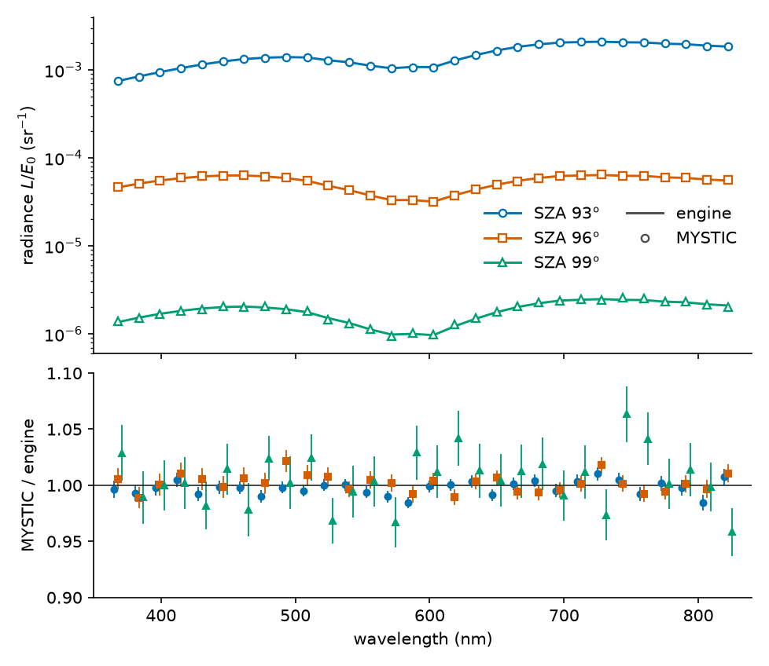
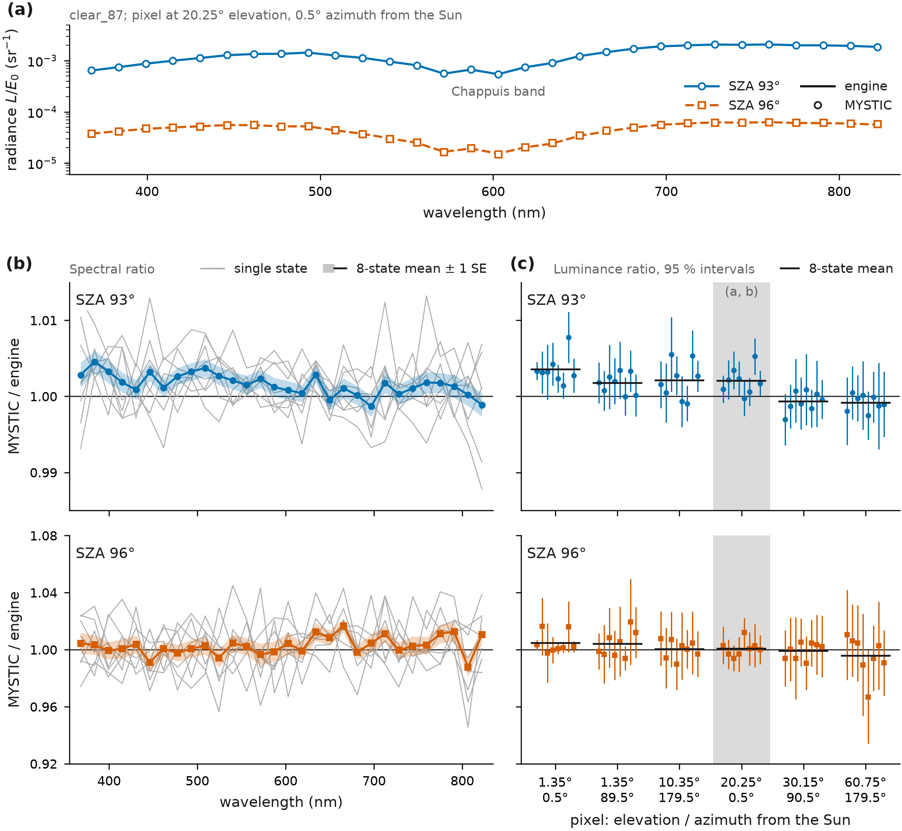
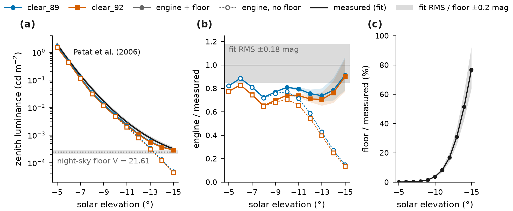

# Validation

The research records document the checks below. The first radiance comparison with MYSTIC (Figure 1) predates 1.1.0 and uses
one atmospheric state, called state A in this document, and one sky pixel: the sun side of the sky at 20.25° elevation and
0.5° relative azimuth, seen from 0.1 km above the ground, at solar zenith angles (SZA) of 93°, 96° and 99°, which are solar
elevations −3°, −6° and −9°. State A has a tropospheric aerosol with aod550 0.0551, Ångström exponent 1.889,
single-scattering albedo 0.898, Henyey–Greenstein asymmetry parameter 0.683 and a 1.0 km scale height; an ozone column of
224.75 DU; a Gaussian stratospheric sulfate layer with centre 19 km, σ 3 km and τ550 0.0037; and a Lambert surface of albedo
0.376.



Figure 1. Top: radiance divided by the solar irradiance, L/E₀, from the engine (lines) and from MYSTIC (open markers). The
relative standard error of MYSTIC lies between 0.52 % and 2.41 % and is not drawn. Bottom: MYSTIC divided by the engine, with
the MYSTIC standard error as bars; the three SZA are offset by ±3 nm so that the bars do not overlap. Data:
`docs/validation/mystic_compare.csv`. Script: `docs/validation/plot_validation.py`.

The sections after the first comparison go beyond that pixel. The third section uses measured zenith polarisation to check
the stratospheric aerosol input. In *NO₂ and O₄ in 1.1.0: engine against MYSTIC on the same input* we ran a 1.1.0 development
build against MYSTIC for two states, at 12 combinations of state, direction and SZA: the sun side, the zenith and the
anti-solar side at SZA 93° to 99°. That test checks whether the engine reproduces the changes that NO₂ and O₄ make to colour
and luminance in MYSTIC, and it also reports the comparison without the absorbers, to which no pass or fail threshold
applies. Neither of those states is one of the 64 bundled states in `states_v2.json`, and both place the stratospheric layer
at 19 km, whereas the bundled states use 21 km. In *Bundled states against MYSTIC (1.2.3)* we compare tables of eight bundled
states with MYSTIC radiances at six pixels and SZA 93° and 96°. Two sections on numerics follow, the convergence of two
settings and the IPRT test case E1. Below a solar elevation of −9° there is no comparison with MYSTIC. Two sections test
parts of the deep-twilight problem down to −18°: the second order of scattering against a direct quadrature, and a Rayleigh
atmosphere against SASKTRAN2. Two sections compare with measurements of the brightness of the twilight sky and of the timing
of the purple light. The last two sections before the open checks return to numerics: the grids in solar zenith angle and in
height, and the error of the band approximation, measured against `point` tables of the engine. Every same-input comparison
with MYSTIC ran at single wavelengths, none in the default band mode. The engine runs of all sections from *Bundled states
against MYSTIC (1.2.3)* onwards set `SOSFUSE2_DETERMINISTIC=1`, which is off by default and changes only the order of
accumulation.

## Same-input comparison with MYSTIC (1.0.0 physics)

The reference is MYSTIC, the Monte Carlo solver of libRadtran 2.0.6 (Mayer 2009; Emde et al. 2016), run in a 1D
spherical-shell atmosphere with polarisation and backward tracing. Both codes were given the same optical input, so any
difference between them comes from the transport and its numerics rather than from the atmosphere.

The input is the engine's, written out for MYSTIC in 0.5 km layers up to 80 km plus the observer level at 0.1 km: Rayleigh
and ozone optical depth per layer, the tropospheric and stratospheric aerosol with their phase functions, and the surface
albedo. The Earth radius is 6371 km and the Rayleigh depolarisation factor is 0.03 in both codes. Aerosol scattering
depolarises completely in both, in the engine by construction and in MYSTIC because it is given only the P₁₁ element of the
phase matrix, and neither code models refraction. A script rebuilds the engine's coefficients from the same asset files and
state parameters and writes the MYSTIC input without calling the engine, so a mistake in that script would appear as a
transport difference. Reading the generated files back through a DISORT direct-beam calculation reproduces the aerosol
optical depth to a relative error of at most 5.8e-7 and the total vertical optical depth to at most 3.7e-7, at 430.5, 555.8
and 696.8 nm.

The engine radiance comes from a table baked with the research build. That table uses the legacy spectral inputs, the 48-band
solar and ozone table `src/sosfuse2/assets/spectra.json` (the shipped file has the sha256 recorded for the comparison), read
as point values at 30 wavelengths, the centres of 30 equal bins over 360–830 nm, and MYSTIC ran at the same 30 wavelengths as
single wavelengths. The 1.0.0 default on the production grid differs: band means and a temperature-dependent ozone cross
section (`src/sosfuse2/atmosphere/spectral.py`). The ozone cross section of the legacy table has a half-bin shift that was corrected in
the research build. Because both codes read the same legacy table, that shift does not affect the comparison, but the
comparison also does not test the current spectral defaults, and we did not re-bake the table with the installed package for
it. The research build had the 1.0.0 physics, a λ⁻⁴ Rayleigh law and no NO₂ or O₄, and the MYSTIC input was made from the
same coefficients, so this comparison tests the transport of the 1.0.0 model. The 1.1.0 absorbers are tested below, under
*NO₂ and O₄ in 1.1.0: engine against MYSTIC on the same input*.

Each of the 90 cells (3 SZA × 30 wavelengths) combines two or four independent MYSTIC runs with different random seeds, 260
runs and 2,074,640,958 photons in total. The first pass was too noisy at SZA 99 and in 10 of 30 cells at SZA 96, so those
cells received further runs. The cell value is the mean over its runs weighted by photon count, and its standard error (SE)
is the photon-weighted combination of the standard errors that MYSTIC reports for each run (`mc_std`). Each SZA has a target
for the relative standard error of every cell: 1 % at SZA 93 and 96, 2.5 % at SZA 99.

The ratio in Table 1 is MYSTIC divided by the engine. Blue is the mean ratio over the wavelengths below 450 nm and red the
mean over those above 600 nm. The last column counts the cells whose MYSTIC standard error meets the target; it describes the
precision of the MYSTIC value, not the agreement between the two codes.

| SZA | ratio min / median / max | blue / red mean ratio | MYSTIC relative SE | cells within target |
|---:|---|---|---|---|
| 93° | 0.9844 / 0.9979 / 1.0102 | 0.9971 / 0.9999 | 0.52–0.77 % | 30 of 30 (1 %) |
| 96° | 0.9890 / 1.0016 / 1.0217 | 1.0017 / 1.0003 | 0.68–0.97 % | 30 of 30 (1 %) |
| 99° | 0.9584 / 1.0040 / 1.0634 | 1.0027 / 1.0105 | 1.97–2.41 % | 30 of 30 (2.5 %) |

Table 1. Radiance ratio MYSTIC / engine at the three solar zenith angles.

We compare the colour through the CIE 1976 coordinates u′ and v′ of the 30-wavelength spectrum, weighted with the solar
irradiance and the CIE 1931 colour-matching functions. Δ is MYSTIC minus engine. The standard error comes from 200 random
draws of the MYSTIC spectrum within its per-wavelength standard errors, with the engine spectrum held fixed. The draws treat
wavelengths as independent, which holds because every cell has its own random seeds.

| SZA | engine u′, v′ | MYSTIC u′, v′ | Δu′ ± SE | Δv′ ± SE |
|---:|---|---|---|---|
| 93° | 0.203054, 0.466584 | 0.203050, 0.466542 | −0.000004 ± 0.000181 | −0.000042 ± 0.000252 |
| 96° | 0.189567, 0.435841 | 0.189052, 0.435705 | −0.000514 ± 0.000316 | −0.000135 ± 0.000496 |
| 99° | 0.191249, 0.432994 | 0.192429, 0.433041 | +0.001181 ± 0.000754 | +0.000047 ± 0.001215 |

Table 2. Chromaticity of the sun-side pixel in both codes.

At SZA 93 and 96 the ratio of every cell lies within 2.2 % of 1, with a standard error below 1 % per cell. At SZA 99 the
ratios range over 0.958–1.063 with a standard error of 2.0–2.4 % per cell. The largest colour differences are Δu′ = −0.0005 ±
0.0003 at SZA 96 and +0.0012 ± 0.0008 at SZA 99, both 1.6 times their standard error. Δu′ changes sign over the three angles
(−, −, +), and Δv′ stays within one standard error at all three, so at the stated precision we detect no systematic
difference. For SZA 99 the largest cell difference |engine − MYSTIC| / SE is 2.53 (the data file gives it as |ratio − 1| / ratio_se);
one of the 30 cells exceeds 2 and none exceeds 3, where 30 independent normal deviates would give 1.4 cells above 2. At
SZA 93 the 587.17 nm cell reaches 3.03. Over all 90 cells five exceed 2 and one exceeds 3, where independent normal
deviates would give 4.1 and 0.24.

At SZA 99 the per-cell target changed from 2 % to 2.5 %. The estimated top-up for 2 % was 6.05 CPU-hours, whereas 2.5 %
needed an estimated 3.64 CPU-hours. The first pass reached 2 % in none of the 30 cells, with relative standard errors of
3.9–18.4 %. After the top-up, 2 of 30 cells meet 2 % and 30 of 30 meet 2.5 %.

The standard errors are Monte Carlo errors of MYSTIC only and contain no uncertainty of the engine, of the layer
discretisation or of the input. Because both codes read the same input, an error in the input itself, whether in the ozone
cross section, the Mie table, the solar spectrum, the colour-matching functions or the Rayleigh optical-depth law, is common
to both and cancels in the ratio, so the comparison cannot detect such errors. This 1.0.0 comparison covers one state and one
pixel at three SZA, with no other directions, states or solar depressions beyond 9°.

## MYSTIC build check

The comparison depends on the MYSTIC build and its spherical 1D set-up. To check them, we ran the same libRadtran build on
the Rayleigh benchmark of Korkin et al. (2020): a spherical-shell atmosphere with conservative Rayleigh scattering of optical
depth 0.25 and 1, a black surface, and the radiance seen at the top of the atmosphere, for which the paper tabulates MYSTIC
results. We reproduced 120 of those cells, covering optical depths 0.25 and 1, solar zenith angles 0°, 70.47° and 84.26°,
relative azimuths 0° and 180°, and single-scattering and total radiance, with 30 cells for each combination of optical depth
and mode. Each cell used 1,690,000 photons and one random seed. The `uvspec` binary has sha256
`d0c5ff763780e13455a95f4eaaa7c5ea936d9f1cbdf1d3eeb4c2a9439b42abb8`, which is also the hash of the binary of the tree that
ran the comparison above.

The largest absolute deviation from the tabulated MYSTIC value is 0.2728 %, and the mean absolute deviation is 0.0643 %. No
cell deviates by more than 3 standard errors (0 of 120). Because the paper gives Monte Carlo accuracies per group of cells
rather than per cell, the standard error combines the error of our run with the accuracy stated for each group. The benchmark
values themselves are not reproduced in this repository.

Three limits apply. The paper's vertical structure was not available as a table, so we tried two candidates on three test
cells, a uniform shell from 0 to 100 km and an exponential profile with an 8 km scale height. Only the uniform shell
reproduced the table; the exponential profile was 4.2 % and 5.7 % off at two of the cells and 99.99 % low at the third, so
the structure was chosen by matching the table. The benchmark neglects polarisation and has no aerosol, no absorption and no
reflecting surface, so this check tests neither MYSTIC's polarised mode nor any of the optical input of the comparison above.
Finally, its geometry is a top-of-atmosphere view rather than a sky seen from the ground.

## Stratospheric aerosol input and zenith polarisation (Ugolnikov et al.)

This calculation was made with MYSTIC rather than with the engine. We gave MYSTIC the engine's optical input for state A,
including its stratospheric sulfate layer, and read the Stokes vector it returns. The engine itself has no Stokes output,
since its tables hold a single radiance per direction and wavelength, so this is a qualitative check of the input, namely the
stratospheric sulfate layer, and does not test the engine's transport.

The calculation looks straight up at SZA 90–99 and 30 wavelengths and takes the degree of linear polarisation, DoLP = √(Q² +
U²)/I. Additional runs at SZA 93–96 and 5 wavelengths reduced the standard error where the features described below appear.
The standard error of a DoLP value is 0.001–0.006 at SZA 91–94, 0.006–0.011 at SZA 95 and 0.011–0.022 at SZA 96.

The reference is published measurements of the polarisation of the zenith twilight sky in a V band (550 nm) and an R band
(700 nm) (Ugolnikov et al. 2004). In the V band the measured polarisation stays nearly constant until the solar elevation
reaches about −5° and then decreases. In the R band the measurements show day-to-day differences in polarisation in bright
twilight down to about −3°, after which the differences nearly vanish, and a fall after −5° from multiple scattering. Later
papers by Ugolnikov and Maslov relate twilight-sky signals to stratospheric aerosol: a scattering effect that grows with
wavelength up to 35 km (Ugolnikov and Maslov 2018a) and a depolarisation near 20 km (Ugolnikov and Maslov 2018b).

Two features are reproduced. The first is a decrease of the polarisation after SZA 95: at 555.8 nm the model DoLP is
0.71–0.73 from SZA 90 to 95 and 0.66 ± 0.01 at SZA 96, while the values at SZA 97 and beyond are too noisy to read (0.60 ±
0.06 at SZA 97). The second is an aerosol-caused reduction of the R-band polarisation near the solar elevations where the
measurements show day-to-day differences. In the model it appears as a dip with a recovery. At 696.8 nm the DoLP is 0.776 at
SZA 91, 0.725 at SZA 93, 0.712 ± 0.003 at SZA 94, 0.755 ± 0.007 at SZA 95 and 0.695 at SZA 96. At 743.8 nm the dip is deeper:
0.782 at SZA 91, 0.700 ± 0.003 at SZA 94 and 0.769 ± 0.007 at SZA 95. The measurements describe a reduction that depends on
the day rather than a dip, so what is reproduced is the presence of the reduction in this range of solar elevation, not its
shape.

To find the cause, we removed the stratospheric aerosol by setting its column to zero with everything else equal and repeated
the calculation for SZA 91–96 at 555.8, 696.8 and 743.8 nm. Without the layer the dip and the recovery are gone: at 743.8 nm
the DoLP is then 0.840, 0.861, 0.859, 0.849, 0.820 and 0.774 for SZA 91–96, a maximum near SZA 92–93 followed by a steady
decrease. The depolarisation by the layer, DoLP with the layer minus DoLP without it, is −0.058, −0.086, −0.132, −0.149 and
−0.051 at 743.8 nm for SZA 91–95. At 555.8 nm it is at most −0.073 (SZA 93), about half the largest value at 743.8 nm. The
direction agrees with the measurements, in which the aerosol effect is larger at longer wavelengths.

We made no quantitative comparison of the absolute polarisation or of the depth of the dip: the published values exist only
as figures, and the observing sites, dates and aerosol loads differ from state A. In this calculation the aerosol scatters
with P₁₁ only and therefore depolarises completely, as in the engine; we did not use a full Mie phase matrix and did not test
what that assumption does to the depth of the dip. We have not inverted the stratospheric optical depth from measured
polarisation with the relation of Ugolnikov and Maslov (2019) or compared it with the input value of 0.0037.

## Input physics added in 1.1.0

Up to 1.0.0 the engine had no NO₂ and no O₄ absorption, and it scaled the Rayleigh optical depth as a pure power law in
wavelength. These are choices of input physics rather than errors of the solver, and the same-input comparison above cannot
detect them because both codes read the same input. We measured them instead against libRadtran's own molecular input, by
running MYSTIC twice, with and without the item, on otherwise identical input. The results led to the three changes of 1.1.0:
NO₂ and O₄ absorption and the Rayleigh cross section of Bodhaine et al. (1999) (`docs/MODEL.md`, *Constituents*). The numbers
in this section are differences between two MYSTIC runs with libRadtran's own cross sections and profiles, not between MYSTIC
and the engine; the 1.0.0 engine corresponds to the run without the item. For scale, the research records judge changes of
the solver against a tolerance of Δu′v′ 2.9e-4 at the 95th percentile and 0.122 % in the RMS of the luminance. All three
effects were measured for one state: the pair runs for O₄ and Rayleigh at SZA 96 and the NO₂ runs at SZA 93–99, in the
directions listed below. Band-mean spectra, other states and other directions were not measured with libRadtran's own input.

### NO₂

libRadtran's `afglus` profile contains NO₂ with a column of 5.57e15 cm⁻² (0.207 DU), a vertical optical depth of about 3e-3
between 370 and 430 nm. To measure its effect, we gave two MYSTIC runs that differ only in NO₂ the same random seeds, so that
their photon paths are nearly identical and the ratio is precise. Each pixel in Table 3 has 8 seeds of 500,000 photons at
each of 30 wavelengths. The ratio is with NO₂ divided by without, and Δ is with minus without. ΔY is the relative change of
the luminance Y, with the same weights as the colour above.

| view | SZA | blue mean ratio | ΔY | Δu′ | Δv′ |
|---|---:|---:|---|---|---|
| sun side 20° | 93° | 0.927 | −1.40 ± 0.01 % | +0.00117 ± 0.00001 | +0.00351 ± 0.00002 |
| sun side 20° | 96° | 0.924 | −1.83 ± 0.03 % | +0.00107 ± 0.00003 | +0.00480 ± 0.00006 |
| sun side 20° | 99° | 0.900 | −2.07 ± 0.12 % | +0.00133 ± 0.00012 | +0.00624 ± 0.00042 |
| zenith | 93° | 0.926 | −1.59 ± 0.01 % | +0.00094 ± 0.00001 | +0.00469 ± 0.00003 |
| zenith | 96° | 0.917 | −2.15 ± 0.04 % | +0.00086 ± 0.00006 | +0.00600 ± 0.00014 |
| zenith | 99° | 0.914 | −1.2 ± 1.4 % | +0.0005 ± 0.0018 | +0.0092 ± 0.0013 |
| anti-solar 10° | 93° | 0.920 | −1.67 ± 0.02 % | +0.00133 ± 0.00002 | +0.00454 ± 0.00005 |
| anti-solar 10° | 96° | 0.919 | −2.11 ± 0.02 % | +0.00107 ± 0.00003 | +0.00550 ± 0.00018 |

Table 3. Effect of the `afglus` NO₂ column in paired MYSTIC runs.

In all eight pixels NO₂ lowers the blue radiance and raises v′. The 1.0.0 engine, without NO₂, therefore gave a lower v′, a
bluer sky, than the same sky with this NO₂ column, by 0.0035 to 0.0092, which is 12 to 32 times the colour tolerance quoted
above. The change grows with SZA and varies by about ±25 % with direction at a given SZA. At the zenith at SZA 99 the blue is
so dark that rare high-order scattering paths dominate and the two runs decorrelate, which is why the errors are large there,
but Δv′ is still 7 times its standard error. Two independent runs with different seeds at the sun-side pixel at SZA 96 give
Δv′ = +0.0049 ± 0.0006, consistent with the paired value of +0.00480 ± 0.00006.

These runs use the column of one profile. Stratospheric NO₂ varies by a factor of several with season, latitude and twilight
chemistry, so the size of the effect for a given sky does not follow from them; we expect it to scale roughly with the column
but did not measure that. 1.1.0 takes the column as a state parameter, `parameters.no2_du`, with 0.207 DU as the default.

### O₄

libRadtran includes the O₄ absorption computed from the O₂ profile, with a vertical optical depth of 8.3e-3 at 477.5 nm, its
maximum, and 7.4e-3 at 571.5 and 634.2 nm. At the sun-side pixel at SZA 96, adding O₄ to MYSTIC changes the radiance by
factors of 0.966, 0.939, 0.964 and 0.913 at 477.5, 571.5, 587.2 and 634.2 nm, and by about 1 at the other wavelengths. The
colour changes by Δu′ = −0.0013 ± 0.0004 and Δv′ = −0.0007 ± 0.0006. These are two independent runs with two seeds of 9
million photons per wavelength. Because the 30 wavelengths are point samples that hit the narrow O₄ bands at their centres,
we expect a smaller effect on band-mean spectra, which we did not measure with MYSTIC; the engine's own change on the band
grid is given under *Size of the 1.1.0 changes on the production grid*.

### Rayleigh optical-depth law

The 1.0.0 engine took the Rayleigh optical depth at 550 nm from the IPRT 450 nm table for the US Standard Atmosphere
multiplied by (450/550)⁴, and scaled it with wavelength as (550/λ)⁴. The Rayleigh optical depth of Bodhaine et al. (1999),
which the libRadtran run used (`crs_model rayleigh Bodhaine`), is not an exact λ⁻⁴ law. For libRadtran's `afglus` atmosphere
the ratio of the Bodhaine optical depth to the 1.0.0 engine's is 1.031 at 368 nm, 1.000 at 446 nm and 0.957 at 822 nm,
measured as vertical optical depth in a DISORT direct-beam calculation.

Scaling the engine's Rayleigh optical depth wavelength by wavelength to the Bodhaine value changes the MYSTIC radiance
at the sun-side pixel at SZA 96 by an inverse-variance weighted mean ratio of 0.9892 ± 0.0020, 5.4 standard errors from
1. The ratio is 0.9825 ± 0.0033 below 420 nm and above 700 nm, and 0.9917 ± 0.0030 between 450 and 650 nm. The colour
does not move beyond its standard error, with Δu′ = +0.0001 ± 0.0004 and Δv′ = +0.0001 ± 0.0006. Only the optical depth
was changed; the depolarisation factor of 0.03 was kept.

1.1.0 uses the Bodhaine cross section, evaluated at the vacuum wavelength, and keeps the 1.0.0 coefficient at 450 nm
(`src/sosfuse2/atmosphere/rayleigh.py`). Its ratio to the 1.0.0 coefficient is 1.032 at 368 nm, 1 at 450 nm and 0.958 at 822 nm, close
to the libRadtran ratios above. The depolarisation factor of the phase function stays at 0.03.

## NO₂ and O₄ in 1.1.0: engine against MYSTIC on the same input

Here we test whether the new absorbers change colour and luminance by the same amount in the engine as in MYSTIC when both
read the same optical input. Both codes read the same absorption optical depth in every layer, so the test covers how the
absorption is carried through the spherical shell, through slant paths, the Earth's shadow and multiple scattering, rather
than the cross sections or the profiles themselves. The package tests compare the cross-section assets with the original data
files when those files are supplied (`SOSFUSE2_BIRA_DIR`, `SOSFUSE2_HITRAN_CIA`; README, *Tests and checks*).

The engine was the 1.1.0 development build with the new physics. It made CUDA tables of two states with `spectral_mode`
`point` at 30 wavelengths (367.8–822.2 nm) and the ozone cross section at a fixed 233 K. We did not use the default band
mode, because MYSTIC runs at single wavelengths cannot reproduce band means, and both codes used the solar irradiance and the
colour weights of this point set-up. The engine runs were made before the 1.1.0 change of the interpolation rule of the
transport (`docs/MODEL.md`, *Multiple scattering*) and were not repeated after it. They used the production interpolation
grid, on which that change is small: in the full-grid gate state it moves the radiance by at most 3.7e-6 relative (*Size of
the 1.1.0 changes on the production grid*), far below the tolerance of 1e-4 used here. The two states of this check were not
re-solved.

The states are A, described at the top of this document, and B. State B has aod550 0.168, Ångström exponent 1.62,
single-scattering albedo 0.954, asymmetry parameter 0.753 and a 2.53 km scale height; an ozone column of 307.4 DU; a
stratospheric sulfate layer with τ550 0.0022 (centre 19 km, σ 3 km); and a surface albedo of 0.559. Both states use the
`usstd76` density and ozone profiles. There are 12 pixels. In state A they are the sun side (20.25°, 0.5°) and the zenith at
SZA 93, 96 and 99, and the anti-solar direction (10°, 180°) at SZA 93 and 96. In state B they are the sun side and the
anti-solar direction at SZA 94 and 96.

We ran four variants of each state: 00 with neither absorber (the Bodhaine Rayleigh law only), 10 with NO₂ (0.207 DU), 01
with O₄, and 11 with both. The change Δ of a variant is its value minus that of 00 for u′ and v′, and Y_variant/Y_00 − 1 for
the luminance Y.

The MYSTIC input is the engine's optical input written per layer, as in the first comparison. In a ledger of 960 layer
entries the molecular optical depths agree with the engine's to a relative 1.8e-15, and a DISORT direct-beam run on the
generated files reproduces the total vertical optical depth to 3.9e-7. The four variants share every input file except the
molecular absorption file. Every MYSTIC run of a variant used the same random seed as a run of 00, with 500,000 photons per
seed and wavelength, so the two runs follow nearly the same photon paths and their difference is far more precise than that
of independent runs. Each comparison started with 8 seeds; unresolved comparisons were doubled to 16 seeds, and the zenith
pixel at SZA 96 to 32. In total there were 23,040 runs and 35.2 CPU-hours of `uvspec` time.

The criterion compares D = Δ_engine − Δ_MYSTIC with a tolerance of max(0.1 |Δ_MYSTIC|, 1e-4): the engine has to reproduce the
change to 10 % of its size, or to 1e-4 in u′, v′ or Y_rel when the change is small. The 95 % Student t interval of D comes
from the per-seed paired changes and contains only the sampling error of MYSTIC. A value passes when the interval lies inside
±tolerance, fails when it lies wholly outside, and is unresolved otherwise.

| variant | MYSTIC Δu′ | MYSTIC Δv′ | MYSTIC ΔY | pass | fail | unresolved |
|---|---|---|---|---:|---:|---:|
| NO₂ (10) | +0.0003 to +0.0014 | +0.0037 to +0.0077 | −1.4 to −2.6 % | 30 | 0 | 6 |
| O₄ (01) | −0.0007 to −0.0022 | −0.0005 to −0.0015 | −1.0 to −2.8 % | 13 | 0 | 23 |
| both (11) | −0.0010 to +0.0002 | +0.0033 to +0.0065 | −3.0 to −4.9 % | 23 | 0 | 13 |

Table 4. Outcome of the paired comparison over the 12 pixels.

Of the 108 values (12 pixels × 3 variants × 3 quantities), 66 pass, none fails and 42 are unresolved. By quantity, Y passes
in 30 of 36 cases, u′ in 19 and v′ in 17. An unresolved value means that the MYSTIC interval stayed wider than the tolerance
after the top-ups; it is not evidence of a difference. Most unresolved values are colour changes from O₄, which are so small
that the tolerance is the 1e-4 floor. Where the MYSTIC change has a relative standard error of 2 % or less (41 of the 108
values), the engine's change divided by MYSTIC's lies between 0.971 and 1.048. Every value is listed in
`docs/validation/b2_tier1_effects.csv`.

With 16 seeds the zenith pixel at SZA 96 gave one failure, in which the engine's O₄ change of v′ was 0.72 times MYSTIC's.
With 32 seeds MYSTIC gives Δv′ = −0.00100 [−0.00121, −0.00080] against −0.00094 in the engine, so the value becomes
unresolved and the Y change passes. The 16-seed interval had been too narrow: in deep twilight a t interval from 16 paired
seeds can understate the scatter, and the 16-seed values there should be read with that in mind.

The 00 runs also give an absolute same-input comparison of the 1.1.0 engine without NO₂ and O₄, at two states and 12 pixels.
It is not part of the criterion. The engine values were read at the nearest table pixel, which on the sun side is the MYSTIC
direction itself; at the zenith the pixel is at 89.55°, and in the anti-solar direction at 10.35° elevation and 179.5°
azimuth. The standard errors in Table 5 come from the scatter of the seed values.

| state | view | SZA | seeds | MYSTIC/engine per wavelength, min / median / max | Y MYSTIC/engine | Δu′ (MYSTIC − engine) | Δv′ |
|---|---|---:|---:|---|---|---|---|
| A | sun side | 93° | 16 | 0.993 / 0.999 / 1.004 | 0.9988 ± 0.0004 | −0.00001 ± 0.00005 | +0.00015 ± 0.00009 |
| A | sun side | 96° | 16 | 0.970 / 0.999 / 1.022 | 0.9987 ± 0.0031 | +0.00000 ± 0.00035 | +0.00094 ± 0.00065 |
| A | sun side | 99° | 16 | 0.939 / 1.019 / 1.079 | 1.0049 ± 0.0196 | +0.00002 ± 0.00130 | −0.00096 ± 0.00350 |
| A | zenith | 93° | 16 | 0.987 / 0.999 / 1.006 | 0.9973 ± 0.0012 | +0.00017 ± 0.00019 | −0.00038 ± 0.00026 |
| A | zenith | 96° | 32 | 0.961 / 0.996 / 1.031 | 0.9916 ± 0.0056 | +0.00065 ± 0.00044 | −0.00086 ± 0.00104 |
| A | zenith | 99° | 16 | 0.684 / 0.971 / 1.203 | 0.9546 ± 0.0220 | −0.00178 ± 0.00274 | +0.00047 ± 0.00609 |
| A | anti-solar | 93° | 16 | 0.967 / 0.976 / 0.995 | 0.9771 ± 0.0010 | −0.00049 ± 0.00009 | −0.00108 ± 0.00017 |
| A | anti-solar | 96° | 16 | 0.980 / 1.004 / 1.038 | 1.0138 ± 0.0052 | −0.00020 ± 0.00048 | +0.00224 ± 0.00089 |
| B | sun side | 94° | 16 | 0.990 / 1.000 / 1.008 | 1.0021 ± 0.0017 | −0.00024 ± 0.00015 | +0.00047 ± 0.00021 |
| B | sun side | 96° | 16 | 0.966 / 0.999 / 1.023 | 1.0018 ± 0.0046 | −0.00118 ± 0.00051 | +0.00051 ± 0.00083 |
| B | anti-solar | 94° | 16 | 0.970 / 0.991 / 1.004 | 0.9945 ± 0.0016 | −0.00014 ± 0.00020 | −0.00022 ± 0.00025 |
| B | anti-solar | 96° | 16 | 0.964 / 1.007 / 1.057 | 0.9955 ± 0.0040 | +0.00094 ± 0.00046 | −0.00187 ± 0.00087 |

Table 5. Absolute same-input comparison of the 1.1.0 engine without NO₂ and O₄ (variant 00).

On the sun side, where the two directions coincide, the luminance ratios lie between 0.9987 and 1.0049. In state A at the
anti-solar pixel at SZA 93 the ratio is 0.977 ± 0.001, 24 standard errors from 1. Four further MYSTIC seeds at the engine's
pixel direction gave 0.995 ± 0.002, against 0.980 ± 0.001 with the same four seeds at the original direction, so most of that
difference comes from the 0.35° offset in elevation. The colour difference at the engine's direction is Δu′ = +0.0001 ±
0.0002 and Δv′ = −0.0002 ± 0.0003. The other zenith and anti-solar pixels were not rerun at the engine's direction.

## Size of the 1.1.0 changes on the production grid

We solved the full-grid gate state on the production grid, in the default band mode, with each combination of the new
absorbers, and compared it with its 1.0.0 table. The state has aod550 0.4, Ångström exponent 1.0, single-scattering albedo
0.92, asymmetry parameter 0.65, a 1.2 km scale height, 300 DU of ozone, a black surface and a stratospheric sulfate layer
with τ550 0.01 at 19 km, with the `usstd76` density and ozone profiles. Y RMS is the root-mean-square relative change of the
luminance over the table pixels whose Y is at least 1 % of the mean of their solar-elevation row, weighted with the cosine of
the view elevation, over all solar-elevation rows of the table. The worst row is the largest RMS of a single solar elevation.
Δu′v′ is the change of chromaticity at each table pixel.

| change against 1.0.0 | Y RMS | worst row | Δu′v′ 95th percentile | Δu′v′ maximum |
|---|---:|---|---:|---:|
| Bodhaine Rayleigh only | 0.45 % | 0.85 % (−4°) | 7.0e-4 | 1.55e-3 |
| and NO₂ (0.207 DU) | 2.40 % | 3.97 % (−18°) | 1.25e-2 | 1.35e-2 |
| and O₄ | 1.67 % | 2.07 % (−12°) | 2.75e-3 | 3.05e-3 |
| and both (the 1.1.0 default) | 4.04 % | 6.18 % (−18°) | 1.08e-2 | 1.17e-2 |

Table 6. Change of the full-grid gate state against its 1.0.0 table.

NO₂ dominates the change of colour, and O₄ offsets part of it. These are differences between two models of one state rather
than errors, and tables from 1.0.0 and 1.1.0 are not interchangeable.

These tables were made before the 1.1.0 change of the interpolation rule of the transport. We solved the 1.1.0 default of
this state, with both absorbers, with the rule before and after the change: the radiance moved by at most 3.7e-6 relative in
every solar-elevation row from +6° to −18°, counting the elements of a row that are at least 1e-3 of the row's maximum, and
its Δu′v′ against 1.0.0 stays 1.08e-2 at the 95th percentile and 1.17e-2 at the maximum. The other three rows of Table 6 were
not re-solved.

## Sensitivity to fixed choices in 1.1.0

We tested two fixed choices of the 1.1.0 model at the tier-1 pixels, against the same tolerance of Δu′v′ 2.9e-4 and 0.122 %
in Y.

**Temperature of the cross sections.** The engine uses NO₂ cross sections at 220 K at all heights and, in the point set-up
above, ozone at 233 K. The default band mode uses an ozone cross section averaged over the profile with the temperatures of
the US Standard Atmosphere (`docs/MODEL.md`, *Ozone*), and that mode was not part of this test. We ran MYSTIC with each
layer's cross sections at the temperature of the US Standard Atmosphere at the layer midpoint and compared with the fixed
temperatures. NO₂ was interpolated between the 220 K and 294 K data of Vandaele et al. (1998), ozone between the Serdyuchenko
columns, and temperatures outside a table were held at its end. The runs used 16 paired seeds at 10 pixels, the tier-1 pixels
without SZA 99. The per-layer temperatures change u′ by −2.3e-5 to −4.8e-5, v′ by −5.1e-5 to −8.0e-5 and Y by −0.004 % to
−0.026 %. The 95 % upper bounds are 1.8e-4 for |Δu′v′|, 0.61 of the tolerance, and 0.040 % for |ΔY|, 0.33 of the tolerance,
so at these pixels the fixed temperatures stay within the tolerance. O₄ kept its fixed temperatures in both runs. Above 666.6
nm the NO₂ asset has no 294 K data, so NO₂ stayed at 220 K there; an estimate of that omitted part, which is not a bound,
gives at most 0.028 % in Y.

**Rayleigh depolarisation.** The phase function uses a depolarisation factor of 0.03 at every wavelength, whereas the King
factor F(λ) of Bodhaine et al. corresponds to ρ = 6(F − 1)/(7F + 3), from 0.0305 at 360 nm to 0.0276 at 830 nm. Paired MYSTIC
runs could not resolve this effect, because a change of the phase function changes the photon paths and the pairs
decorrelate; a pilot at two pixels was dominated by noise, and extrapolating it gives about 25,000 seeds for a result.
Instead, we multiplied each engine pixel spectrum by the ratio of the Rayleigh phase function with ρ(λ) to that with 0.03, at
single scattering angles of 0°, 60°, 90°, 120° and 180°, for the 12 tier-1 pixels. The largest colour change is 3.9e-5 (0.14
of the tolerance) and the largest change in Y is 0.083 % (0.68). This treats all of the radiance as Rayleigh single
scattering at one angle, so it estimates the size of the effect but is not a bound under multiple scattering, which we did
not measure.

## Bundled states against MYSTIC (1.2.3)

We compared the installed 1.2.3 package with MYSTIC for eight of the 64 bundled states of `states_v2.json`: `clear_37`,
`clear_43`, `clear_62`, `clear_66`, `clear_68`, `clear_80`, `clear_86` and `clear_87`. The states kept their stratospheric
layer at 21 km, their NO₂ and their O₄. The bundled states carry no `density` block, and we added one with `density_profile:
usstd76`, `ozone_profile: usstd76` and `rayleigh_column: usstd`. As in the 1.1.0 comparison, the engine ran in `point` mode
at 30 wavelengths with the ozone cross section at 233 K, and both codes read the same optical input. Two switches that are
off by default were set for the engine tables, `SOSFUSE2_GROUND_SH_L=24` and `SOSFUSE2_DETERMINISTIC=1`, so the tables are
not those of an unmodified default run. We read the engine at six table pixels, given as elevation and relative azimuth in
Table 7, at SZA 93° and 96°. A case below is one state at one pixel and one SZA, and there are 96 cases.

MYSTIC (libRadtran 2.0.6) received the optical input in layers of 0.1 km from the ground to 3 km and of 0.5 km above. In an
earlier run of two of the states, changing the layers below 3 km from 0.5 km to 0.1 km raised the MYSTIC luminance at the
pixels at 1.35° elevation by 0.11 % to 0.88 % at SZA 93°. The tropospheric Henyey–Greenstein phase function was expanded to
256 Legendre terms, and the stratospheric phase function was given by the 33 Legendre moments of the engine's sulfate table.
Each case has 16 seeds of 250,000 photons at each of the 30 wavelengths, and all 46,080 runs finished. For each case
we computed the relative luminance difference Y_MYSTIC / Y_engine − 1 and its 95 % Student t interval over the 16 seed
values. The interval contains only the sampling error of MYSTIC. Table 7 summarises the cases over the eight states.

| pixel (elevation / azimuth) | SZA 93°: mean [min, max] (%) | intervals excluding 0 | median SE (%) | SZA 96°: mean [min, max] (%) | intervals excluding 0 | median SE (%) |
|---|---|---:|---:|---|---:|---:|
| 1.35° / 0.5° | +0.352 [+0.144, +0.775] | 6 of 8 | 0.12 | +0.464 [−0.229, +1.624] | 0 of 8 | 0.30 |
| 1.35° / 89.5° | +0.175 [−0.001, +0.344] | 1 of 8 | 0.13 | +0.390 [−0.600, +1.949] | 0 of 8 | 0.90 |
| 10.35° / 179.5° | +0.209 [−0.093, +0.551] | 4 of 8 | 0.15 | +0.045 [−1.027, +0.777] | 0 of 8 | 0.90 |
| 20.25° / 0.5° | +0.203 [−0.029, +0.527] | 4 of 8 | 0.11 | +0.075 [−0.604, +1.196] | 1 of 8 | 0.52 |
| 30.15° / 90.5° | −0.067 [−0.305, +0.091] | 0 of 8 | 0.16 | −0.073 [−0.947, +0.517] | 0 of 8 | 0.95 |
| 60.75° / 179.5° | −0.081 [−0.251, +0.046] | 0 of 8 | 0.18 | −0.439 [−3.318, +1.047] | 1 of 8 | 1.35 |

Table 7. Y_MYSTIC / Y_engine − 1 in per cent: mean, minimum and maximum over the eight states, the number of states whose 95
% interval excludes 0, and the median standard error.

Over the 96 cases Y_MYSTIC / Y_engine − 1 has a mean of +0.104 %, a root mean square of 0.629 % and a largest absolute value
of 3.318 %, in `clear_68` at 60.75° / 179.5° and SZA 96°, where the standard error is 1.53 %. All 48 cases at SZA 93° lie
between −0.30 % and +0.77 %. The chromaticity difference, MYSTIC minus engine, ranges over −0.00060 to +0.00028 in u′ and
−0.00070 to +0.00045 in v′ at SZA 93°, with median standard errors of 0.00015 and 0.00025. At SZA 96° the ranges are −0.0024
to +0.0024 and −0.0054 to +0.0026, with median standard errors of 0.00086 and 0.0014.



Figure 2. Engine 1.2.3 (12 source nodes per path segment, Legendre order 16, `SOSFUSE2_GROUND_SH_L=24`) and MYSTIC in
libRadtran 2.0.6 at 30 single wavelengths from 368 to 822 nm for eight of the 64 bundled states at SZA 93° and 96°, or
solar elevations −3° and −6°, with 16 seeds of 250,000 photons. (a) L/E₀ of `clear_87` (418 DU, the largest ozone column)
at the sun-side pixel 20.25° / 0.5°, engine lines and MYSTIC markers, whose standard errors are at most 0.47 % at 93° and
2.8 % at 96°; the dip near 600 nm is the ozone Chappuis band. (b) Ratio MYSTIC / engine in that pixel for the eight
states in grey and their mean with ±1 standard error, the seed scatter of each state combined in quadrature and divided
by 8. (c) Luminance ratio at six pixels for `clear_37`, `clear_43`, `clear_62`, `clear_66`, `clear_68`, `clear_80`,
`clear_86` and `clear_87`, from left to right, with 95 % Student t intervals over the 16 seeds; black bars are the means
and the grey band marks the pixel of (a) and (b). Over the 96 cases the ratio minus 1 has a mean of +0.10 % and a root
mean square of 0.63 %. At SZA 93° all 48 cases lie between −0.30 % and +0.77 %, 15 of the 48 intervals exclude 1 and the
mean at 1.35° / 0.5° is +0.35 %; at SZA 96° the largest difference is −3.32 % (`clear_68`, 60.75° / 179.5°, standard
error 1.53 %) and 2 of 48 intervals exclude 1, where chance alone gives 2.4.

At SZA 93° the MYSTIC luminance exceeds the engine's by 0.18 % to 0.35 % in the mean at the four pixels up to 20.25°
elevation, and at 1.35° / 0.5° the interval excludes 0 in six of the eight states. Averaged over the 48 cases at SZA
93°, the difference per wavelength is +0.06 % to +0.20 % from 368 to 415 nm, +0.17 % to +0.36 % from 431 to 540 nm and
−0.11 % to +0.13 % above 556 nm, with a standard error of about 0.07 % per wavelength. The grid in solar zenith angle
accounts for part of this difference: with 0.25° instead of 0.5° the mean at 1.35° / 0.5° falls from +0.352 % to
+0.195 %, and +0.13 % to +0.20 % remains at the two pixels at the Sun's azimuth (*Grids in solar zenith angle and in
height*). At SZA 96° the Monte Carlo error is larger than most of the differences: the interval excludes 0 in 2 of 48
cases, where chance alone would give 2.4. This count cannot show a difference of the size found at 93°, because the
standard error of a case at 96° has a median of 0.89 %. The eight-state mean at 1.35° / 0.5° is +0.46 % ± 0.21 %, of the
same sign as at 93°, which is not significant among six pixels.

We solved two further engine tables per state, each with one setting raised: the source nodes per piece of a path from 12 to
24, and the Legendre order of the phase functions in multiple scattering from 16 to 24. Against the same MYSTIC values, the
mean, root mean square and largest absolute value over the 96 cases are +0.080 %, 0.622 % and 3.334 % with 24 source nodes
and +0.089 %, 0.633 % and 3.310 % with order 24, against +0.104 %, 0.629 % and 3.318 % with 12 nodes and order 16. At SZA 93°
either setting lowers the mean difference at a pixel by at most 0.04 percentage points, a small part of the 0.18 % to 0.35 %.

We also made the tables of `clear_43` and `clear_80` with 1.3.2, with 12 nodes, order 16 and the same two switches. They are
identical to the 1.2.3 tables bit for bit.

The comparison covers eight states, six pixels and two SZA in `point` mode, with the three US Standard Atmosphere options. As
in the earlier comparisons, an error in the common input cancels in the ratio.

## Convergence of the path quadrature and of the Legendre order

The engine integrates the source along each piece of a path with 12 nodes and expands the phase functions of multiple
scattering to Legendre order 16 (`docs/MODEL.md`). We solved full tables with one of the two settings raised and compared
them with the tables at 12 nodes and order 16. All tables of this section were made with the two switches named in the
previous section.

In the default band mode and with the exp8 configuration (`exp8`/`triangle`/`keep`, the default through 1.4.0), we solved four bundled states, `clear_34`,
`clear_37`, `clear_43` and `clear_80`. Here Y RMS is the root-mean-square relative change of the luminance, weighted with the
cosine of the view elevation, over the table pixels that reach 1e-3 of the maximum of their solar-elevation row, and the
percentile of Δu′v′ is unweighted. Raising the source nodes from 12 to 24 changes the tables by a Y RMS of 0.007 % to 0.048
%, with a largest change of Y at one pixel of 0.212 % and a 95th percentile of Δu′v′ of at most 1.2e-4. Raising them from 12
to 48 gives nearly the same change against 12 nodes, a Y RMS of at most 0.050 % and a largest change of 0.216 %. In
`clear_43`, the state with the largest change, the step from 24 to 48 nodes moves no pixel by more than 0.009 % at solar
elevations −3°, −6° and −12°.

Table 8 gives the changes from raising each setting for the eight states of the previous section, in that section's `point`
set-up with the three US Standard Atmosphere options. The quantity is the relative change of the radiance at a table pixel,
averaged over the 30 wavelengths without weights, and every pixel with positive radiance is counted. Each entry is the
largest value among the eight states, which is not the same state for every entry.

| solar elevation | 24 against 12 source nodes: net mean / 95th percentile of \|change\| / largest \|change\| | order 24 against 16: net mean / 95th percentile of \|change\| / largest \|change\| |
|---:|---|---|
| 0° | 0.016 / 0.028 / 0.042 % | 0.012 / 0.632 / 1.215 % |
| −3° | 0.018 / 0.028 / 0.034 % | 0.011 / 0.320 / 0.481 % |
| −6° | 0.042 / 0.062 / 0.086 % | 0.015 / 0.480 / 0.676 % |
| −9° | 0.074 / 0.121 / 0.207 % | 0.026 / 0.869 / 1.271 % |
| −12° | 0.128 / 0.155 / 0.235 % | 0.024 / 0.877 / 1.206 % |

Table 8. Change of the table radiance when one setting is raised. The net mean is the absolute value of the signed mean over
the pixels.

The source quadrature is converged at 12 nodes to about 0.2 % per pixel. The Legendre order moves single pixels by up to 1.3
%, in the states whose aerosol asymmetry parameter is 0.78 to 0.80. The signed changes cancel over the sky, so the net mean
stays within 0.03 % while the mean of the absolute change is 0.08 % to 0.25 %: the higher order redistributes radiance
between directions. At the six pixels of the MYSTIC comparison the luminance at order 24 differs from that at order 16 by
−0.35 % to +0.29 %, which is less than the standard error of MYSTIC in 93 of the 96 cases.

For the four band-mode states we also measured order 32 against 16 with the definitions of *Size of the 1.1.0 changes on the
production grid*, which differ from those above: the pixels are those with Y of at least 1 % of the mean of their row, and
the percentile of Δu′v′ is cosine-weighted. With these definitions Y RMS is 0.160 % in `clear_37` and 0.158 % in `clear_43`,
above the tolerance of 0.122 % quoted under *Input physics added in 1.1.0*, and 0.024 % in `clear_80` and 0.022 % in
`clear_34`. The 95th percentile of Δu′v′ is within 2.9e-4 in all four. The default order stays 16. In band-mode runs of the
same four states the tables at order 24 took 2.1 times as long as those at order 16.

With the same definitions we also measured order 24 against order 16 for the eight states of *Bundled states against MYSTIC
(1.2.3)*, in that section's `point` set-up at 30 wavelengths and with package 1.2.3. Y RMS and the 95th percentile of Δu′v′
are 0.163 % and 3.2e-4 in `clear_37`, whose aerosol asymmetry parameter g is 0.797, 0.130 % and 2.7e-4 in `clear_87` with g
0.792, 0.127 % and 1.7e-4 in `clear_43` with g 0.780, 0.088 % and 1.5e-4 in `clear_62` with g 0.759, 0.076 % and 1.1e-4 in
`clear_86` with g 0.749, 0.049 % and 9.4e-5 in `clear_66` with g 0.738, 0.027 % and 6.2e-5 in `clear_80` with g 0.755, and
0.004 % and 1.0e-5 in `clear_68` with g 0.653. The three states with the largest g, 0.780 to 0.797, exceed the tolerance of
0.122 % in Y RMS, and `clear_37` also exceeds 2.9e-4. The other five are within both. In every state the solar-elevation row
with the largest Y RMS is −11°. These are differences between two orders of the same engine and not errors against a
reference.

## IPRT spherical test case E1

Case E1 of the spherical test cases of the IPRT intercomparison of polarised radiative transfer models is a non-absorbing
Rayleigh atmosphere without aerosol over a black surface at 450 nm. We compared the total radiance seen from the ground at
SZA 93° and 96° in 324 directions with viewing zenith angles up to 89°, against two references: results stored for the case
by the authors of SMART-G (Ramon et al. 2019), and our own vector MYSTIC runs with 56 seeds. Before running the engine we
fixed limits for r = engine / reference − 1 at each SZA: 0.20 % for the magnitude of the mean of r, 0.50 % for the 95th
percentile of |r|, 1.00 % for the largest |r|, and 0.50 % for the mean absolute r near the horizon on the anti-solar side.

The case defines the atmosphere as homogeneous layers, 1 km thick below 25 km, 2.5 km thick from 25 to 50 km and 5 km thick
above, up to 120 km. The engine has no input for homogeneous layers. It reads a profile table and interpolates linearly, so
we entered the layers as a table at 0.125 km spacing, which smooths every layer boundary. The engine's top is at 80 km, which
cuts an optical depth of 2.35e-6. The engine was 1.2.3 with NO₂ and O₄ switched off. Along a line of sight it uses 12 source
nodes per piece, as above, and 24 output nodes per piece.

| engine setting | SZA 93°: mean of r / 95th percentile of \|r\| / largest \|r\| (%) | SZA 96°: mean of r / 95th percentile of \|r\| / largest \|r\| (%) |
|---|---|---|
| 12 source nodes, 24 output nodes (default) | +0.114 / 2.655 / 3.193 | −1.630 / 4.119 / 4.953 |
| 24 source nodes, 24 output nodes | −1.419 / 1.757 / 1.899 | −2.306 / 4.610 / 5.554 |
| 48 source nodes, 24 output nodes | −0.937 / 1.437 / 1.587 | −1.755 / 4.111 / 5.059 |
| 96 source nodes, 24 output nodes | −1.008 / 1.475 / 1.615 | −2.241 / 4.559 / 5.498 |
| 48 source nodes, 96 output nodes | −0.142 / 0.363 / 0.501 | −1.415 / 3.141 / 4.133 |

Table 9. Engine against the SMART-G results in case E1, with the layered profile.

With its default settings the engine does not meet the limits. Only the mean at SZA 93° does, and it is a cancellation
between −0.5 % to −0.7 % towards the zenith and +1.5 % to +2.4 % towards the horizon; the mean absolute r near the anti-solar
horizon is 2.30 % at SZA 93° and 0.53 % at SZA 96°. Against MYSTIC the default setting gives +0.119 / 2.623 / 3.147 % at SZA
93° and −1.695 / 4.152 / 6.693 % at SZA 96°. Tightening the tolerance of the iteration from 1e-3 to 2e-4 changes no direction
by more than 0.010 %, a grid in solar zenith angle of 0.25° instead of 0.5° by at most 0.23 %, and a doubled angular
quadrature by at most 0.015 %. The number of source nodes moves the mean by 0.5 % to 1.5 % at each of the first two
doublings. From 48 to 96 nodes the mean moves by 0.07 % at SZA 93° and by 0.49 % at SZA 96°.

We repeated the refinements on a continuous profile of the US Standard Atmosphere. There the largest change over the
directions of both SZA is 0.043 % from 12 to 24 source nodes and 0.005 % from 24 to 48 source nodes. With 12 source nodes it
is 0.013 % from 24 to 48 output nodes and 0.006 % from 48 to 96 output nodes. The path quadrature is therefore converged on a
smooth profile, in agreement with the table results above, and we attribute its sensitivity in E1 to the layer boundaries of
the entered table. With 48 source nodes and 96 output nodes the layered profile gives −0.142 / 0.363 / 0.501 % at SZA 93°.
That is inside the first three limits, and the fourth was not evaluated for it. We chose this setting after seeing the
results, so it is not a pass of the test fixed beforehand. At SZA 96° doubling the output nodes from 48 to 96 at 12 source
nodes, a step that Table 9 does not list, still moves the mean of r by 1.1 percentage points, and the two references differ
from each other by 2.0 % at the 95th percentile of their relative difference, so that angle is undecided.

The continuous profile itself differs from the SMART-G results by −0.72 / 1.03 / 1.26 % at SZA 93° and by −2.75 / 4.50 / 5.26
% at SZA 96°, in the order of Table 9. That difference includes the different atmosphere, continuous against layered, and so
does not measure the engine. Case E1 therefore neither confirms the engine to the limits we set nor shows an error of the
engine on the continuous profiles it is built for. The engine aligns its quadrature with few of the layer boundaries of the
case, and we expect a layered case to need more. The 1.3.0 engine returned the same values as 1.2.3 at all 342 grid
directions of both SZA, in the default setting and in one with 24 source nodes, the 0.25° grid in solar zenith angle and the
doubled angular quadrature. The 324 directions above count the zenith once.

## Second-order scattering against a direct quadrature (solar elevation −6° to −18°)

The Monte Carlo error of MYSTIC grows quickly with the solar depression. For deeper twilight we compared one term of the
engine's solution, the second order of scattering, with an independent calculation that integrates the same term directly
over the two scattering points, in vector form and with the same Rayleigh depolarisation factor of 0.03. The two calculations
share only the optical input. We wrote out the engine's profile of each constituent at 0.005 km spacing, and the column
optical depths of the two calculations agree to a relative 2.1e-6. They share neither the source grid, the spherical-harmonic
expansion, the interpolation nor the path quadrature, and the reference evaluates the Henyey–Greenstein function in closed
form where the engine expands it.

The engine was the installed 1.2.3 package on the production grid in the default band mode, read at two bands, 553.875 nm and
448.125 nm. The three states derive from the bundled state `clear_33`, with a black surface and the exp8 configuration (`exp8`/`triangle`/`keep`, the default through 1.4.0).
State R has no aerosol and no stratospheric layer, which leaves molecular scattering and gas absorption. State T keeps the
tropospheric aerosol (aod550 0.045, asymmetry parameter 0.738, single-scattering albedo 0.978) without the stratospheric
layer. State S keeps both, with a stratospheric τ550 of 0.0052. There are seven directions: 2°, 10° and 30° elevation at the
Sun's azimuth, 10° and 30° elevation opposite to it, 10° elevation at 90° relative azimuth, and 89° elevation at the Sun's
azimuth. We refined the reference in levels. The column "reference step" of Table 10 is the largest relative change of the
reference value between its last two levels, and the last column is the largest first-order difference among the directions
that the direct beam reaches.

| state, band | solar elevation | engine / reference − 1 (%) | reference step (%) | first order, largest (%) |
|---|---:|---|---:|---:|
| R, 553.875 nm | −6° | −0.129 to +0.004 | 0.001 | 0.049 |
| R, 553.875 nm | −9° | −0.119 to −0.035 | 0.001 | 0.028 |
| R, 553.875 nm | −12° | −0.251 to −0.113 | 0.019 | 0.042 |
| R, 553.875 nm | −15° | −0.601 to −0.197 | 0.381 | 0.006 |
| R, 553.875 nm | −18° | −2.596 to −0.384 | 0.342 | no direction in the direct beam |
| T, 553.875 nm | −6° | −0.157 to +0.167 | 0.008 | 0.050 |
| T, 553.875 nm | −9° | −0.288 to +0.171 | 0.006 | 0.029 |
| T, 553.875 nm | −12° | −0.446 to +0.085 | 0.117 | 0.042 |
| R, 448.125 nm | −6° | −0.19 to −0.07 | 0.008 | 0.014 |
| R, 448.125 nm | −9° | −0.26 to −0.09 | 0.002 | 0.011 |
| R, 448.125 nm | −12° | −0.55 to −0.26 | 0.017 | 0.022 |
| T, 448.125 nm | −6° | −0.08 to +0.02 | 0.033 | 0.015 |
| T, 448.125 nm | −9° | −0.28 to −0.05 | 0.029 | 0.007 |
| T, 448.125 nm | −12° | −0.62 to −0.31 | 0.283 | 0.023 |
| S, 553.875 nm | −6° | −0.50 to −0.05 | 0.008 | 0.056 |
| S, 553.875 nm | −9° | −0.67 to −0.16 | 0.003 | 0.031 |
| S, 553.875 nm | −12° | −1.12 to −0.24 | 0.073 | 0.044 |

Table 10. Second-order radiance of the engine against the direct quadrature, as the range over the seven directions.

Down to −12° the second order agrees to 0.25 % for molecules alone at 553.875 nm, to 0.62 % with the tropospheric aerosol and
in the blue band, and to 1.12 % with the stratospheric layer, where the largest differences are at the Sun's azimuth. At −15°
and −18° we refined the reference less far and its last step is 0.34 % to 0.38 %, so the differences there can be read to
about ±0.4 %. The value of −2.596 % at −18° belongs to the direction at 10° elevation opposite the Sun, the darkest of the
table; without it the range at −18° is −1.19 % to −0.38 %. The differences are almost all negative and grow with the solar
depression.

For state R at 553.875 nm we changed one engine setting at a time. Table 11 gives the mean of engine / reference − 1 over the
seven directions with the changed setting, minus that mean with the default setting, in percentage points.

| setting changed | −6° | −9° | −12° | −15° | −18° |
|---|---:|---:|---:|---:|---:|
| height grid, 44 nodes to 39 (coarser) | −0.023 | −0.043 | −0.090 | −0.199 | −0.530 |
| grid in solar zenith angle, 0.5° to 0.25° | −0.010 | +0.004 | +0.054 | +0.128 | +0.271 |
| source nodes per piece, 12 to 24 | −0.000 | −0.005 | −0.028 | −0.033 | −0.020 |
| nodes per polar interval, 12 to 24 | −0.001 | +0.002 | −0.002 | +0.000 | +0.002 |
| azimuth intervals, 16 to 32 | −0.000 | −0.000 | −0.000 | +0.000 | +0.000 |

Table 11. Change of the mean second-order difference of state R when one setting of the engine's discretisation is changed,
in percentage points.

The negative difference that grows with the solar depression responds to the height grid and to the grid in solar zenith
angle, and not to the angular quadrature. These runs used a version that accepted no height grid finer than 44 nodes, so
we could not test a finer one. In state T the Legendre order accounts for part of the difference: at −12° the range is
−0.446 % to +0.085 % with order 16, −0.329 % to −0.063 % with 24 and −0.335 % to −0.044 % with 32.

This is one term of the solution. The third and higher orders and the convergence error of the iteration are not included,
and we did not measure whether the error of the full solution has the same size. The comparison has two bands for states R
and T and one for state S, no reflecting surface, and the exp8 configuration (`exp8`/`triangle`/`keep`, the default through 1.4.0) rather than `usstd76`.

## Molecular atmosphere against SASKTRAN2 (solar elevation −9° to −18°)

For the radiance of all orders in deep twilight we compared the engine with SASKTRAN2 (version 2026.10.1; Bourassa et al.
2008; Zawada et al. 2015) in an atmosphere of Rayleigh scattering only, without aerosol, ozone, NO₂ or O₄, over a black
surface, with the exp8 configuration (`exp8`/`triangle`/`keep`, the default through 1.4.0) and a top at 80 km. The directions are the seven of the second-order comparison. Three
differences between the two calculations were not corrected. SASKTRAN2 ran as a scalar code at 550 nm, while the engine
carries the polarisation of Rayleigh scattering. The engine value is that of the band containing 550 nm, multiplied by the
ratio of the engine's Rayleigh cross section at 550 nm to that of the band, a factor of 1.029, without a new solution at 550
nm. At 550 nm the engine's Rayleigh coefficient is 2 % smaller than that of SASKTRAN2.

We ran SASKTRAN2 with increasing numbers of horizontal source columns and incoming directions: 41 × 350, 81 × 434 and, at
−18° only, 81 × 590. Table 12 gives the engine divided by the finest reference and the relative change of the reference over
its last refinement step, which is from 41 × 350 to 81 × 434 at −9° to −15° and from 81 × 434 to 81 × 590 at −18°.

| solar elevation | finest reference | engine / reference | last step of the reference (%) |
|---:|---|---|---|
| −9° | 81 × 434 | 0.88 to 1.10 | 0 to +5 |
| −12° | 81 × 434 | 0.93 to 1.10 | +0.5 to +11 |
| −15° | 81 × 434 | 0.99 to 1.15 | +5 to +23 |
| −18° | 81 × 590 | 0.94 to 1.18 | +13 to +37 |

Table 12. Engine against SASKTRAN2 for a Rayleigh atmosphere, as ranges over the seven directions.

At −15° and −18° the reference is not converged at the settings we could run. The difference from the engine is smaller than
the last step of the reference in six of the seven directions at −15° and in all seven at −18°, so there the comparison shows
no error of the engine larger than that step and cannot bound it more tightly. At −18° the ratio against 81 × 434 was 1.24 to
1.49, and the step to 81 × 590 moved the reference towards the engine in all seven directions and past it in the direction
near the zenith. The step before, from 41 × 350 to 81 × 434, had changed the reference by −8 % to +16 %, with both signs
among the directions. A setting of 161 × 590 failed in the reference code, and we did not run 81 × 770. We treat −18° as
undecided. At −9° and −12° the reference moves less, by at most 5 % and 11 %, and the difference from the engine exceeds the
last step of the reference in six and in two of the seven directions, reaching 12 % and 10 %. This comparison does not
separate an error of the engine from the three uncorrected differences above.

## Measured twilight brightness (Koomen et al. 1952; Patat et al. 2006)

We compared the luminance of engine tables with two sets of measurements: the all-sky twilight brightness of Koomen et al.
(1952) at a site in Maryland and at Sacramento Peak, and the zenith V-band brightness at ESO-Paranal fitted by Patat et al.
(2006), whose fit is valid for solar elevations from −5° to −15°. The engine was 1.2.3 in the default band mode on the
production grid, with the observer at 0.03 km for Maryland, 2.8 km for Sacramento Peak and 2.635 km for Paranal. This
comparison tests the model atmosphere and the states rather than the solver.

Several approximations enter. The model luminance L, in cd m⁻², is the band radiance weighted with the CIE photopic function.
The V-band surface brightness S_V of the Patat fit, in mag arcsec⁻², was converted to a luminance with S_V ≈ 12.58 − 2.5
log₁₀ L, not by an integration over the Johnson V passband. The ground is the sea-level sphere at all three sites, so the air
and the surface below the two mountain sites remain in the model. Table 13 adds no night-sky background: its values are
model over measurement without such a floor, which matters from about −12° downwards. `clear_89` is a bundled state, and
we did not fit it to the sites or dates.

| site | solar elevation | `clear_89`, exp8 configuration (`exp8`/`triangle`/`keep`, the default through 1.4.0) | `clear_89`, `usstd76`/`triangle`/`keep` | `clear_89`, `usstd76`/`usstd76`/`usstd` |
|---|---|---|---|---|
| Maryland, all sky | −6° / −9° / −12° | 1.78 / 2.09 / 2.06 | 0.96 / 1.04 / 0.86 | 1.00 / 1.05 / 0.87 |
| Sacramento Peak, all sky | −6° / −9° / −12° | 3.17 / 2.87 / 2.88 | 1.63 / 1.44 / 1.19 | 1.67 / 1.45 / 1.23 |
| Paranal, zenith | −6° / −9° / −12° | 1.68 / 1.49 / 1.42 | 0.86 / 0.75 / 0.58 | 0.88 / 0.75 / 0.59 |

Table 13. Model luminance divided by the measured luminance for the bundled state `clear_89` (aod550 0.020, stratospheric
τ550 0.0032). For the all-sky sets the value is the median over the measured directions. The fourth column changes only
`density_profile`, with `ozone_profile: triangle` and `rayleigh_column: keep` explicitly retained; the last column sets
`density_profile: usstd76`, `ozone_profile: usstd76` and `rayleigh_column: usstd`.

With the exp8 configuration (`exp8`/`triangle`/`keep`, the default through 1.4.0), the table is 1.4 to 2.1 times the Maryland and Paranal measurements
between −6° and −12°, and 2.9 to 3.2 times those at Sacramento Peak. With `usstd76`/`triangle`/`keep` the ratios are 0.86
to 1.04 at Maryland and 0.58 to 0.86 at Paranal. In the engine the luminance with `usstd76`/`triangle`/`keep` is 0.41
times the exp8 configuration at −12°. SASKTRAN2 gives 0.39 to 0.41 for a similar change of profile in a Rayleigh atmosphere, in
which the two profiles do not have exactly the same column. The agreement of the two codes shows that this sensitivity
does not come from the solver, and it supports the density profile, which holds more air above 20 km (README,
*Limitations*), as the main cause of the excess; the comparison does not test other causes. Sacramento Peak stays at 1.2
to 1.6 with `usstd76`, and it is 1.56 already at −3°; the sea-level ground under a mountain site is a candidate cause
that we have not tested. Paranal also sits over a sea-level ground and lies below 1, but the two values come from
different sites and from a median over the sky and the zenith, so they do not isolate the effect of the ground. Between
the two `usstd76` columns of Table 13, adding `ozone_profile: usstd76` and `rayleigh_column: usstd` moves every site by
less than the spread between the sites; at Paranal those two options change the luminance of `clear_89` and `clear_92`
by +0.4 % to +3.3 % from −5° to −15°.

At Paranal the V-band zenith fit of Patat et al. (2006), S_V = 11.84 + 1.518 (z − 95) − 0.057 (z − 95)² mag arcsec⁻²
with z = 90° − solar elevation, is valid from −5° to −15° with an RMS deviation of 0.18 mag from its data and gives no
measurement below −15° (SZA above 105°). The fit includes the night sky and the engine does not, so part of the decline
of the ratio without a floor with growing solar depression comes from the missing floor. Patat (2003) measured an
average dark-time sky brightness at Paranal, corrected to the zenith, of V = 21.61 mag arcsec⁻² with an RMS deviation of
0.20 mag, which we take as the uncertainty of the floor. We did not assess moonlight, zodiacal light or a change of the
airglow during twilight in the data of the fit, nor the error of the conversion from V to luminance. Adding this average
as a uniform night-sky floor, 2.443e-4 cd m⁻² with the same conversion, gives a ratio at −12° of 0.747 for `clear_89`
with `density_profile: usstd76`, `ozone_profile: triangle` and `rayleigh_column: keep`. Table 14 gives the Paranal ratios from −5° to −15° with
`density_profile: usstd76`, `ozone_profile: usstd76` and `rayleigh_column: usstd` for `clear_89` (aod550 0.020, albedo
0.61) and `clear_92` (aod550 0.100, albedo 0.09). We did not fit the bundled states to the site, and the two states also
differ in albedo, aerosol scale height, single-scattering albedo, asymmetry parameter, Ångström exponent, ozone column
and stratospheric τ550, so their difference cannot be attributed to the aerosol optical depth alone. With the floor, the
ratio between −5° and −12° is 0.72 to 0.89 for `clear_89` and 0.65 to 0.83 for `clear_92`. Down to −12° a change of
±0.20 mag in the floor moves the ratio by less than 5 %, so there the floor does not limit the ratio; from −13° to −15°
the floor is 31 % to 77 % of the fit and ±0.20 mag of floor moves the ratio by 7 % to 17 %, so there the floor
assumption sets the result. The 0.18 mag RMS deviation of the data from the fit is a factor of 0.85 to 1.18; with the
floor, `clear_89` lies below that band at seven of the eight elevations from −5° to −12° and `clear_92` at all eight.

| elevation | `clear_89` no floor | `clear_89` floor | `clear_92` no floor | `clear_92` floor | floor share of fit | ratio change for floor ±0.20 mag (`clear_89`) |
|---:|---:|---:|---:|---:|---:|---|
| −5° | 0.821 | 0.821 | 0.774 | 0.774 | 0.0 % | 0 |
| −6° | 0.885 | 0.885 | 0.828 | 0.829 | 0.0 % | 0 |
| −7° | 0.809 | 0.810 | 0.743 | 0.745 | 0.2 % | 0 |
| −8° | 0.718 | 0.723 | 0.647 | 0.652 | 0.5 % | 0 |
| −9° | 0.755 | 0.769 | 0.683 | 0.697 | 1.4 % | 0 |
| −10° | 0.772 | 0.809 | 0.705 | 0.741 | 3.6 % | −1 % / +1 % |
| −11° | 0.712 | 0.794 | 0.655 | 0.737 | 8.2 % | −2 % / +2 % |
| −12° | 0.587 | 0.755 | 0.542 | 0.710 | 16.8 % | −4 % / +4 % |
| −13° | 0.428 | 0.737 | 0.395 | 0.704 | 30.9 % | −7 % / +8 % |
| −14° | 0.271 | 0.784 | 0.250 | 0.762 | 51.3 % | −11 % / +13 % |
| −15° | 0.147 | 0.912 | 0.135 | 0.900 | 76.6 % | −14 % / +17 % |

Table 14. Paranal zenith luminance divided by the Patat et al. (2006) fit for `clear_89` and `clear_92` with
`density_profile: usstd76`, `ozone_profile: usstd76` and `rayleigh_column: usstd`, without and with the uniform
night-sky floor of V = 21.61 mag arcsec⁻² (2.443e-4 cd m⁻²), the floor as a share of the fit, and the change of the
`clear_89` ratio with the floor when the floor is made fainter (first value) or brighter (second value) by 0.20 mag.



Figure 3. Zenith twilight at ESO-Paranal from engine 1.2.3 in band mode, with the observer at 2.635 km above a sea-level
spherical ground, against the V-band fit of Patat et al. (2006), for `clear_89` (aod550 0.020, albedo 0.61) and
`clear_92` (aod550 0.100, albedo 0.09) with all three US Standard Atmosphere options. (a) Zenith luminance: the black
line is the fit from −5° to −15° with a grey band for its 0.18 mag RMS deviation from the data, and the dotted line is
the uniform night-sky floor of V = 21.61 mag arcsec⁻² with a light band for its 0.20 mag uncertainty; filled symbols add
the floor to the engine and open symbols do not. (b) Engine divided by the fit with the floor (filled symbols, solid
lines) and without it (open symbols, dashed lines), with tinted bands for ±0.20 mag of floor and a grey band around 1
for the 0.18 mag RMS deviation of the fit. (c) The floor as a share of the fit, 16.8 % at −12° and 76.6 % at −15°, with
a band for ±0.20 mag of floor. S_V is converted to a luminance as for Table 13.

In both states, with or without `ozone_profile: usstd76` and `rayleigh_column: usstd`, log₁₀ of the engine's zenith
luminance falls by 0.54–0.59 per degree from −5° to −8° and by 0.39–0.45 per degree from −8° to −15°. The fit can
neither confirm nor exclude such a step at −8°. It is a second-order polynomial in magnitude, so its slope changes
linearly by construction, from 0.58 to 0.17 per degree. It also includes the night sky, which flattens it towards −15°,
and its data deviate from it by 0.18 mag RMS. The cause of the step in the engine is an open question (*Open checks*).

## Timing of the purple light (Lee and Hernández-Andrés 2003)

Lee and Hernández-Andrés (2003) give the solar elevations at which the purple light begins, peaks and ends in 35 selected
twilights. We followed the chromaticity of one line of sight of the engine, at 20° elevation on the sun side, for solar
elevations from 0° to −10° in steps of 0.1°, in `point` mode at 30 wavelengths with the observer at 0.1 km. As proxies for
the three events we took the local maximum of u′ after sunset and the local minima before and after that maximum. The state
is state A of this document, which was fitted to these observations in earlier research with the three US Standard Atmosphere
options, so the comparison is not independent for those options.

| | begin | peak | end |
|---|---:|---:|---:|
| Lee and Hernández-Andrés (2003), mean (standard deviation) | −1.41° (0.93°) | −3.89° (0.71°) | −7.37° (0.56°) |
| state A, three US Standard Atmosphere options, τ550 0.0037 | −1.4° | −4.0° | −7.4° |
| state A, `density_profile: exp8` with the other two options, τ550 0.0037 | −1.5° | −3.9° | −8.5° |
| state A, `density_profile: exp8` with the other two options, τ550 0.006 | −1.3° | −4.0° | −7.5° |

Table 15. Solar elevation of the three purple-light events at 20° elevation on the sun side. In the `density` block the two
lower rows change only `density_profile`, and the last row also raises τ550 to 0.006. Both keep `ozone_profile: usstd76` and
`rayleigh_column: usstd`, so they differ from the exp8 configuration (`exp8`/`triangle`/`keep`, the default through
1.4.0) in the ozone profile and the Rayleigh column.

With the exponential density profile and the same stratospheric layer, the purple light ends 1.1° later than the measured
mean, about 12 standard errors of that mean. Raising τ550 by a factor of 1.6 restores the end to −7.5°, so the timing alone
does not distinguish the density profiles. The two states that reproduce the timing differ in deep twilight. Against the
measurements of the previous section, in band mode at the sites' altitudes, the state with the exponential profile and τ550
0.006 gives 1.85, 2.14 and 2.12 times the Maryland luminance and 1.82, 1.61 and 1.56 times the Paranal luminance at −6°, −9°
and −12°. The state with the three US Standard Atmosphere options gives 0.97, 1.04 and 0.86 times the Maryland luminance and
0.94, 0.79 and 0.65 times the Paranal luminance. Only the latter state is close to both the Maryland and the Paranal
measurements. At Sacramento Peak it gives 1.79, 1.52 and 1.37 times the measured luminance. We did not compare the
chromaticities at the events with measured colours, and the comparison has one state and one line of sight. The 1.2.3 values
of the state with the three US Standard Atmosphere options repeat those of 1.1.1 to 2e-8 in u′ and v′.

## Grids in solar zenith angle and in height

With package 1.3.2 we solved `clear_86` and `clear_80` in the `point` set-up of *Bundled states against MYSTIC (1.2.3)*:
30 wavelengths, the ozone cross section at a fixed 233 K, 12 source nodes, Legendre order 16, `density_profile:
usstd76`, `ozone_profile: usstd76`, `rayleigh_column: usstd`, the stratospheric layer, NO₂ and O₄ on, and the two
switches named in *Bundled states against MYSTIC (1.2.3)*. The X, Y and Z channel values of these tables agree with
those of the 1.2.3 tables of that section to a relative difference of 5.4e-7. We then changed one setting at a time. The
grid in solar zenith angle between 85° and 110° was set to 0.25° instead of the default 0.5°, with `chi_step_deg: 0.25`
and `nchi: 125`. The height grid was set to 39 nodes with `nr: 39` and to 20 nodes with `nr: 20`, instead of the default
44. The 20 nodes are the base nodes listed in `docs/MODEL.md`. The 39-node grid adds the midpoint of every interval, and
the default 44-node grid adds the midpoints below 13 km and two interior thirds of each interval above 13 km, so the
39-node and 44-node grids differ only above 13 km. The settings of the version we used accepted no finer grid than 0.25°
and 44 nodes; 1.4.0 accepts finer grids (`docs/MODEL.md`, *Production grid*). Table 16 gives the change of the luminance
Y against the default tables at solar elevation −3°, which is SZA 93°, at the six pixels of the MYSTIC comparison.

| setting, state | 1.35° / 0.5° | 1.35° / 89.5° | 10.35° / 179.5° | 20.25° / 0.5° | 30.15° / 90.5° | 60.75° / 179.5° |
|---|---:|---:|---:|---:|---:|---:|
| 0.25° grid, `clear_86` | +0.370 | +0.178 | +0.291 | +0.214 | +0.100 | +0.097 |
| 0.25° grid, `clear_80` | +0.067 | −0.018 | +0.017 | +0.016 | −0.025 | −0.010 |
| 39 nodes, `clear_86` | +0.002 | +0.003 | −0.006 | −0.022 | −0.011 | −0.009 |
| 39 nodes, `clear_80` | −0.009 | −0.013 | −0.016 | −0.023 | −0.022 | −0.014 |
| 20 nodes, `clear_86` | −0.337 | −0.226 | −0.093 | −0.300 | −0.108 | −0.007 |
| 20 nodes, `clear_80` | −0.009 | +0.003 | −0.096 | −0.081 | −0.128 | −0.096 |

Table 16. Change of the luminance Y against the default tables at solar elevation −3°, in per cent, at the six pixels of the
MYSTIC comparison, given as view elevation / azimuth from the Sun.
The change from the 0.25° grid depends on the solar elevation and changes sign. In `clear_86`, averaged over the view
elevations below 21°, it is 0.00 % at +6°, +0.18 % at 0°, +0.25 % at −3°, −0.10 % at −5°, −0.06 % at −9° and +0.18 % at −15°.
It is largest at −3°, the solar elevation of the MYSTIC comparison at SZA 93°. With the definitions of *Size of the 1.1.0
changes on the production grid*, over all solar-elevation rows, the 0.25° tables differ from the default ones by a Y RMS of
0.108 % in `clear_86` and 0.065 % in `clear_80`, and by a 95th percentile of Δu′v′ of 6.5e-5 and 8.6e-5, within the tolerance
of 0.122 % and 2.9e-4.
The 39-node tables differ from the 44-node ones by a Y RMS of 0.251 % in `clear_86` and 0.219 % in `clear_80`, and by a 95th
percentile of Δu′v′ of 1.8e-4 and 1.5e-4. The row with the largest Y RMS is at solar elevation −16° in `clear_86`, with 0.54
%, and at −18° in `clear_80`, with 0.53 %. The 20-node tables differ from the 44-node ones by a Y RMS of 0.438 % and 0.846 %.
At SZA 93° the step from 39 to 44 nodes, which refines the grid only above 13 km, changes the six pixels by at most 0.03 %.
In deep twilight the same step changes the luminance at the level of 0.5 %, and we did not measure whether 44 nodes are
converged there.
We solved the other six states of *Bundled states against MYSTIC (1.2.3)* with the 0.25° grid as well and divided the MYSTIC
ratios of that section by the engine's change at each pixel. MYSTIC was not rerun. The intervals are the Student t intervals
of that section, divided by the same change, and contain only the sampling error of MYSTIC. Table 17 gives the result at SZA
93°.

| pixel (elevation / azimuth) | default grid: mean (%) | 0.25° grid: mean [min, max] (%) | intervals excluding 0: default, 0.25° |
|---|---:|---|---|
| 1.35° / 0.5° | +0.352 | +0.195 [+0.054, +0.403] | 6, 2 of 8 |
| 1.35° / 89.5° | +0.175 | +0.113 [−0.021, +0.356] | 1, 0 of 8 |
| 10.35° / 179.5° | +0.209 | +0.060 [−0.146, +0.307] | 4, 0 of 8 |
| 20.25° / 0.5° | +0.203 | +0.132 [−0.051, +0.312] | 4, 1 of 8 |
| 30.15° / 90.5° | −0.067 | −0.090 [−0.315, +0.111] | 0, 0 of 8 |
| 60.75° / 179.5° | −0.081 | −0.119 [−0.249, +0.002] | 0, 0 of 8 |

Table 17. Y_MYSTIC / Y_engine − 1 at SZA 93° over the eight states, with the engine tables on the default grid in solar
zenith angle and on the 0.25° grid.
The engine's change at 1.35° / 0.5° is largest in the state with the largest difference from MYSTIC: +0.370 % in `clear_86`,
where the difference was +0.775 %, against +0.064 % to +0.067 % in `clear_37`, `clear_68` and `clear_80`. The 0.5° grid in
solar zenith angle therefore accounts for part of the difference, about 45 % of the mean at 1.35° / 0.5° and about 70 % at
10.35° / 179.5°. A mean of +0.13 % to +0.20 % remains at the two pixels at the Sun's azimuth, 1.35° / 0.5° and 20.25° / 0.5°,
where the sampling error of MYSTIC gives the eight-state mean a standard error of 0.04 %. We did not test whether a grid
finer than 0.25° would remove it, because the settings of that version accepted none, and we did not run MYSTIC with
layers thinner than those of that comparison.

### Finer grids with the 1.4.0 grid rules

With a research build that already had the 1.4.0 grid rules, in the default band mode, we solved five bundled states of
`states_v2.json` (`clear_86`, `clear_37`, `clear_80`, `clear_43` and `clear_87`), each with the `usstd76` density and
ozone profiles and `rayleigh_column` `usstd`, using `h_refine` `b2a6`, `chi_refine_deg` `[88, 100]` and `L` 24, and
compared them with a finer reference grid of the same states at `chi_step_deg` 0.125 with 225 `χ` nodes, `h_refine`
`b4a12` with 117 nodes, and `L` 24. We measure the difference by the relative RMS of the luminance Y, weighted with
cos(view elevation) over the pixels whose Y is at least 0.01 of the mean, and by the 95th percentile of Δu′v′. The Y RMS
is 0.061–0.130 %, or 0.130, 0.087, 0.061, 0.117 and 0.093 % per state in that order, and the 95th percentile of Δu′v′ is
at most 1.37e-4, from 6.10e-5 to 1.37e-4. The differences sit in the deepest twilight rows: the RMS of the worst
solar-elevation row is 0.14–0.25 %, at −16° or −17°. This comparison is between two grids of the same model and does not
bound the physical error. Solved again with the 1.4.0 release build, `clear_86` differs from the research-build table by
at most 1.9e-7 of the largest value of each solar elevation and colour channel.

## Error of the band approximation

In the default band mode the engine solves one wavelength per band, the band centre, with the absorption cross sections of
O₃, NO₂ and O₄ and the solar irradiance averaged over the band on the 0.1 nm grid (`docs/MODEL.md`). In `point` mode it reads
them at the wavelength. With package 1.3.2 we solved `clear_80` with `density_profile: usstd76`, `ozone_profile: usstd76`,
`rayleigh_column: usstd`, the stratospheric layer, NO₂ and O₄ on, and the two switches named in *Bundled states against
MYSTIC (1.2.3)*. The band tables have the default 45 bands, once with the ozone cross section at a fixed 233 K and once with
the default ozone treatment, the cross section averaged over the profile that *Sensitivity to fixed choices in 1.1.0*
describes. The `point` tables have 118, 235, 470 and 940 equally spaced wavelengths between 360 and 830 nm, which are
spacings of about 4, 2, 1 and 0.5 nm, all at 233 K. The 940-wavelength table was solved as two interleaved sets of 470
wavelengths, and each set was reduced to the colour channels with its rows of the 940-wavelength weights. We did not solve
the 940 wavelengths in one run for comparison. Table 18 compares the tables over all solar-elevation rows with the
definitions of *Size of the 1.1.0 changes on the production grid*.

| reference : test | Y RMS | 95th percentile of Δu′v′ |
|---|---:|---:|
| 2 nm point : 4 nm point | 0.082 % | 2.26e-3 |
| 1 nm point : 2 nm point | 0.023 % | 6.2e-4 |
| 0.5 nm point : 1 nm point | 0.019 % | 8.8e-5 |
| 0.5 nm point : 4 nm point | 0.043 % | 1.72e-3 |
| 0.5 nm point : band, 233 K | 0.021 % | 3.35e-4 |
| 1 nm point : band, 233 K | 0.025 % | 4.2e-4 |
| 2 nm point : band, 233 K | 0.044 % | 3.0e-4 |
| 0.5 nm point : band, default ozone treatment | 0.088 % | 2.4e-4 |

Table 18. `point` tables of decreasing spacing against each other and against the 45-band tables, in `clear_80`.
The `point` tables converge as the spacing is halved: the 95th percentile of Δu′v′ between successive tables falls from
2.26e-3 to 6.2e-4 and to 8.8e-5. Against the 0.5 nm `point` tables, the band tables at the same ozone temperature have a Y
RMS of 0.021 %, one sixth of the tolerance of 0.122 %, and a 95th percentile of Δu′v′ of 3.35e-4, which is 1.16 times 2.9e-4.
With the 2 nm, 1 nm and 0.5 nm references the chromaticity value stays between 3.0e-4 and 4.2e-4. The band tables are closer
to the 0.5 nm reference than the 4 nm `point` tables, at 1.72e-3, and the 2 nm `point` tables, at 5.4e-4. The last row of
Table 18 includes the difference between the two ozone treatments, which is a difference of input and not an error of the
approximation.
With NO₂ removed through `no2_du: 0`, the 4 nm `point` tables and the band tables at 233 K agree to a Y RMS of 0.020 % and a
95th percentile of Δu′v′ of 1.4e-4, against 0.054 % and 2.07e-3 with NO₂. The NO₂ cross section has structure finer than the
point spacing, which a point sample misses and a band mean keeps. A `point` table with a spacing of 4 nm or 2 nm is therefore
not a reference for the band tables once NO₂ is in the model. The comparisons with MYSTIC in this document are not affected,
because there both codes read the same point values.
The measurement covers one state, `clear_80`, which has the smallest tropospheric aerosol optical depth of the eight, 0.035
at 550 nm. The 4 nm `point` tables against the band tables at 233 K gave nearly the same values in `clear_43`, 0.064 % and
1.93e-3, as in `clear_80`, 0.054 % and 2.07e-3, but the finer references were not solved for `clear_43`. The 0.5 nm table is
still a point sample on a 0.1 nm cross-section grid. Its remaining error was not bounded, and the step from 1 nm to 0.5 nm,
8.8e-5, is not an upper bound for it.

## Open checks

- A comparison of the engine's colours with measured twilight colours (Lee and Hernández-Andrés 2003; Lee 2026). We compared
  only the timing of the purple light, for one state and one line of sight. The NO₂ column of a measured sky is rarely known
  and varies by a factor of several, and in the paired MYSTIC runs of Table 3 NO₂ changes v′ by +0.0035 to +0.0092. The 1.1.0
  default is one profile with 0.207 DU, so such a comparison has to treat the column as an unknown or take it from a
  measurement.
- The remaining difference from MYSTIC at SZA 93° at low elevations. The 0.5° grid in solar zenith angle accounts for part of
  the relative luminance difference of 0.18 % to 0.35 % in the mean of eight bundled states: with the 0.25° grid the mean at
  1.35° / 0.5° falls from +0.352 % to +0.195 %. A mean of +0.13 % to +0.20 % remains at the two pixels at the Sun's azimuth.
  On the default grid, raising the source nodes or the Legendre order does not reduce the difference. The version used for
  that comparison accepted no grid finer than 0.25°, and we did not run MYSTIC with layers thinner than those of that
  comparison.
- Convergence of the height grid in deep twilight. In `clear_86` and `clear_80`, tables with 39 and 44 height nodes
  differ by a Y RMS of 0.22 % to 0.25 % over the table and by 0.54 % and 0.53 % in their rows with the largest
  difference, at −16° and −18°. Those tables were made with a version that allowed no more than 44 nodes. The check
  under *Finer grids with the 1.4.0 grid rules* compares a 59-node, 99-`χ`-node grid with a 117-node, 225-`χ`-node
  reference, and its worst rows, at −16° or −17°, differ by 0.14–0.25 %. We did not measure whether the default 44 nodes
  are converged below −12°.
- The radiance of all orders below a solar elevation of −9°. The second-order comparison covers one term. Against SASKTRAN2
  the differences at −9° and −12° reach 12 % and 10 % with three known differences between the calculations left uncorrected,
  and at −15° and −18° the reference still moves by 5 % to 37 % in its last refinement step.
- IPRT case E1 as fixed beforehand. SZA 96° is undecided, the setting that comes within the limits at SZA 93° was chosen
  after seeing the results, and no layered test case was run with a quadrature aligned to its layers.
- The remaining difference from the measured twilight brightness with `density_profile: usstd76`,
  `ozone_profile: usstd76` and `rayleigh_column: usstd`. In `clear_89` without a night-sky floor the model is 0.87 to
  1.05 times the Maryland measurements, 1.23 to 1.67 times those at Sacramento Peak and 0.59 to 0.88 times the Paranal
  zenith fit at −6°, −9° and −12°, against 0.86 to 1.04, 1.19 to 1.63 and 0.58 to 0.86 with
  `usstd76`/`triangle`/`keep`. At Paranal, with a uniform night-sky floor of V = 21.61 mag arcsec⁻² and its uncertainty of 0.20 mag, the ratio
  is 0.72 to 0.89 for `clear_89` and 0.65 to 0.83 for `clear_92` between −5° and −12°, where ±0.20 mag of floor moves it
  by less than 5 %; from −13° to −15° the floor is 31 % to 77 % of the fit and ±0.20 mag of floor moves the ratio by 7 %
  to 17 %. We did not fit the bundled states to the sites, the mountain sites sit over a sea-level spherical ground, and
  `clear_89` and `clear_92` also differ in albedo, aerosol scale height, single-scattering albedo, asymmetry parameter,
  Ångström exponent, ozone column and stratospheric τ550, so their difference cannot be attributed to the aerosol
  optical depth alone.
- The step at −8° solar elevation in the slope of the engine's zenith luminance at Paranal. The log₁₀ of the luminance
  falls by 0.54–0.59 per degree from −5° to −8° and by 0.39–0.45 per degree from −8° to −15°. The fit of Patat et al.
  (2006) cannot show whether the sky has such a step, because its slope is linear by construction and it includes the
  night sky. The step is the same in `clear_89` and `clear_92` and with or without `ozone_profile: usstd76` and
  `rayleigh_column: usstd`. Both ozone settings contain ozone and differ only in the shape of its profile. The zenith
  rows of research tables of `clear_86` and `clear_80` have the same step, and there the slopes agree to within 0.001
  per degree between height grids of 39 and 89 nodes and between grids in solar zenith angle of 0.5° and 0.25°, for
  `clear_86` also 0.125°. We have not found the cause, and three candidates are untested. We have not separated
  first-order from higher-order scattering along this row, and the model has no refraction. The model also ends at 80 km
  (`docs/MODEL.md`), a top that the comparisons with MYSTIC and SASKTRAN2 share, and the README gives the Earth's shadow
  over the observer as about 79 km at a solar depression of 9°.
- A quantitative comparison of the polarisation with measurements: the absolute DoLP, the depth of the dip, and the inversion
  of the stratospheric optical depth. The Stokes vector comes from MYSTIC on the engine's input, so such a comparison tests
  the input rather than the engine.
- A same-input comparison with MYSTIC in the default band mode, and the band approximation in other states. In `clear_80` the
  45-band tables at 233 K differ from `point` tables with a spacing of 0.5 nm by a Y RMS of 0.021 % and a 95th percentile of
  Δu′v′ of 3.35e-4, which is 1.16 times 2.9e-4 (*Error of the band approximation*). A comparison with MYSTIC on band-mean
  input was not run, the 1 nm and 0.5 nm references were not solved for other states, and the remaining error of the 0.5 nm
  reference was not bounded. All three same-input comparisons with MYSTIC used single wavelengths. The 1.0.0 comparison read
  a legacy table at 30 wavelengths for one state and one pixel. The 1.1.0 comparison used a development build in point mode
  at two states, with SZA up to 99°, and the 1.2.3 comparison used the installed package in point mode at eight bundled
  states and six pixels, at SZA 93° and 96°.
- The wavelength dependence of the Rayleigh depolarisation under multiple scattering. Only the single-scattering estimate
  above exists.
- Temperature dependence of the O₄ cross sections, which the model does not have, and of NO₂ above 666.6 nm, where the asset
  has only 220 K data. Neither was measured.
- Atmospheric refraction. Neither code models it, and MYSTIC's refraction option could not be combined with a reflecting
  surface in this build, so its effect was not measured.

## Reproducing the figures and the records

Figure 1 is rebuilt from the CSV with

```sh
uv run --no-project --with matplotlib --with numpy python docs/validation/plot_validation.py
```

The script reads `docs/validation/mystic_compare.csv` and writes `docs/validation/mystic_vs_engine.png` next to it. The PNG
carries no date or software version, so repeated runs with one matplotlib version give the same bytes. The header of the CSV
defines the columns and the ratio, lists the MYSTIC settings and gives the sha256 of the source records.

`mystic_compare.csv` is the record of the MYSTIC runs and cannot be regenerated from this repository. Regenerating it needs
libRadtran 2.0.6 built with MYSTIC and research scripts that are not distributed here: the writers of the per-layer input
files and of the aerosol species library, the job runner and the comparison script. The engine column needs the table baked
with the research build on a CUDA machine. The full set of MYSTIC runs took 23,897 CPU-seconds of `uvspec` time. The Korkin
check has the same requirements.

Figures 2 and 3 are rebuilt with

```sh
uv run --no-project --with matplotlib --with numpy python docs/validation/plot_mystic_states.py
uv run --no-project --with matplotlib --with numpy python docs/validation/plot_paranal_twilight.py
```

Both scripts import `docs/validation/figure_style.py`, read their CSV (`mystic_states.csv`, `paranal_twilight.csv`) next
to them and write the PNG (`mystic_states.png`, `paranal_twilight.png`) next to it with no date or software version, so
repeated runs with one matplotlib version give the same bytes. Both CSVs are records of runs with the installed 1.2.3
package. `paranal_twilight.csv` cannot be regenerated from this repository, because it needs the engine tables of the two
states solved with 1.2.3 in band mode on a CUDA machine and a comparison script that is not distributed here. Its header
gives the fit, the conversion, the floor and the columns.

The scripts in `docs/validation/mystic` produce `mystic_states.csv` with the installed package, and its `README.md` gives
the commands, the requirements and a small configuration. They export the shared optical input, build libRadtran 2.0.6,
write and check the MYSTIC input files, run MYSTIC, bake the engine tables of the eight states on a CUDA machine, read
them at the six pixels and write the comparison and the CSV. The 46,080 MYSTIC runs of the record took 359,883
CPU-seconds (100.0 CPU-hours) of `uvspec` time. Run on the stored records of those runs, the scripts regenerate the input
file of every run, every value of the CSV and the twelve rows of Table 7 at their printed precision. With 1.5.0,
`SOSFUSE2_DETERMINISTIC=1` and the `rig` device profile, the engine tables of `clear_43` and `clear_80` came out
identical, value for value, to the recorded 1.2.3 tables, and on the same Linux machine the small configuration ran from
the libRadtran build to the comparison. A new MYSTIC run is a new Monte Carlo sample, so we compare it with the record
through the standard errors of both rather than by whether it falls inside the recorded 95 % intervals. The scripts serve
this record only, and `mystic_compare.csv` and `b2_tier1_effects.csv` still need the research scripts named for them.

`docs/validation/b2_tier1_effects.csv` is the record of the 1.1.0 comparison, with one row for each pixel, variant and
quantity and the columns defined in its header. It cannot be regenerated from this repository either: that needs the same
libRadtran build, a CUDA machine for the engine tables in point mode, and research scripts that are not distributed here,
namely the writer of the per-layer MYSTIC input from the engine's optical input, the paired-seed runner and the comparison
script. The comparison took 35.2 CPU-hours of `uvspec` time, the temperature test 9.6 CPU-hours including its pilot, and the
rerun at the engine's anti-solar pixel direction 0.44 CPU-hours. The absolute 00 table, the phase-function estimate and the
production-grid table are summaries of research records and have no file here.

Apart from the data of Figures 2 and 3, the sections from *Bundled states against MYSTIC (1.2.3)* to *Error of the band
approximation* are summaries of research records and have no data file here. Regenerating them needs the same libRadtran
build, a CUDA machine, the direct-quadrature code, SASKTRAN2, the stored SMART-G results of case E1, the published
measurements, and research scripts that are not distributed here.
